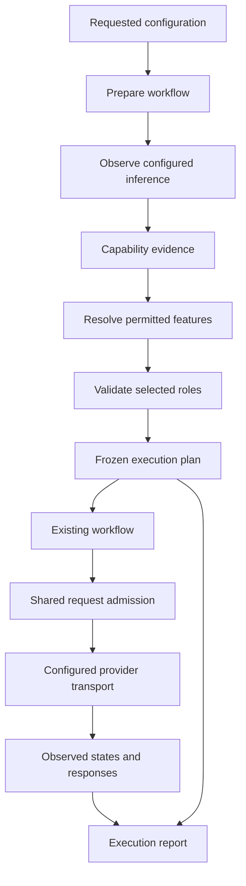

# Design: observable readiness and explicit completion fallback

Status: independently reviewed design approved by the user on 2026-11-01.
The user approved the reviewed task plan, implementation and bounded pilot on 2026-11-01.

## 1. Overview

Extend the configured completion path with two explicit choices: an optional
readiness policy for variable service behavior, and an optional completion-only
fallback when token evidence is unavailable. Reuse `RecallWorkflow`, its rewrite
policy, the existing ensemble and the existing MCS availability rules.

The operator sees the requested features, the selected execution plan and what
actually ran. Waiting, pending work, temporary service failure and missing
logprobs have different meanings and different actions.

### Goals and non-goals

Support observed response progress, server retry hints, bounded waiting and
explicit fallback on the configured model. Preserve physical accounting,
partial failure evidence and portable use. Do not add model routing, automatic
parameter optimization, remote cancellation claims, a new scoring estimator,
or a service that runs after the calling application stops.

## 2. Boundary commitments

- **Core configuration and transport** own readiness policy, actual provider
  observations, response assembly, cancellation checks, pacing and every
  physical request. They do not select rewriting, ensembles or calibration.
- **Harness preparation** owns requested-versus-resolved feature selection,
  using the caller's explicit fallback policy and actual capability evidence.
  It produces a plan before workflow construction and protocol freezing.
- **Existing workflow and scorer** execute the resolved plan. Fidelity rejection
  remains a failed intervention. Missing token evidence remains unavailable MCS.
- **Experiment persistence and reporting** retain preparation, transport traces
  and actual stage records, with compatible readers for saved old runs.

### Out of boundary

Automatic model switching; unrelated generation-parameter removal; fitting MCS
without token evidence; new ensemble mathematics; bypassing fidelity checks;
editing old study receipts; guessing unsupported status URLs; global rate-limit
tables; background provider monitoring after the operation returns.

### Allowed dependencies

Pure policy/types use the standard library. Core transport depends on those
types, existing `ModelConfig`/`ModelResponse`, `RequestControl` and Requests.
Harness preparation depends on core capability evidence and existing workflow
contracts. Reporting depends on saved typed records. Core never imports harness.
No new runtime dependency is planned.

### Revalidation triggers

Changes to endpoint, model, generation parameters, selected stream mode,
required capabilities or fallback choices require a newly resolved plan and
probes for changed configurations. Transport-only waiting changes are recorded
but do not by themselves create a new MCS calibration identity. Changing
`stream` is an explicit parameter change and follows existing identity rules.
Changing method or configuration after a study is frozen requires a new
protocol; an in-flight evaluation cannot silently adopt another plan.

## 3. Architecture and flow

Preparation is an explicit operation with the shared budget. The experiment
factory stays free of provider calls. An observed missing-logprob trigger may
select a caller-authorized text-only plan; a timeout cannot trigger that choice.

## 4. File structure plan

| Path | Responsibility |
| --- | --- |
| `recall_guard/core/readiness_types.py` | Standard-library-only policy, observation, pending-receipt and cancellation contracts; serialization |
| `recall_guard/core/readiness_evidence.py` | Complete/partial probe evidence using existing completion contracts; keeps configuration imports acyclic |
| `recall_guard/core/readiness.py` | Per-operation state, wait decisions, cancellation and observation trace |
| `recall_guard/core/request_control.py` | Reused one-attempt admission/ledger seam; retry hints and redaction |
| `recall_guard/core/completion.py` | Optional policy/trace on existing configured contracts; old defaults preserved |
| `recall_guard/core/provider_stream.py` | Incremental SSE framing and choice-zero response assembly |
| `recall_guard/core/providers.py` | OpenAI-chat JSON/SSE and explicitly supported pending-status exchanges |
| `recall_guard/core/provider_anthropic.py`, `provider_callback.py` | Early explicit rejection of unsupported readiness transport selections |
| `recall_guard/harness/workflow_preparation.py` | Requested/resolved plan and narrow missing-token fallback resolution |
| `recall_guard/harness/workflow_types.py`, `workflow.py`, `request_failures.py` | Execute selected plan; retain trace; stop on cancellation/deferral and capability drift |
| `recall_guard/harness/intervention_types.py`, `intervention_config.py` | Versioned plan/trace contracts and physical-call planning |
| `recall_guard/harness/intervention_journal.py`, `intervention.py` | Preserve preparation evidence and write-ahead safety without implicit replays |
| `recall_guard/harness/intervention_report.py`, `intervention_metrics.py`, `_execution_metadata.py` | Whitelisted trace export and actual-action reporting; retain old metric semantics |
| `scripts/prepare_provider_readiness.py` | Explicit dry-run/live operational study and offline replay |
| `scripts/run_intervention.py` | Consume an already resolved plan; display requested/selected actions |
| `tests/core/test_readiness.py`, `test_provider_stream.py` | State/clock/budget and framing scenarios |
| `tests/harness/test_workflow_preparation.py` | Fallback decision and role-validation scenarios |
| Existing provider/workflow/report/CLI tests | Integration, old artifact compatibility and unchanged disabled behavior |
| `examples/provider_readiness.py`, `notebooks/completion_workflow.ipynb`, `docs/completion-api.md` | Offline application/kernel examples and engineering explanation |

Paths may be combined only where responsibilities stay clear and reviewable;
do not create parallel transport or ensemble implementations. Public names
identify domain meaning and units. Observation rows are per operation/event;
request rows are per physical exchange; evaluation rows retain item/arm/draw.

## 5. Core contracts

### 5.1 Policy and runtime controls

`ModelConfig.readiness: ReadinessPolicy | None` defaults to `None`. Absence
preserves existing request behavior and exact old `to_dict()` output.

`ReadinessPolicy` contains finite positive `connect_timeout_s`,
`socket_idle_timeout_s`, `max_wait_s`, bounded `max_poll_requests`,
`backoff_initial_s`, `backoff_max_s`, optional bounded jitter, an explicit
`allow_ambiguous_replay` defaulting false, and an optional `PendingStatusPolicy`.
Existing `max_retries`, `min_call_interval_s` and shared `CallBudget` remain the
only retry-count, pacing and physical-request caps. Reject contradictory or
non-finite values locally. No policy silently changes those caps.

Stream selection stays in the explicit generation parameters (`stream=true`),
not an inferred URL capability. The initial supported observation profile is
NVIDIA-hosted OpenAI-chat; other transport profiles are rejected locally until
implemented. Ordinary JSON mode can still use retry hints and state reporting.

Runtime-only `CancellationToken` wraps a thread event. An optional observation
callback receives immutable sanitized state, never credentials or raw request
headers. Neither callback nor token is serialized. Callback failure terminates
the operation with a static diagnostic; it cannot trigger another provider call.

The operation uses monotonic elapsed time. `max_wait_s` bounds controlled waits
and further admission; per-exchange connect/read limits are capped by the
remaining allowance. Cancellation is checked before admission, during short
interruptible backoff waits, and while consuming response bytes. Synchronous
I/O already blocked returns under its configured transport bounds. This is
cooperative cancellation, not an exact wall-clock interrupt of DNS/OS I/O, and
never an assertion that remote inference stopped. Keyboard interruption closes
owned responses/sessions and leaves journal intent available for reconciliation.

A blocked synchronous read does not emit periodic callbacks. A read-only
`readiness_snapshot()` exposes the current state and computes elapsed time on
inspection for caller-owned observers. Callback notifications occur on actual
state transitions and cooperative waiting points; no monitoring thread or
service is left running after the call returns.

### 5.2 Observable states

`ReadinessObservation` includes operation ID, stage, model, optional physical
call ID, UTC timestamp, elapsed seconds, state, optional provider request ID,
HTTP status, delay and its source, and progress counters. It carries no key,
authorization header or arbitrary response-header mapping.

| State | Evidence and action |
| --- | --- |
| `waiting` | No new provider evidence; expose elapsed time only |
| `pending` | Explicit accepted-work response with validated identity; observe the same request if supported |
| `progress` | Valid answer or reasoning delta; count separately from keepalive/byte traffic |
| `ready` | Complete usable response and selected capability checks passed |
| `temporarily_unavailable` | Retryable service/throttling response; wait or defer under policy |
| `rejected` | Explicit auth/access/parameter/hard-quota failure; stop retries |
| `unknown_outcome` | Timeout, ambiguous disconnect, gateway timeout or interrupted stream; retain evidence |
| `deferred` | Waiting allowance or supported observation path unavailable; no further admission |
| `cancelled` | Caller cancellation observed; no further admission |
| `exhausted` | Shared request/retry/poll limit reached; preserve evidence |

Terminal transport state and logical answer usability are separate. HTTP 200
with malformed content is not `ready`. HTTP 202 is not a completed answer.
An elapsed-time heartbeat is never labeled provider progress. Progress counters
are coalesced so output-token volume does not create an unbounded event list;
retain all state transitions, wait decisions and physical request records.

### 5.3 Admission, retry and pending work

Refactor a single-attempt seam out of `RequestControl.run`; both old `run` and
the optional readiness loop reuse it. One invocation admits exactly one HTTP
exchange. It may return a typed completed response or pending receipt; it never
hides polling or retries. A pending HTTP exchange can succeed physically while
the logical generation remains pending. Add optional request-purpose and
request-ID fields to the ledger; old events retain exact old serialization.

Preserve and sanitize `Retry-After` from transport errors. Accept nonnegative
integer seconds and valid HTTP dates, deriving a delay at receipt time. An
invalid value is recorded as ignored and uses fallback backoff. Never shorten
a valid provider delay to fit a local cap: defer instead. Backoff is bounded
and can use injected randomness/clock for deterministic verification. Waits
and network operations do not hold admission locks. A shared client cooldown
prevents concurrent draws from bypassing an observed server delay; another
client/model does not inherit that cooldown.

Authentication/access, explicit bad parameters and hard-quota failures never
retry. A 429/503 can lead to another bounded attempt. Read timeout, connection
loss after possible submission and 504 retain unknown outcome; re-submission
requires `allow_ambiguous_replay`. Every admitted replay is a new physical
request, with unknown prior usage retained. Accepted pending work is never
re-posted automatically, even if its status route is unavailable.

`PendingStatusPolicy` must bind an explicitly verified profile, same-origin
status URL template and request-ID contract to the selected model. Validate
UUID IDs and URL construction; reject credentials, fragments, arbitrary
response locations and cross-origin redirects. Each status GET consumes the
shared budget and poll cap and retains the original logical operation ID.
For the initial gpt-oss-20b profile, read `NVCF-REQID`/`NVCF-STATUS` but keep
polling disabled because its exact route is unverified. Return pending/deferred
with the ID; do not guess `/v1/status/`. Explicit fixture profiles exercise the
generic polling contract without being advertised as measured live support.

### 5.4 Stream and response preservation

Use Requests' streaming response within an owned context and an incremental
UTF-8/SSE decoder. Handle split UTF-8 sequences, line endings, event boundaries
and terminal `[DONE]`; do not assume network chunks correspond to events.
Consume bounded byte chunks so semantic progress and cancellation checks are
not held until an arbitrarily long line completes. Enforce configured response
and event size limits with an explicit failure, preserving bounded partial data.

Assemble only choice index zero, matching the existing adapter. Keep optional
reasoning deltas out of answer text and count them as a separate progress kind.
Keepalives and transport bytes do not reset semantic-progress observations.
Require terminal framing and a terminal finish reason before returning a
complete response. Preserve `length` as truncation evidence rather than changing
the answer parser. Malformed/error payloads and premature EOF retain a typed
partial response with `complete=false`, never a successful `ModelResponse`.

Usage and token evidence are accepted only when actually reported and valid.
Keep token order and alternatives aligned across chunks; absent/censored or
incomplete evidence yields the existing unavailable reason. No stream capability
is inferred from the endpoint or model family. Streaming MIA remains unverified
until a probe observes sufficient evidence. A complete text response that lacks
required token evidence is retained with its failure/probe result so preparation
can make an informed fallback decision without inventing a new answer.

`probe_with_evidence()` returns a typed capability report, complete or partial
response evidence and readiness trace. Existing `probe()` retains its return
type and semantics when readiness is disabled. Traces attach to successful
responses or sanitized failures and are available to the harness whitelist.

## 6. Explicit fallback preparation

Introduce `prepare_workflow(requested, fallback_policy, client_factory,
budget, cancellation=None, on_observation=None) -> WorkflowPreparation`.
Requested input contains role configs, `FeatureChoices`, existing rewrite policy
and optional `EnsembleSpec`. The factory builds fresh clients on the supplied
shared budget; it performs no provider work itself.

`CompletionFallbackPolicy` declares the text-only `FeatureChoices` to use and
whether omission of `logprobs` and `top_logprobs` controls is authorized. It is
absent by default. Its resolved choice has `mia_scoring=false`; rewriting and
draw count remain caller choices, validated through the existing workflow.

Resolution order:

1. Validate explicit contradictions and unsupported unrelated settings. An
   explicit false/null logprob choice combined with requested MIA remains a
   configuration error, not a fallback trigger.
2. Inspect supplied capability declarations and, where needed, perform actual
   configured probes. A declared unsupported token capability can resolve
   before constructing a client that would reject that declaration.
3. Trigger fallback only for missing/unsupported required token evidence or a
   provider rejection that identifies the logprob controls. Timeout, 504, access
   rejection, empty text, generic 400, missing calibration and fidelity rejection
   are not missing-logprob triggers.
4. Resolve an immutable `WorkflowPlan` with requested and selected role configs,
   requested/selected features, selected method, exact omitted control names,
   reason/evidence, decision time and policy identity. Keep endpoint/model and
   all other generation parameters unchanged. Selected settings do not mean
   provider-confirmed effective sampling values.
5. Build clients matching that plan; do not reuse a client still enforcing MIA.
   Re-probe every changed configuration and newly active auxiliary role. A
   rewrite selection requires the caller's rewrite policy and verifier; missing
   prerequisites fail preparation rather than inventing defaults.
6. Produce a prepared workflow only when the selected roles are ready. The
   text-only plan has no scorer, skips MCS calibration with an explicit reason,
   and retains MCS as unavailable. Reuse existing ensemble/rewrite execution.

`WorkflowPreparation` retains plan, capability evidence, physical preparation
records, readiness traces and stopping reason. Failed/deferred preparation
does not start evaluation. A supplied valid original MCS plan still requires
matching calibration; fallback does not substitute for a missing fit.

Once selected, the plan is stable for the evaluation. Later capability drift
is a recorded failure and stops required scoring; an operator must explicitly
prepare a new plan. The existing fidelity rejection path remains unchanged.

## 7. Persistence and reports

### 7.1 Supported plan shapes and evaluation handoff

`RecallWorkflow` and preparation reports support the caller's existing choices:
rewriting off/on and single/ensemble responses. The operational readiness study
also supports those choices without requiring the paired mitigation runner.

`ExperimentRunner` retains its existing four-condition contract: original and
rewritten arms, all three explicitly configured roles, equal selected draw
count, and draw zero reused as the single-response condition. Its CLI validates
that a proposed fallback plan can satisfy this shape before preparation or any
provider call. A fallback that selects rewriting off remains valid for library
use but is rejected by this paired runner. This spec does not add arbitrary arm
sets, reinterpret disabled rewriting as successful mitigation, or invent
rewriter/verifier configurations to satisfy a runner constraint.

`WorkflowPreparation` produces immutable evidence and a selected plan; any
prepared workflow object is runtime-only. The experiment factory constructs
fresh clients on the remaining evaluation budget, performs zero provider calls
itself, and must still satisfy the runner's exact configuration equality check.
Fresh evaluation clients intentionally perform the existing selected-role
preflight. A resumed execution does so again. Charge those probes to the
remaining evaluation allowance and include them in nominal/upper-bound plans.
Preparation observations remain timestamped historical evidence; they never
seed or bypass the current `id(client)`-scoped probe cache. The original and
rewritten arms continue to share the normal in-execution preflight behavior.

The frozen version-2 run validates the preparation ledger's used count and
hashes against its total cap. It admits new evaluation requests only from the
remaining allowance after preparation and any prior evaluation attempts.
Preparation and evaluation IDs remain separate namespaces. A deferred or failed
fresh preflight retains its own records and starts no evaluation arms.

### 7.2 Versioned artifacts and actual-action reporting

New persisted plans/traces use experiment schema version 2. Readers continue
to accept version 1 and reproduce its exact serialization, protocol identity
and metrics. A version-1 protocol cannot contain readiness/fallback fields.
Version-2 codecs use explicit typed construction and field whitelists; no
serialization of live clients, callbacks, tokens or scorer internals.

Preparation has its own execution ID and immutable ledger. The frozen run binds
the plan and preparation-artifact hashes, original total request cap, preparation
requests already used, and remaining evaluation allowance. Constructing the
evaluation budget from that remaining allowance cannot replenish it. Report
both phase counts and combined physical usage. Existing write-ahead intent
and ambiguous-restart refusal remain; a saved pending ID does not authorize a
new POST. Remote status retrieval is allowed only through the explicit validated
profile and its saved request identity.

Reports distinguish three levels:

- **Requested:** user model/roles, parameters and features.
- **Selected:** resolved execution plan, omitted controls and fallback reason.
- **Observed:** actual role/model/stage requests, completed/skipped/rejected
  actions, available capability evidence, counts, timings and reported usage.

Derive observed actions from saved request, rewrite and draw records, not from
the intended plan. Include a compact stage table with role/model, action,
outcome, physical calls and usage availability. Preserve unknown costs and
separate answer agreement from MCS. A fidelity-rejected rewrite shows no target
stage if no target request occurred. Group metrics by resolved plan so fallback
cannot silently mix paired methods. Existing saved Opus metrics remain unchanged.

## 8. Measurement and validation

First validate deterministic scenarios with a fake monotonic clock and local
HTTP/SSE fixtures: delayed completion; valid/malformed retry hints; throttling
then success; excessive delay causing deferral; missing logprobs with and without
authorized fallback; pending work without a supported route; one POST followed
by budgeted polls under a fixture profile; progress then disconnect; split UTF-8;
truncated/oversized streams; auth/quota stops; cancellation; concurrent cooldown;
budget exhaustion; and no network work with readiness disabled.

Exercise real local sockets for streaming/read-timeout cleanup on Windows and
Linux, plus an existing Jupyter kernel. Check that cancellation admits no later
request and that sessions close; do not claim exact OS-level cancellation.
Test legacy config/response/event serialization and all saved artifact hashes.
Validate fallback before construction, exact parameter omissions, fresh role
probes, no scorer in text-only mode, no runtime plan switch and actual-action
report reconciliation.

The operational study command offers dry-run, explicit live execution and offline
replay. Before live work it freezes date, exact configuration, JSON/SSE choices,
policy, request and waiting caps, fallback choices and metric definitions.
Compare completion yield, time to first observed progress, time to usable
response, retry/poll counts and deferred/unknown outcomes. Keep capped and
incomplete observations in denominators. A paired fixed-policy/adaptive-policy
comparison requires planned balanced ordering and identical generation settings;
switching JSON to SSE is a separate configuration comparison. No availability
result is a mitigation-effectiveness result.

No new live budget is approved by this design. October 31 receipts remain
immutable. Any future live protocol must state its additional limits explicitly.

## 9. Requirements traceability

| Requirements | Components and verification |
| --- | --- |
| 1.1, 1.2, 1.3, 1.4 | Policy/configuration and profile validation; disabled-path parity and unsupported-profile tests |
| 2.1, 2.2, 2.3, 2.4 | Observation states and probe evidence; delayed/pending/unknown/permanent scenarios |
| 3.1, 3.2 | Retry hint parsing, bounded backoff and shared cooldown; fake-clock/date/concurrency checks |
| 3.3 | Explicit pending profile and per-GET admission; one-POST polling and unsupported-route deferral |
| 3.4, 4.4 | SSE assembly and partial response contract; progress, truncation, token alignment and unusable partial tests |
| 3.5, 3.6 | Ambiguous replay policy and permanent-error classifier; no duplicate or forbidden retry tests |
| 4.1, 4.2, 4.3 | Shared budget, cancellation, traces and versioned whitelists; exhaustion, cleanup and secret-exclusion tests |
| 5.1, 5.2 | Windows/Linux/application/kernel scenarios and full offline regression |
| 5.3, 5.4 | Explicit operational study protocol, saved records and offline report replay |
| 6.1, 6.2, 6.3 | Preparation and immutable selected plan; missing-logprob fallback, unavailable MCS and exact control-removal checks |
| 6.4, 6.5 | Narrow triggers and re-probing of selected roles; unrelated failure and missing auxiliary-role tests |
| 6.6, 6.7 | Actual stage reporting and existing fidelity gates; ledger reconciliation and zero target calls after rejected rewrite |

## 10. Review status and residual limitations

All 29 acceptance criteria map to a concrete contract and validation scenario.
Boundaries and file responsibilities are explicit. The exact hosted gpt-oss
polling route and streamed logprob availability remain unverified capabilities,
with visible deferral/fallback behavior rather than assumed support. These do
not justify a live-success claim. Independent design validation and user design
approval precede executable task generation.
