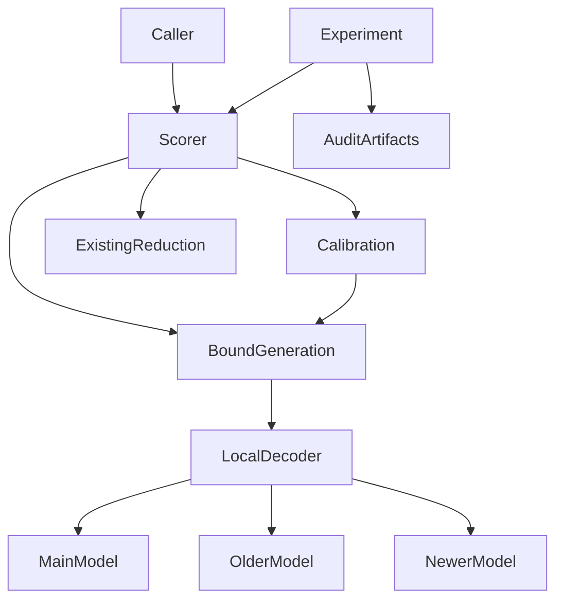
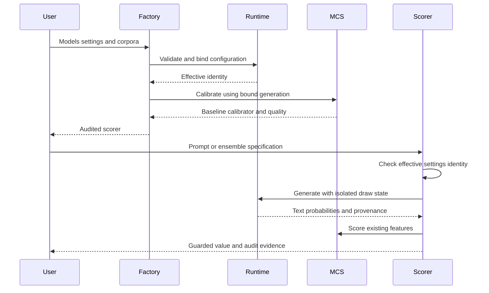

# Technical Design — Divergence Decoding

## Overview

Add an experimental, explicitly selected local divergence decoder to recall_guard. Researchers supply three compatible model snapshots and calibrated corpora. Existing callers continue through the NVIDIA completion path unchanged. Generation evidence feeds the existing MIA/MCS definitions and confidence discount.

This design chooses the hybrid approach from research.md: a small generation contract, an optional local runtime, and extensions to existing scoring and audit paths. Technical feasibility and empirical mitigation remain separate release gates. No production-supported model triple is claimed at design time.

### Goals

Provide actual pre-sampling steering, configuration-bound calibration, auditable single/multiple/ensemble scoring, and a controlled historical evaluation protocol. Preserve package layering, legacy serialization and scoring parity.

### Non-Goals

Training checkpoints, distillation, prompt rewriting, activation probes, portfolio policy, a general inference service, arbitrary tokenizer translation, and guaranteed unlearning are excluded.

## Boundary Commitments

### This Spec Owns

- The opt-in decoding configuration, token-generation evidence contract and local execution adapter.
- Binding existing calibration/scoring to effective generation semantics, including replay identity checks.
- Research evaluation artifacts and evidence gates for documenting supported configurations.

### Out of Boundary

NVIDIA transport behavior and default generation settings, existing MIA formula definitions, normal harness cutoff rules, downstream exposure decisions, model training and external checkpoint provenance claims.

### Allowed Dependencies

Keep core below mia/dataset/portfolio below harness. New generation contracts and the runtime adapter live in core; orchestration lives in harness. Core never imports calibration or harness. Reuse numpy, sklearn and existing statistical functions. PyTorch and Transformers are lazy optional dependencies; no DSPy or new unregistered package layer.

### Revalidation Triggers

Changes to model/tokenizer revisions, prompt templates, dtype, runtime versions, probability transforms, candidate set, alpha or generation settings invalidate decoding identity and require calibration revalidation. Feature/baseline parameter changes invalidate calibration identity. Result schema changes require consumer/replay review. Model/runtime changes require a new support smoke test; dataset/protocol changes require a new experimental verdict.

## Architecture

### Existing Architecture Analysis

The NVIDIA client returns completed text and top-20 probabilities; it cannot steer generation. Scorer factory injection is useful but NVIDIA-specific. Existing MCS objects lack configuration identity. Ensemble overrides can differ from calibration defaults. Min-K++ depends on the supplied candidate set. The normal runner's cutoff guard must remain intact.

### Architecture Pattern & Boundary Map



A frozen bound-generation object supplies the existing generate-shaped interface with fixed effective settings. This prevents calibration helpers' default arguments from silently selecting different settings. Existing NVIDIA objects still follow their current code path.

### Technology Stack

| Layer | Choice | Role |
|---|---|---|
| Contracts and orchestration | Python >=3.12, existing stdlib/numpy | Typed values, validation, hashing and evaluation |
| Optional local runtime | Transformers and PyTorch, exact versions recorded and locked during implementation | Causal-model forward logits and inference |
| Statistical scoring | Existing sklearn MCS and numpy features | Reuse rather than replace formulas |
| Artifacts | Versioned JSON/JSONL and Markdown | Audit/replay and experiment reporting |

The first adapter uses standard causal-LM forward calls, not provider chat endpoints or a server plugin. Dependency versions and a supported Python/device matrix must be established by an installation and runtime spike before advertising the optional extra as supported. Unsupported environments fail at adapter construction; the default package remains usable. Version pinning is a task prerequisite, not an assumption that latest packages work on every supported interpreter.

## File Structure Plan

### New Files

| File | Responsibility |
|---|---|
| recall_guard/core/generation.py | Provider-neutral generation protocol and evidence/result types |
| recall_guard/core/divergence.py | Frozen model/configuration values, identity validation and logits-combination contract |
| recall_guard/core/local_decoder.py | Lazy optional model loading, compatibility checks and per-draw token loop |
| recall_guard/harness/divergence_scoring.py | Opt-in construction, calibration binding and audited score wrappers |
| recall_guard/harness/divergence_eval.py | Explicit historical experiment orchestration and verdict |
| recall_guard/harness/divergence_report.py | Versioned experiment artifact serialization and human-readable report |
| tests/core/test_divergence.py | Configuration, identity and controlled-logit tests |
| tests/core/test_local_decoder.py | Optional adapter and tiny-model contract tests |
| tests/harness/test_divergence_scoring.py | Calibration binding, legacy parity and replay validation |
| tests/harness/test_divergence_eval.py | Temporal splits, paired metrics and verdict gates |
| docs/divergence-decoding.md | Setup, support evidence and scientific limitations |

### Modified Files

- recall_guard/harness/scorer.py — add opt-in constructor delegation and reusable protected scoring/reduction hooks; retain existing methods and return shapes.
- recall_guard/core/nvidia_lm.py — adopt shared generation type annotations only where needed; preserve endpoint and legacy response fields.
- recall_guard/mia/control.py and recall_guard/mia/mcs.py — accept the structural generation protocol; no formula or legacy default changes.
- recall_guard/harness/evaluator.py — expose shared scoring/parsing helpers needed by the opt-in wrapper without duplicating MIA logic.
- recall_guard/core/ensemble.py — allow evidence-aware callers to validate identities before existing reduction; do not change text-only hash semantics.
- recall_guard/core/manifest.py — optional versioned divergence block, omitted for legacy runs; strict reader compatibility.
- recall_guard/__init__.py and recall_guard/core/__init__.py — lightweight type exports only; no eager tensor/runtime imports.
- pyproject.toml and uv.lock — optional inference dependency group/extra after compatibility verification.
- mkdocs.yml — register feature documentation.
- tests/harness/test_scorer.py, tests/core/test_manifest.py, tests/test_packaging.py and tests/test_ensemble_boundary.py — compatibility assertions.
- .kiro/steering/recall-guard-package.md — document shipped public contracts only after implementation validation.

## System Flows



Validation precedes corpus generation. Configuration mismatch is fatal to the request; per-draw runtime failures remain explicit failed draws. No silent unsteered fallback or implicit retry after partial generation.

## Components and Interfaces

| Component | Layer | Intent | Contracts |
|---|---|---|---|
| Configuration and identities | core | Define valid reproducible execution | State |
| LocalDecoder | core | Produce steered token evidence | Service |
| DivergenceScorer | harness | Bind calibration and reuse guard | Service, State |
| Evidence and artifacts | core/harness | Validate replay and audit execution | Batch |
| Experiment runner | harness | Compare matched temporal conditions | Batch |

### Configuration and identities

Inbound: scorer/experiment (P0). External: model/tokenizer metadata (P0). No harness imports.

Frozen values:
- ModelSnapshot: repository/local path, immutable revision or local content hash, tokenizer content hash, cutoff date, cutoff source URL/document digest and source kind (operator_claim or documented).
- GenerationSettings: nonnegative finite temperature, positive max_tokens, optional seed. V1 supports greedy or full-vocabulary categorical sampling only; top-p, repetition penalties and beam search are rejected.
- DivergenceSpec: three snapshots, finite alpha >=0, settings, exact prompt-template hash, dtype/device configuration and runtime versions.
- FeatureContract: adjusted_pre_temperature_top20_v1, k=0.2 and existing clipping/z-score constants.
- RuntimeIdentity: adapter version, loaded revisions, dependency versions and effective device/dtype.

Dates must satisfy older < newer. A valid experiment additionally requires main cutoff >= newer and post-control dates later than all three cutoffs. Metadata claims are retained as claims; technical execution can be investigated with claims, but documented support requires reviewed evidence.

Identity uses SHA-256 over versioned canonical JSON: sorted keys, UTF-8, explicit nulls, finite numeric values, normalized dates and no credentials. Record all fields, not just the digest. Decoding identity includes effective settings and feature contract. Calibration identity additionally includes reference identity if supplied, ordered corpus hashes, baseline/training parameters, split seed, feature order and accepted/excluded-row hashes. Request/draw seed is recorded separately from the calibration configuration's sampling policy; changing the sampling policy invalidates calibration.

### LocalDecoder

Inbound: bound-generation interface (P0). External: Transformers, PyTorch and supplied snapshots (P0).

```python
class GenerationBackend(Protocol):
    model: str
    def generate(self, prompt: str, temperature: float = 0.0,
                 max_tokens: int = 512) -> CompletionResult: ...

class LocalDecoder:
    def validate(self, spec: DivergenceSpec) -> ValidatedConfiguration: ...
    def generate_evidence(self, prompt: str,
                          draw: DrawContext) -> GenerationEvidence: ...
```

The bound adapter's generate method uses frozen settings for omitted/default internal helper calls; explicit caller overrides are resolved and checked by the scorer before invoking it. It must not guess whether an arbitrary explicit default was omitted: internal calibration calls use a dedicated bound adapter with no override semantics, while public override validation stays outside it.

Compatibility requires identical tokenizer serialization, token-to-ID mapping, added/special token IDs and rendered prompt token IDs across models. Serialized equality is a conservative supported-subset restriction and can reject semantically equivalent tokenizers; no researched candidate is presumed to pass. Reject differing chat templates in v1; callers may select a shared explicit plain-text template whose bytes are hashed. Validate prompt length plus budget against the minimum supported context. No tokenizer translation.

Load pinned snapshots with remote code disabled and safe tensor weights. V1 starts with one draw at a time per runtime instance and no quantization, automatic device offload or distributed inference. Models are in evaluation/inference mode; draw caches and RNG state are isolated and released on failure. Full-prefix forward execution is the initial correctness baseline; caching may be enabled only after parity tests and becomes part of runtime identity.

At each position obtain full-vocabulary logits for all models at the same prefix; combine in FP32 as main + alpha*(older-newer). Reject non-finite model logits and overflow/non-finite combined logits even when alpha itself is finite. Compute log-softmax over the full combined vocabulary **before** sampling temperature. Emit the realized token's log probability and the highest 20 candidates from that distribution (token-ID order breaks ties). Feed these to unchanged MIA formulas. Preserve main-model log probabilities as optional diagnostics, never silently mix them into features.

For temperature=0 select argmax; otherwise sample softmax(combined/temperature). Do not describe the greedy point mass as model likelihood. Alpha=0 bypasses subtraction after compatibility validation and uses the exact main logits. Controlled FP32 zero-alpha tests require absolute probability difference <=1e-6 with relative tolerance 1e-5 on the same runtime; nonconformance fails support validation.

EOS ends generation; output budget yields finish_reason=length. Evidence stores all sampled token IDs and maps scoring log probabilities to content tokens, excluding terminal special tokens consistently in calibration and scoring. An empty scoring sequence fails with no_logprobs. Truncation is retained even if parsing succeeds.

### DivergenceScorer

Inbound: caller and experiment (P0). Outbound: existing scorer, baseline, MCS and reduction (P0). Contract: Service and immutable calibrated state.

```python
MemoryGuardedScorer.calibrate_divergence(
    *, spec: DivergenceSpec, is_memorized: Sequence[str],
    oos_control: Sequence[str], min_auc: float = 0.6,
    min_valid: int = 50, seed: int = 0
) -> DivergenceScorer

class DivergenceScorer:
    def score(self, prompt: str) -> AuditedScore: ...
    def score_many(self, prompts: Sequence[str], *,
                   max_workers: int = 1) -> list[AuditedScore]: ...
    def score_ensemble(self, prompt: str,
                       spec: EnsembleSpec) -> AuditedEnsemble: ...
    def replay(self, draws: Sequence[AuditedScore],
               spec: EnsembleSpec) -> AuditedEnsemble: ...
```

The new constructor needs no NVIDIA credential. It returns an opt-in wrapper composing the existing scorer, not a parallel MIA implementation. V1 divergence calibration has no independent reference model; an explicitly supplied reference-model option is rejected before calibration; existing non-divergence reference functionality is unchanged. Four-feature MCS is already supported. Auxiliaries are never substituted for ref_delta.

Bound generation supplies identical settings to baseline construction, MCS training and scoring. Wrap the resulting objects with CalibrationBinding and verify runtime identity before every scoring request. Ensemble None overrides inherit bound settings; explicit unequal temperature/budget overrides raise calibration_mismatch before generation. Worker counts above one are queued through the runtime lock, with measured elapsed time rather than a false parallel-cost estimate.

AuditedScore contains the unchanged GuardedScore plus evidence and calibration quality. Weak MCS retains is_weak and existing score semantics; absent baseline/calibrator prevents construction. AuditedEnsemble contains the unchanged EnsembledScore plus ordered draw evidence and common identity. Existing exposure-vs-representative semantics remain. Raw response ensemble component verdicts remain on the existing raw reduction surface; this design does not invent those fields on guarded-score results.

### Evidence and artifacts

Inbound: runtime/scorer/experiment (P0). Outbound: existing manifest and canonical hash utilities (P1).

GenerationEvidence includes content, content-token logprobs, sampled token IDs, finish reason, mode, decoding identity, execution timestamp, elapsed seconds, token counts and measured device-memory data where available. Unsupported cost/memory measurements are null with an unavailable reason. Wall duration is measured through completion, including device synchronization where required. Estimated money costs are separate and require a supplied rate; none is invented.

Persist versioned draw JSONL and an optional manifest divergence block. Legacy manifests omit the block. Strict readers reject unsupported schema versions and malformed typed fields. Persist no credentials. Atomic writes publish the manifest after its referenced artifacts. Calibration estimators stay in memory in v1; artifacts retain training identity and evidence for audit, not unsafe pickle-based loading.

Replay accepts only a complete typed audited draw set with a single decoding and calibration identity. Verify evidence hashes covering probabilities, status and identities, then call existing order-independent reduction. Preserve the text-only canonical_draw_hash separately. Duplicates remain separate draws, so hash a sorted multiset, not a set. Replay has no fabricated generation timestamp.

### Experiment runner

Inbound: explicit research invocation (P0). Outbound: scorer and report artifacts (P0). It is a separate module entry point, not a bypass flag on the ordinary runner:

```text
python -m recall_guard.harness.divergence_eval --protocol protocol.json --out run-directory
```

Protocol v1 requires configuration snapshots, tuning/calibration/evaluation dataset paths and hashes, stable example/event IDs, event dates, target directions, matching strata, alpha selected on tuning data, seed, bootstrap count, minimum group size, utility-loss tolerance and minimum mitigation-effect threshold. Numeric thresholds are mandatory user-supplied preregistered research parameters; there is no universal scientifically justified default.

Reject overlap by prompt hash or event ID across the three splits and duplicate IDs within splits. Each condition gets a separate bound calibration on the same calibration examples. Baseline uses the same main runtime/template/settings; alpha-zero uses the validated triple; nonzero uses selected alpha. Maintain paired example IDs and report failures for all conditions.

Temporal bands: at/before older cutoff, between auxiliary cutoffs, after newer up to main cutoff, and after main cutoff. Empty bands are explicit; empty target interval or post-main control prevents a mitigation verdict. Match strata using protocol-specified exact strata and fixed weights shared across conditions. Missing strata or unresolved confound declarations make the verdict inconclusive.

Primary utility is directional accuracy over all rows, with failed/truncated-unparseable responses counted incorrect; also report parsed-only accuracy, confidence, parse/completion rates and class baseline. Compute the reduction in historical excess accuracy relative to post-main controls:
effect = (baseline historical accuracy - baseline OOS accuracy) -
         (steered historical accuracy - steered OOS accuracy).
This is a temporal exposure proxy, not causal proof of memorization or memory erasure. The preregistered confound checklist includes baseline predictiveness against the class baseline and temporal changes in task difficulty; reviewers must resolve or flag them before a positive verdict.

Use paired, stratified bootstrap resampling by event ID, sharing resampled IDs across conditions; report 95% percentile intervals, valid/failed resample counts and seed. Require protocol minimum counts, valid uncertainty estimates, verified cutoff evidence and no unresolved confound flags. A positive verdict requires baseline historical excess lower CI >0, effect lower CI above the predeclared effect threshold, and OOS utility delta lower CI >= minus the declared tolerance. Alpha-zero parity is an independent prerequisite. Otherwise report inconclusive, no_evidence or utility_regression with reasons. Confidence and p_memorized reductions never determine this verdict alone.

Report MCS holdout AUC as exposure-class discrimination, not probability calibration truth; include score distributions and weak-calibration status. Preregister protocol hash before evaluating final data. A changed protocol creates a new run identity and is labeled exploratory if chosen after inspecting held-out results.

## Data Models

All new public values are frozen dataclasses with explicit enums/tuples and boundary validation. Audit wrappers preserve existing result schemas. JSON schema version 1 is independent of package version. No database or migration of existing artifacts is required. Integrity checks bind snapshot configuration, calibration provenance, individual draws and experiment protocol separately.

## Error Handling

| Category | Response |
|---|---|
| Invalid config, incompatible tokenizer, missing optional dependency, unsupported capability | ConfigurationError before calibration/generation with field and reason |
| Calibration mismatch or mixed replay identity | ConfigurationError before execution/reduction; no fallback |
| Model load/permission failure | Construction failure; no partial scorer |
| Timeout, invalid logits, exhausted memory | Failed draw with structured stage/reason; clear cache; no partial success |
| Missing probability evidence or parse failure | Existing failure semantics in wrapped GuardedScore; detailed audit reason |
| Weak calibration | Visible is_weak; no reliable-mitigation claim |
| Missing/confounded experiment evidence | Explicit nonpositive/inconclusive verdict, retain available results |

Exceptions carry model role and stage, excluding credentials and full prompts. Unexpected programming errors propagate rather than becoming successful empty reports.

## Testing Strategy

- Configuration and runtime: 2.1–2.6, 3.1–3.6 — controlled logits, zero-alpha tolerance, tokenizer/template mismatch, equal/reversed cutoffs, NaN/Inf, context limit, auxiliary failure, EOS/length and realized-token evidence alignment.
- Scoring integration: 4.1–4.7 — identical bound settings during baseline/train/score; identity changes reject reuse; top-20 pre-temperature semantics including greedy mode; existing scorer/evaluator parity; weak/missing calibration.
- Ensemble and replay: 5.1–5.5, 6.1–6.5 — every draw retains identity; mixed inputs rejected; per-call overrides validated before calls; failure denominators and exposure semantics preserved; permutations and duplicate draws replay consistently; probability changes alter evidence hash but not legacy text hash.
- Experiment: 7.1–7.8 — synthetic dated cohorts, split overlap rejection, identical paired conditions, empty strata and confounding, paired resampling, missing data and utility-regression verdicts, confidence-only changes never pass.
- Compatibility: 1.1–1.4 — default import excludes torch/transformers/matplotlib/vectorbt; existing credential and serialization behavior unchanged; architecture gate and required sentrux checks.
- Support E2E: 8.1–8.4 — install optional dependencies in declared environment; load a real verified triple; generate/calibrate/score single and ensemble examples; persist/replay artifacts and measured resources. Label tiny/synthetic fixtures as contract tests only.

## Performance and Security

No latency or hardware claim is made before measurement. Serialize local draws initially; document loaded model memory, peak memory, tokens per model, wall time and failure rate. Three-model resource use is not approximated by counting one HTTP call. Disable remote model code; pin weight/tokenizer revisions; never record hub tokens. Respect model access/licensing requirements. Device and dependency changes alter runtime identity.

## Migration and Release Gates

No automatic migration or global toggle. Legacy constructors and stored artifacts remain valid. Implementation sequence is bounded: dependency/checkpoint spike; core contracts/decoder; binding/scoring; audit/replay; experiment; real support verification. Optional execution can exist as experimental tooling while the support registry remains empty.

At design time no verified temporal triple is available. A candidate pair is not a supported configuration. Requirements 8.1–8.4 explicitly allow reporting unmet dependencies. Implementation may validate contracts with small models, but cannot declare this feature supported or empirically effective until the corresponding real evidence gates pass. Design approval authorizes the architecture, not those scientific claims.

## Requirements Traceability

| Requirement | Summary | Components | Interfaces | Flows |
|---|---|---|---|---|
| 1.1, 1.2, 1.3, 1.4 | Opt-in and legacy isolation | Factory, packaging | calibrate_divergence | Construction |
| 2.1, 2.2, 2.3, 2.4, 2.5, 2.6 | Capability validation | Configuration, LocalDecoder | validate | Preflight |
| 3.1, 3.2, 3.3, 3.4, 3.5, 3.6 | Token steering | LocalDecoder | generate_evidence | Generation |
| 4.1, 4.2, 4.3, 4.4, 4.5, 4.6, 4.7 | Calibrated scoring | DivergenceScorer, existing MCS | CalibrationBinding, score | Calibration and scoring |
| 5.1, 5.2, 5.3, 5.4, 5.5 | Ensemble compatibility | DivergenceScorer, existing reduction | score_many, score_ensemble, replay | Draw reduction |
| 6.1, 6.2, 6.3, 6.4, 6.5 | Auditability | Evidence and artifacts | GenerationEvidence, manifest | Persistence |
| 7.1, 7.2, 7.3, 7.4, 7.5, 7.6, 7.7, 7.8 | Controlled evaluation | Experiment runner | Protocol v1 | Matched experiment |
| 8.1, 8.2, 8.3, 8.4 | Support evidence | Runtime, documentation | Support E2E report | Release gates |

## Design Review

Full discovery and design synthesis completed. The review mapped all 45 acceptance criteria, checked boundary/file alignment and interface/failure contracts, and incorporated an independent review of runtime and probability semantics. The gate passes for the experimental framework design; real checkpoint/runtime support and mitigation effectiveness remain unverified release gates. Design approval remains pending.

