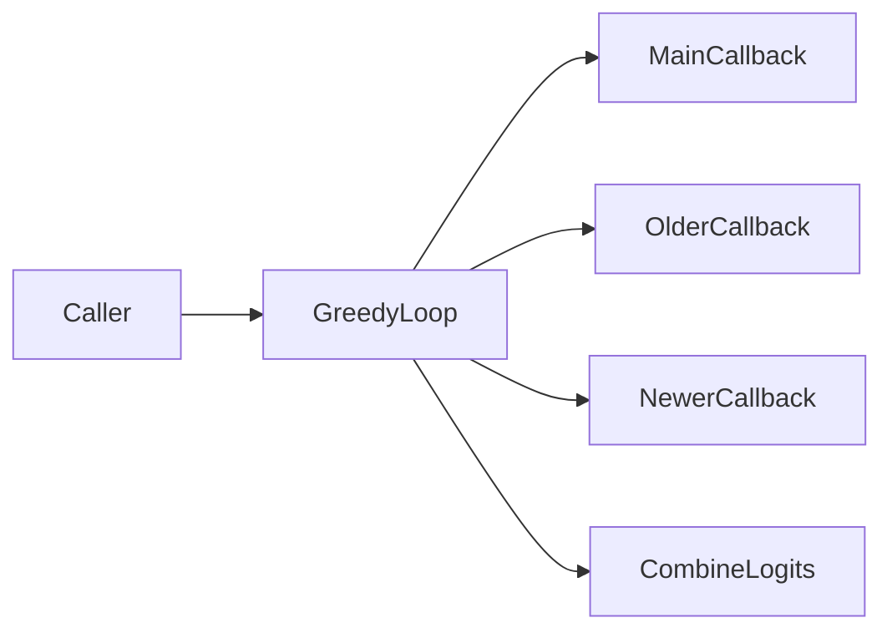

# Technical Design — Divergence Decoding MVP

## Overview

A numpy logits-combination function and a minimal greedy loop provide the optional mathematical layer. Callers own model execution. No NVIDIA, calibration or ensemble integration is added.

### Goals
Implement the equation correctly and make it usable with three compatible caller callbacks.

### Non-Goals
Loading models, GPU scheduling, caching, stochastic sampling, training-cutoff validation, MIA/MCS changes, audit/replay and scientific evaluation.

## Boundary Commitments

### This Spec Owns
Validation of vectors and declared callback metadata; the equation; shared-prefix greedy selection; stopping, errors and an executable synthetic example.

### Out of Boundary
Actual tokenizer compatibility and cutoff authenticity remain caller responsibilities. The utility does not certify model compatibility from equal vector lengths, and does not estimate memorization.

### Allowed Dependencies
Existing numpy and Python standard library only. Modules remain in core and import no higher layers. No torch/transformers imports or package extras.

### Revalidation Triggers
Changes to vector precision, callback contracts, token selection or finish semantics require focused tests. Future scoring integration requires a separate calibration design; it cannot treat this utility as already calibrated.

## Architecture

The pure function is independently usable in a caller's generation runtime. The greedy loop is a small integration helper, not a model backend abstraction or service.



Technology: existing Python >=3.12 and numpy>=1.26 dependency floor; no version or installation changes.

## File Structure Plan

| File | Action and responsibility |
|---|---|
| recall_guard/core/divergence.py | New: pure vector validation and combination |
| recall_guard/core/divergence_decode.py | New: callback values, greedy loop and structured failure |
| tests/core/test_divergence.py | New: mathematical and validation checks |
| tests/core/test_divergence_decode.py | New: deterministic callback integration checks |
| docs/divergence-decoding.md | New: scope, caller contract and runnable synthetic example |
| mkdocs.yml | Modify: register documentation |

Use direct imports from the new core modules. No root export changes or modifications to existing scorer, client, MCS, ensemble or manifest files. This limits default-path regression risk.

## Components and Interfaces

### Mathematical function

```python
def combine_logits(
    main: ArrayLike,
    older: ArrayLike,
    newer: ArrayLike,
    *,
    alpha: float,
) -> NDArray[np.float64]: ...
```

Accept real numeric one-dimensional arrays/sequences; reject boolean, complex, object and string arrays rather than coerce them silently. Convert accepted integer/float inputs to float64. Require nonempty equal shapes, finite entries and finite nonnegative real alpha (not bool). Validate all inputs even for alpha=0; then return a main copy without evaluating the difference. Otherwise compute the formula with overflow checks and reject any non-finite result. Never modify inputs.

Identity is exact relative to the validated float64 main vector; the function does not promise bitwise preservation of a different input dtype. Mathematical unit tests use exact representable cases and explicit allclose tolerances for ordinary floating-point combinations.

### Greedy decoder

```python
NextLogits = Callable[[tuple[int, ...]], ArrayLike]

@dataclass(frozen=True)
class ModelSource:
    next_logits: NextLogits
    vocabulary_id: str
    vocabulary_size: int
    eos_token_ids: frozenset[int]
    context_limit: int

@dataclass(frozen=True)
class DecodeResult:
    token_ids: tuple[int, ...]
    finish_reason: Literal["eos", "length"]

def decode_greedy(
    prompt_ids: Sequence[int], *,
    main: ModelSource, older: ModelSource, newer: ModelSource,
    alpha: float, max_new_tokens: int,
) -> DecodeResult: ...

class DecodeError(RuntimeError):
    role: Literal["main", "older", "newer", "combination"]
    step: int
```

Preflight validates callable callbacks; matching nonempty vocabulary_id and vocabulary_size; equal EOS sets; positive integer limits/budget; nonempty prompt; non-boolean integer token IDs within vocabulary; EOS IDs in range; finite nonnegative alpha; and len(prompt)+budget <= minimum context limit. An empty EOS set is allowed for budget-only termination. vocabulary_id is a caller-supplied identifier for the complete token mapping and special-token semantics, not a claim of independent verification.

On each step create one immutable full prefix tuple and pass it sequentially to main, older and newer. Validate each returned vector against vocabulary_size with the same numeric rules. Combine and choose numpy argmax; its first-maximum behavior implements lowest-ID ties. Append the selected token. EOS returns immediately; otherwise stop at the budget. Returned token_ids exclude the input prompt and include a selected terminal EOS token. No text decoding or hidden prompt template is performed.

All three callbacks run even at alpha=0, so failures and shared-prefix semantics remain consistent. Callbacks may use private caches but must implement the full-prefix contract without shared mutable cross-model state. The helper introduces no concurrent execution, retries or RNG.

Preflight errors are ValueError or TypeError with field context. Callback exceptions and returned-value failures raise DecodeError with role, zero-based generation step and chained original exception. Combination overflow uses role=combination. No partial successful result is returned. KeyboardInterrupt/SystemExit propagate. The package does not log full prompts.

## Data Models

Only ModelSource, DecodeResult and DecodeError are new values. There is no persistent schema, calibration identity, evidence envelope or replay contract. Callers may persist token IDs themselves without claims of deterministic replay across changed models.

## System Flow

Validate configuration before calls; obtain three logits at the identical prefix; combine; select one token; stop or repeat. A callback error exits immediately. Alpha-zero equality is a mathematical property, not a promise that remote or nondeterministic callbacks emit identical vectors across calls.

## Requirements Traceability

| Requirement | Component and evidence |
|---|---|
| 1.1, 1.2, 1.3, 1.4, 1.5 | combine_logits and controlled-vector tests |
| 2.1, 2.2, 2.3, 2.4, 2.5 | ModelSource preflight and decode_greedy callback tests |
| 3.1, 3.2 | Isolated core modules; existing dependency set; unchanged client/scorer |
| 3.3, 3.4, 3.5 | Documentation and token-only DecodeResult |
| 4.1, 4.2, 4.3 | Focused tests and executable synthetic example |

## Testing Strategy

- Formula: hand-calculated vectors, negative/zero logits, alpha=0 copy, deterministic output and unchanged arrays.
- Validation: wrong dimensions/length, empty, NaN/Inf, invalid dtype/alpha, overflow and callback vocabulary-size mismatch.
- Loop: callbacks record prefixes; assert all see identical prompt and every selected continuation. Verify ties, first-token EOS, budget stop and EOS inclusion.
- Failures: each model role raises; invalid returned vectors and combination overflow; verify no success result and no later callback calls after a failing role.
- Preflight: mismatched vocabulary/EOS metadata, invalid tokens/budget and context overflow cause zero callback calls.
- Integration: execute the documented synthetic example without credentials/models; existing architecture and lean-import checks remain green. Run repository checks appropriate to the two new core modules.

## Performance and Limitations

Combination is O(vocabulary size) time and memory per token. The helper makes three sequential callback calls per step; model execution cost belongs to the caller and is not estimated here. No minimum hardware or empirical mitigation effectiveness is asserted.

## Migration and Deferred Work

No migration or default toggle. New direct-import functions are explicitly experimental. Calibration integration, local model adapters, ensemble audit/replay and controlled mitigation evaluation are separate follow-up candidates, not completion conditions for this milestone. Their previous findings remain in archive/full-scope/design-validation.md.

Estimated engineering scope: S–M, contingent on the caller already having compatible logits access. This is not a commitment to supply suitable model checkpoints.

## Design Review

The original 18 behavioral acceptance criteria have concrete contracts and tests; the three user-requested quality criteria are covered by the Implementation Quality Contract below. The three previous blockers concern replay, audit-envelope association and automated scientific verdicts; those features are removed from this milestone, not claimed fixed. The user approved the revised requirements and design on 2026-10-30; task generation is the next phase. No implementation or empirical validation has occurred.


## Implementation Quality Contract

User-requested on 2026-10-30; mandatory for task generation and review (5.1, 5.2, 5.3).

- Use idiomatic Python and NumPy. Prefer direct array arithmetic for the formula and a straightforward loop for sequential decoding; avoid redundant wrappers, clever one-liners and unnecessary abstractions.
- Use main_logits, older_logits, newer_logits and adjusted_logits for vocabulary-indexed logit vectors. Use main_source, older_source and newer_source for callback-bearing model objects. Update the illustrative interface parameter names accordingly during implementation.
- Use prompt_token_ids, generated_token_ids, prefix_token_ids, next_token_id, vocabulary_size and generation_step for their respective values. Do not call a probability vector logits, a token-ID sequence tokens when ambiguous, or a count an index.
- Document the vocabulary axis and one-dimensional shape at array boundaries. Name transformed values for their new meaning rather than reusing a name whose meaning no longer fits. Avoid generic data, arr, x or df when a domain name communicates the role.
- If future tasks involve DataFrames, use domain-specific frame, column and index names, document row grain and units, and preserve label alignment through transformations. This rule adds no pandas dependency or DataFrame work to the current scope.
- Each implementation task must include this quality contract in its acceptance/review criteria. Review actual code and examples for naming/idioms; use lint for mechanical conventions rather than brittle tests that assert variable names.

Additional traceability: 5.1 maps to both core modules; 5.2 maps to their signatures, local values and array contracts; 5.3 maps to every implementation task and review checklist. The design now covers 21 acceptance criteria.

