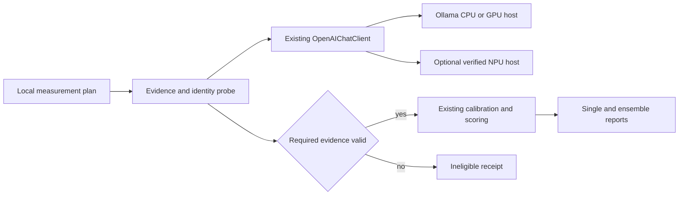

# Design: local AI provider

## Overview

Extend Recall Guard's existing completion-client integration to locally hosted
models with verified token log probabilities. Use Ollama's OpenAI-compatible
endpoint for CPU/GPU hosting. Evaluate Gemma on the Ryzen AI NPU through a small,
separate feasibility probe before committing to an NPU serving integration.

The library remains portable. Windows hosting and measurement commands use
PowerShell. WSL is reserved for Dagger CI. The default package does not import
accelerator libraries, manage drivers or launch model hosts.

### Goals

- Admit local endpoints only after genuine, aligned token evidence is observed.
- Prioritize Gemma NPU feasibility; keep GPT-OSS-20B as a separate local candidate.
- Reuse calibration, scoring, ensemble and request-accounting contracts.
- Report observed execution mode and limitations without implying mitigation efficacy.

### Non-Goals

Opus/completion-only alternatives, renewed NIM diagnosis, model-fleet management,
hardware configuration changes and implementation of a divergence intervention
are outside this delivery. The November 5 NIM attempts are reported as
"NIM unavailable", with their original 504 evidence preserved.

## Boundary Commitments

### This Spec Owns

Local configuration guidance, evidence admission, runtime provenance, calibration
identity extensions and a bounded local evaluation entry point. It also owns the
Gemma NPU feasibility experiment and, only after that gate succeeds, the minimal
external serving integration needed to supply the same completion contract.

### Out of Boundary

No changes to MIA formulas, core divergence mathematics, frontier completion-only
workflows, general readiness state machines, release infrastructure or drivers.
No mandatory accelerator dependency in `recall_guard`.

### Allowed Dependencies

Reuse `ModelConfig`, `OpenAIChatClient`, `ModelResponse`, `TokenEvidence`,
`CallBudget`, `ReadinessControl`, `MemoryGuardedScorer.calibrate_client` and
`EnsembleSpec`. External hosts may use Ollama or AMD's compatible OGA distribution.
An NPU host environment is separate from the project environment and CI image.
Pin its exact runtime/model revisions in its receipt after feasibility is established.

### Revalidation Triggers

Model weights, quantization, tokenizer/template, runtime version, execution backend,
score normalization or sampling semantics, response alignment and context changes
invalidate the corresponding capability/calibration assumptions. Driver changes
also require a fresh NPU execution probe. Missing provenance does not imply a match.

## Architecture

### Existing Architecture Analysis

`OpenAIChatClient` already accepts explicit endpoint URLs and unauthenticated
operation. It parses realized-token and alternative log probabilities. The scorer
already accepts a `CompletionClient`; no second scoring API is needed.
`CalibrationIdentity` currently covers protocol, endpoint, model, settings and
intervention but not runtime/model-artifact provenance. Extend it compatibly.

### Architecture Pattern & Boundary Map

Keep dependency direction `core contracts <- harness <- scripts/examples`.
Optional host code depends on its vendor runtime and wire-format definitions;
the core library never imports host code. Hardware telemetry belongs to evaluation
receipts, not model generation parameters.

### Technology Stack

| Area | Choice | Constraint |
| --- | --- | --- |
| Client | Existing synchronous requests-based OpenAI chat adapter | No additional SDK |
| CPU/GPU host | Installed Ollama; pin observed version and digest | Advertised support is not a passed probe |
| NPU feasibility | AMD OGA with matching Gemma artifact | Verify text-only operation, logits and NPU use together |
| NPU serving | Existing compatible server if verified; otherwise bounded optional bridge | Build only after feasibility gate |
| Artifacts | Versioned JSON plan and receipts; Markdown report | No database or new orchestration service |
| Validation | PowerShell locally; Dagger for CI | WSL only for Dagger CI |

## File Structure Plan

| Path | Change and responsibility |
| --- | --- |
| `recall_guard/core/local_evidence.py` | New pure token-alignment validation and local provenance value types |
| `recall_guard/core/completion.py` | Optional typed provenance on configuration/response, defaults preserving existing clients |
| `recall_guard/core/providers.py` | Parse the optional local provenance extension; reuse existing request and token parsing |
| `recall_guard/harness/scorer_client.py` | Bind optional provenance to calibration identity and validate it |
| `recall_guard/harness/local_evaluation.py` | Local admission, frozen plan, evaluation and report assembly |
| `scripts/probe_local_model.py` | PowerShell-invoked CLI for bounded endpoint feasibility |
| `scripts/measure_local_models.py` | Thin CLI for admitted local calibration and paired single/ensemble runs |
| `experiments/local_provider/probe_oga.py` | Isolated Gemma NPU feasibility experiment, lazy vendor imports |
| `experiments/local_provider/serve_oga.py` | Conditional minimal bridge, only if direct OGA succeeds and no existing endpoint meets the contract |
| `examples/local_provider.py` | Existing-client/scorer example with explicit logprob requirements |
| `tests/core/test_local_evidence.py` | Alignment, provenance and normalization boundary fixtures |
| `tests/harness/test_local_evaluation.py` | Admission, budgets, identity drift and report semantics |
| `tests/experiments/test_local_oga_contract.py` | Fake-runtime tests for the optional host boundary; no NPU dependency |
| `docs/local-provider.md`, `README.md`, `mkdocs.yml` | Setup, capability table and dated results navigation |

Changes to existing provider/scorer tests accompany their changed contracts.
Do not add the conditional serving file merely to satisfy this layout: a verified
existing endpoint is preferred, and the feasibility receipt determines that choice.

## Components and Interfaces

### Local evidence and provenance

Define immutable `LocalModelIdentity` with artifact digest/revision, quantization,
tokenizer/template identity, runtime/version, backend and score semantics. Each
unknown value remains null. Canonical serialization produces an identity hash.
Keep declared and observed values separate; declarations cannot verify NPU use.

Add optional `local_identity` to `ModelConfig` and `ModelResponse`, omitted from
legacy serialization when absent. It is not transmitted as a generation control.
For a controlled host, parse a versioned `recall_guard_local` response extension.
For Ollama, bind a sidecar observation of model digest/runtime metadata to the
run and check it before and after each batch. If identity changes or cannot be
re-established, mark the batch condition-mismatched and exclude it from calibrated
aggregate claims. Do not claim atomic identity guarantees from sidecar snapshots.

`validate_local_evidence(response: ModelResponse) -> None` raises a typed evidence
error for missing, censored, invalid or misaligned data. Ordered token bytes must
reconstruct output bytes; where bytes are absent, exact ordered token text must
reconstruct the output. Do not strip whitespace or retokenize to manufacture
alignment. Special/reasoning tokens require explicit channel mapping; unsupported
channels fail admission. Existing MIA alternative-token requirements still apply.

Preserve the distinction between base-model probabilities, sampling-transformed
probabilities and unknown semantics. Partial top-k evidence is never renormalized
as full-vocabulary evidence. Unknown semantics restrict claims and calibration reuse.

### Local endpoint admission

Use `OpenAIChatClient` with explicit URL, model and `logprobs=true`; request
`top_logprobs` required by the selected scorer. Keep explicit authentication choice.
Do not send a NIM credential to a local endpoint. No URL-based automatic fallback.

Admission states: `unverified -> probing -> eligible | ineligible | unavailable |
cancelled`. These are local evaluation outcomes, not new transport readiness states.
One successful probe must provide nonempty text plus all required evidence.
Revalidate every measured response, not just the first one. A successful probe
does not promise that subsequent outputs or changed settings remain eligible.

### Gemma NPU feasibility gate

Run a standalone probe from PowerShell in the vendor-compatible environment.
Select a release-matched Gemma 3 4B artifact and record its exact revision; the
current AMD linked artifact includes `logit-pruning` in its name. Before any
server integration, establish whether the runtime exposes genuine full-vocabulary
scores or already-normalized genuine log probabilities. Pruned scores alone are
not sufficient to derive full-distribution log probabilities.

At each generated position, use the score vector for the same prefix that selected
that token. For full logits, calculate natural-log probabilities by stable
log-softmax across the vocabulary, then select the realized token and alternatives.
Record whether processors altered scores before capture. Arrays use documented
axes `[batch, position, vocabulary]`; a one-step vector is `[vocabulary]`. Do not
confuse batch positions, prompt positions and generated positions.

Evidence must include runtime profiling/placement information showing the NPU
executed the tested model. Requested device settings alone are insufficient.
Text-only inputs must work without fabricated image input. If logits, alignment,
text-only operation or placement evidence fails, write an ineligible receipt and
stop NPU build-out. Do not substitute Phi or another Gemma artifact silently.

After success, first probe an available vendor server. If it provides the required
wire contract, use it unchanged. Otherwise the optional bridge exposes only
`POST /v1/chat/completions` with one configured model, text messages, non-streaming
responses, bounded `max_tokens`, temperature/top-p controls actually supported,
and requested logprobs/top-logprobs. Unsupported controls return an explicit error.
It emits the standard choices/logprobs structure plus observed local provenance.
Use one active request, a bounded queue and loopback binding by default. Reject
model mismatch. Keep deployment dependencies isolated and document the bridge as
an experimental host, not a general-purpose public server.

### Calibration and measurement

Extend `CalibrationIdentity` with optional local identity, preserving the identity
of existing configurations when absent. Check identity in both `validate_client`
and `validate_response`; update response-side reconstruction so provenance is not
lost. Unknown fields permit within-run exploratory fitting but do not establish
cross-run calibration compatibility. Existing MIA/MCS feature gates remain intact.

Freeze corpus hashes, development/held-out split, prompt template, generation
settings, context, selected features and ensemble draw count in a plan before
execution. Reuse `calibrate_client` and `score_ensemble`; serialize one request
at a time for the initial machine. Separately budget any calibration probe the
existing scorer performs; do not hide it behind the earlier feasibility probe.

Store per-item single and ensemble arms separately, including all failed and
unparsed draws. Report AUC as discrimination and pair comparisons only on common
usable items, retaining planned and completed denominators. No claims of successful
divergence mitigation arise from this provider test.

## Data Models and System Flow

A versioned plan records endpoint/model identity, explicit limits, corpora,
generation settings and requested execution mode. A receipt records physical
attempts, monotonic durations, token usage, load/generation timing, observed mode,
memory measurements with units, outcome and evidence references. Null means
unknown, never zero. Dataset row grain is one item/arm/draw; joins use these keys,
not positional DataFrame alignment.

Preflight identity -> bounded generation probe -> evidence gate -> development
calibration -> frozen held-out single/ensemble evaluation -> final identity check
and report. GPT-OSS-20B and Gemma have independent receipts; failure of one does
not invalidate the other's feasibility result.

Initial feasibility defaults proposed for task review: at most two inference
attempts per candidate, zero automatic retries, 2,048-token context, 32 output
tokens and five minutes elapsed per attempt. Model downloads are separate from
inference timing and require an explicit artifact selection. Larger calibration
batches require their own concrete plan and budget; this design does not run them.

## Error Handling

| Condition | Outcome |
| --- | --- |
| Endpoint missing, connection failure or timeout | Unavailable/unknown outcome, preserve request record |
| Missing, pruned-only, censored or misaligned required evidence | Ineligible; no completion-only fallback |
| GPU/CPU observed when NPU requested | Report actual mode; NPU feasibility not passed |
| Memory exhaustion | Failed feasibility; no BIOS/WSL adjustment |
| Identity drift | Condition-mismatched calibration; no calibrated aggregate claim |
| Cancellation or exhausted budget | Stop new admissions; retain partial results |

Use existing request controls for physical admission, bounded waits and failures.
For synchronous generation already in flight, cancellation prevents later work;
do not pretend a client timeout guarantees that remote/local-host generation stopped.
Reports redact credentials and avoid exporting private prompts by default.

## Requirements Traceability

| Requirements | Design coverage |
| --- | --- |
| 1.1, 1.2, 1.3, 1.4 | Explicit client config, identity, candidate-specific admission |
| 2.1, 2.2, 2.3 | Local evidence validation and existing scorer feature gate |
| 2.4, 2.5, 2.6 | NPU normalization contract, partial evidence rules, score availability |
| 3.1, 3.2, 3.3 | Observed placement gate and execution-mode receipts |
| 3.4, 3.5, 3.6, 3.7 | Resource receipt, separate memory categories, sequential pilot, failure policy |
| 4.1, 4.2 | Existing scorer integration and extended calibration identity |
| 4.3, 4.4, 4.5 | Frozen paired arms and limited claims |
| 5.1, 5.2 | Plan bounds, existing request controls and cancellation |
| 5.3, 5.4, 5.5 | NIM operational label, receipts and redaction |
| 6.1, 6.2, 6.3 | External optional host, configured endpoint from Docker CI, setup docs |
| 6.4, 6.5 | Representation contracts and documentation boundaries |

## Testing Strategy

- Unit fixtures cover Unicode/whitespace alignment, missing alternatives, censored
  values, invalid numbers and partial-score rejection (2.1–2.6).
- A fake OGA runtime verifies score/prefix position, stable normalization and
  observed-versus-requested backend distinctions without hardware (2.4, 3.1–3.3).
- Provider/scorer integration tests cover unauthenticated local configuration,
  provenance serialization, drift rejection and unchanged legacy identity (1.1–1.3,
  4.1–4.2). No real model is required in CI.
- Evaluation fixtures cover serial execution, probe accounting, cancellation,
  unavailable NIM labeling and separate single/ensemble denominators (3.6, 4.3, 5.1–5.5).
- Live feasibility receipts establish actual Gemma NPU and Ollama support; mocks
  cannot satisfy that gate. Measure cold/warm latency and memory without inventing
  a speed target (3.1–3.7).
- Focused checks use PowerShell. Dagger owns CI validation; do not invoke ad hoc
  WSL Docker or Python. This document-only phase needs link/traceability checks,
  not another full regression of unchanged application code.

## Documentation and References

README explains when to choose local hosting and links to the engineering setup
and dated measurements. Engineering docs show explicit parameters, observed
capability tables, PowerShell examples and how a Docker CI client reaches an
external endpoint without assuming container localhost is the host.

- [Ollama compatibility](https://docs.ollama.com/api/openai-compatibility)
- [AMD OGA deployment](https://ryzenai.docs.amd.com/en/main/hybrid_oga.html)
- [OGA Python API](https://onnxruntime.ai/docs/genai/api/python.html)
- [Jane Street mitigation](https://blog.janestreet.com/mitigating-memorization-in-llms/)

Status: design drafted and self-reviewed. NPU feasibility remains unverified.
Task generation and implementation require the next review gate.
