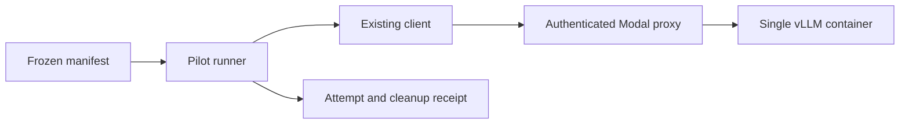

# Design: optional Modal hosting

## Overview

This additive design covers requirements 7.1–7.11. The user accepted the Modal
extension and requested proceeding. Existing local approvals remain scoped to
their original implementation.

### Goals

Serve `openai/gpt-oss-20b` remotely, verify actual logprobs through the existing
client, and measure feasibility and cost before larger experiments.

### Non-Goals

No model fleet, automatic fallback, new scoring mathematics, frontier
completion-only integration or claim of divergence mitigation efficacy.

## Boundary Commitments

### This Spec Owns

Optional deployment recipe, frozen manifest, bounded pilot runner, cleanup
observations and operational reporting.

### Out of Boundary

Core transport and calibration algorithms, local memory admission, NPU drivers,
account billing administration and automatic release deployment.

### Allowed Dependencies

Modal belongs only in deployment tooling; vLLM/CUDA belong only in the remote
image. Reuse `OpenAICompatibleClient`, `CallBudget`, evidence validation and
provenance contracts. Core never imports deployment code. Windows commands use
PowerShell; WSL remains Dagger CI only.

### Revalidation Triggers

Model revision, quantization, tokenizer/template, image, runtime, score semantics
and context changes require new capability and calibration compatibility checks.
Unknown identity never establishes a calibration match.

## Architecture

Use a Modal Web Function wrapping vLLM with `requires_proxy_auth=True`,
`min_containers=0`, `max_containers=1`, `buffer_containers=0`,
`scaledown_window=60` and one concurrent input. Supply the proxy token ID and
secret joined by a period through the existing client's bearer credential
environment reference. No new provider class or scoring API is needed.

First candidate: one A100 40 GB, four physical CPU cores, 32 GiB host RAM,
tensor parallel size one, context 4096 and one scheduled sequence. vLLM's A100
recipe supports GPT-OSS MXFP4 using Marlin and Triton attention. This is a
feasibility configuration, not an observed fit; no automatic GPU upgrade.

Implementation must resolve a released vLLM image digest, compatible exact Modal
SDK version and model/tokenizer commits before execution. Reject floating pins.
Use a dedicated remote weight cache and stage weights without GPU allocation
where supported. Do not upload local `models/`, `.env` or credentials. No
speculative decoding or auxiliary model in this pilot.

## File Structure Plan

| Path | Responsibility |
| --- | --- |
| `deploy/modal/serve.py` | Serving recipe, startup provenance and remote expiry |
| `deploy/modal/pyproject.toml`, `deploy/modal/uv.lock` | Isolated pinned deployment tooling |
| `configs/modal/gpt-oss-20b-pilot.json` | Immutable model/resource/budget plan without secrets |
| `scripts/probe_modal_model.py` | Plan validation, bounded run and cleanup receipt |
| `tests/scripts/test_probe_modal_model.py` | Offline lifecycle/evidence regressions |
| `docs/modal-provider.md` | Setup, budgets, start/stop, recovery and interpretation |
| `docs/local-provider.md`, `mkdocs.yml` | Navigation to optional hosting guide |

Dependency direction remains core contracts to harness consumers to scripts;
core does not import scripts or Modal. No generic orchestration framework.

## Components and Interfaces

**Manifest:** typed workspace/environment/app identifiers, artifact commits,
quantization, image digest, SDK version, GPU count/type, CPU cores, RAM GiB,
context tokens, concurrency, idle seconds, credential reference, pricing
timestamp and pilot limits. Unresolved required values prevent execution.
Default planning mode neither deploys nor sends inference or prints secrets.

**Runner:** explicit execution requires a frozen plan and new receipt path.
Persist intent before each physical POST. Reuse the evidence validator with
five required alternatives. Keep evidence and environment eligibility separate.
Check GPT-OSS reasoning/final-answer alignment as actually returned; do not strip
or retokenize text to force acceptance. Partial top-k remains partial evidence.

**Provenance:** capture resolved model/tokenizer identity, runtime, settings and
observed GPU in an experiment-owned artifact. Retrieve before/after snapshots
through Modal's authenticated control plane and bind them to this deployment.
Configured hardware alone is not observed hardware. Drift or missing evidence
precludes calibrated claims while retaining diagnostics.

**Receipt:** one row per physical inference attempt, including stage, timing,
token counts, HTTP outcome, evidence result and identity reference. Lifecycle
events are separate from inference counts. Record startup/generation seconds,
estimated USD, observed USD or null, usable count and cleanup state. Cost per
usable measurement is null when cost is unknown or no measurement is usable.
Published artifacts exclude credentials and raw generated text.

## System Flow and Pilot Bounds

1. Validate account/environment access, pinned model access and budget record
   without starting GPU compute. Prepare/cache weights with separately recorded
   costs. Verify remaining allowance; absent billing access requires an
   operator-confirmed budget record.
2. Start one experiment-owned app; startup allowance is ten minutes. Readiness
   uses a bounded SDK method on the existing serving class to invoke its startup
   hook and return metadata without token generation. This integration detail
   resolves the absence of observations while scaled to zero; it preserves zero
   warm minimum and zero buffer. Record readiness as a control operation, arm
   remote expiry first, and do not replay an uncertain readiness invocation.
3. Run one eligibility request, followed by at most seven fixed-prompt requests
   only if eligible. Eight inference POSTs total, zero retries, serial calls,
   temperature 0, top_p 1, logprobs true, top_logprobs 5, at most 512 output
   tokens each (4096 total). Freeze prompts/hash and verify input plus output
   allowance fits context before admission.
4. Each request has a 120-second limit. The GPU phase has a 20-minute deadline
   including startup. Cancellation, deadline or uncertain transport outcome
   stops admission without replay.
5. Finally stop this app through the control plane; allow two minutes for
   cleanup verification. Report unverified cleanup with app ID and recovery
   command. Preserve the cache and unrelated apps.

Schedule a separate CPU-only remote expiry controller at startup to stop the
experiment app at its deadline if the local process disappears. It must not
call the inference endpoint or restart GPU compute. Keep it in the deployment
recipe; cost/control observations are separate. Control-plane failure may still
prevent cleanup: budgets and scale-to-zero are additional controls, not an exact
spend guarantee.

## Cost and Error Handling

Target USD 5 total pilot spend. Provider budgets are monthly, not per-run;
account for prior usage. Environment budgets cover compute, while workspace
budgets cover broader usage. Do not overwrite shared workspace policy. Verify
current enforcement semantics and prices before execution; report gross usage
cost separately from credits.

Research estimate: A100 40 GB USD 2.0988/hour plus about USD 0.4444/hour for four
CPU cores and 32 GiB RAM. Twenty minutes is approximately USD 0.85 for those
resources, excluding staging, storage, cleanup and other charges. It is neither
an invoice nor a performance promise.

401/403 stops admission. Capacity failure does not trigger hardware switching.
Invalid evidence ends as ineligible. Timeout retains unknown outcome. Cleanup
failure stays visible even if inference succeeded. Later billing reconciliation
may append observed costs without rewriting attempt history.

## Requirements Traceability

| Requirements | Coverage |
| --- | --- |
| 7.1, 7.10 | Explicit manifest, bearer authentication, secret redaction |
| 7.2 | Evidence and reasoning alignment gate |
| 7.3, 7.11 | Provenance snapshots and calibration mismatch handling |
| 7.4, 7.5 | Reviewed bounds, budget record, one container/request |
| 7.6 | Finally cleanup, remote expiry and stop receipt |
| 7.7, 7.8 | Lifecycle/cost observations and budget caveats |
| 7.9 | Isolated hosting dependencies |

Requirements 1–6 keep their original design mappings and apply where relevant.

## Testing Strategy

Offline tests cover missing credentials, unresolved pins, invalid limits,
dry-run zero mutation, exclusive receipts, intent-before-send, eight-call cap,
serial admission, evidence rejection, reasoning alignment, provenance drift,
timeout/cancellation, process-loss expiry, cleanup ownership/failure and
unknown-versus-zero costs. Assert core imports never load Modal. Fake control
plane calls; CI must never deploy paid resources.

Live acceptance requires authenticated denial without GPU startup, actual
hardware/runtime identity, usable five-alternative logprobs, cold/warm timings
and verified shutdown. Publish failures without starting calibration. Later
single/ensemble comparisons require separately frozen plans and budgets.

## Review and Rollout

Inline design review PASS after adding remote expiry for client loss and
separating monthly provider budgets from per-run targets. Coverage includes all
eleven added criteria. Resolve pins and test lifecycle offline before requesting
paid pilot approval. The user approved this design before task generation;
no paid execution occurred.
