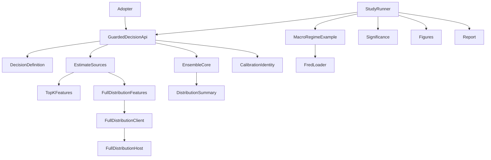
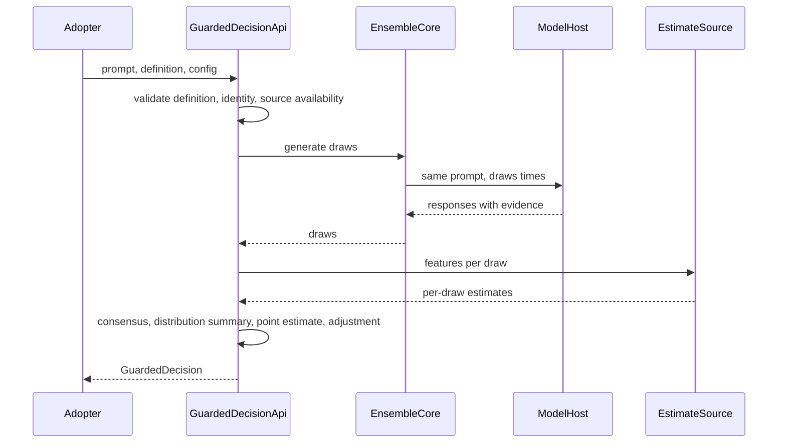
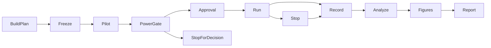

# Design Document: memorization-adjusted-finance-sim

## Overview

**Purpose**: This feature delivers an importable, ensemble-first API that returns a
model's decision for a finance simulation together with its answer distribution,
a calibrated memorization estimate and a memorization-adjusted decision. It also
delivers the study that tests, with pre-registered paired statistics, whether the
adjustment and the ensemble each matter.

**Users**: Quant researchers and Recall Guard adopters (first of all the
Global_Macro_AI_Factors project) call the API from simulations; the principal
investigator runs the study and reads the dated report.

**Impact**: Adds a guarded-decision layer next to the existing scorer, which stays
unchanged; adds full-distribution evidence as a second estimate source; adds a
point-in-time FRED loader, significance helpers and four documentation figures.

### Goals

- One call returns consensus decision, distribution summary, point estimate and
  adjusted decision; a single draw only on explicit request and labelled (1.1, 1.2).
- Estimates from top-k logprobs or full distributions, bound to calibrators that
  record their source (3, 4).
- A positive control (identifying versus anonymised FRED prompts) and a negative
  control (SEC EDGAR), six variants, frozen plan, Holm-corrected paired tests (6 to 8).
- Convergence of top-k to full-distribution features within one model (9).
- One worked example with four figures, reproducible offline (10).

### Non-Goals

- Changing Global_Macro_AI_Factors (it adopts the API in its own change).
- Removing memorization from models; trading advice; live trading.
- Changing `MemoryGuardedScorer.score` or its single-draw parity.
- New hosting runtimes beyond release 1.0 (llama.cpp, Ryzen AI OGA, FastFlowLM,
  Ollama, Modal).

## Boundary Commitments

### This Spec Owns

- The guarded-decision API: decision definitions, the guarded-decision result,
  the adjustment rule, ensemble-by-default behaviour and the distribution summary.
- The estimate-source label and the full-distribution evidence contract.
- The calibration identity's source and corpus fields and the calibrator AUC interval.
- The full-distribution scoring host for prompt plus response (native, loopback).
- The point-in-time FRED loader and the macro regime example (prompt renderer,
  decision definition, defensive spread).
- Significance helpers (Holm, block bootstrap, exact and Monte Carlo nulls, paired
  loss differences, half-ensemble variance comparison, simulated power).
- The study runner, its frozen plan and approval record, results, four figures and
  the dated report with its register entry.

### Out of Boundary

- `MemoryGuardedScorer.score`, `score_many` and their parity with the batch
  harness; `RecallWorkflow` and the completion-only workflow.
- Global_Macro_AI_Factors code and data.
- Model hosts' own lifecycle scripts (`serve_local_ollama.ps1`,
  `serve_local_flm.ps1`), used as they are. `modal_operator.sh` and
  `deploy/modal/` are extended only for the serving route below; their GPT-OSS-20B
  paths stay unchanged.
- Publication of raw licensed values (BAA10Y, FMP prices): only derived
  statistics and figures are published.
- Fine-tuning, rewriting, divergence decoding.

### Allowed Dependencies

- Layering `core < {mia, dataset, portfolio} < harness < scripts`; same-level
  siblings do not import each other; `dspy` stays banned
  (`scripts/check_architecture.py`).
- Runtime dependencies stay `numpy, scikit-learn, rich, pyyaml, requests,
  python-dotenv, psutil`; no scipy or pandas in the API path. Plotting stays lazy
  (`matplotlib` in the `backtest` extra and `dev` group; added to the `docs` extra
  only if figures render at build time, which this design avoids).
- Existing: `generate_ensemble` / `reduce_draws`, `CalibrationIdentity`,
  `feature_p_memorized`, `compute_mia_features`, `full_vocabulary_logprobs`,
  `bootstrap_ci`, `held_out_calibration`, `wilson_interval`, `connect` and the
  provider profiles, `load_cutoffs`, `portfolio/prices.py`, the frozen-plan and
  approval-record pattern of `scripts/measure_modal_model.py`.
- External: FRED API (free key `FRED_API_KEY`), FMP (`FMP_API_TOKEN`),
  llama.cpp b12199 (user-installed), Ryzen AI OGA 0.18.0 venv.

### Revalidation Triggers

- Any change to `GuardedDecision`, `DecisionDefinition` or `DistributionSummary` fields.
- Any change to the adjustment rule or the weak-calibrator and no-evidence policy.
- Any change to `CalibrationIdentity` serialisation (must stay v1-compatible).
- A change of estimate-source semantics (k, normalisation) or the full-distribution
  evidence contract.
- A change of FRED series, vintage policy, cutoffs or the accuracy definition after
  the plan is frozen (requires a new plan).

## Architecture

### Existing Architecture Analysis

- `MemoryGuardedScorer` couples per-draw scoring to the `Direction:` /
  `Confidence:` parser; a JSON decision fails every scored draw. The seam is
  `feature_p_memorized`, which needs only content and logprobs.
- `generate_ensemble` already accepts `decide` and `components` callbacks and
  reduces draws (location, multimodal verdicts, Wilson agreement, lag
  dependence, `draws_sha256`).
- The package invariant states the ensemble is opt-in; this design keeps that for
  the existing scorer and makes the new API ensemble-first, recorded by a steering
  amendment.

### Architecture Pattern and Boundary Map



- **Pattern**: ports and adapters around a pure core. Reductions, adjustment,
  features and statistics are pure functions of recorded inputs; model access sits
  behind the existing `CompletionClient` and one new full-distribution client.
- **Boundaries**: the API owns decisions and their adjustment; estimate sources own
  feature computation per source; the study owns plans, runs, statistics and
  figures. Each can be tested without the others by replaying recorded draws.
- **Preserved patterns**: calibration identity refusal, `min_parsed` failure with
  `None` (never 0.0), content-addressed draws, frozen-plan hashes and approval
  records, native model hosts behind authenticated auto-stopping gateways.
- **Steering compliance**: layering, runtime dependency set, lazy plotting,
  containers on Windows, report rules.

### Technology Stack

| Layer | Choice / Version | Role in Feature | Notes |
|-------|------------------|-----------------|-------|
| Library | Python 3.12+, numpy, scikit-learn | API, features, statistics | No new runtime dependency |
| Model hosts | llama.cpp b12199 (Vulkan), Ryzen AI OGA 0.18.0, FastFlowLM 1.0.12 | Generation, top-k logprobs, full distributions | Native Windows, loopback, gateway |
| Data | FRED API (vintages), FMP end-of-day, SEC EDGAR corpus (`data/edgar/`) | Macro rows, realized returns, negative control | Raw licensed values stay in `runs/` |
| Figures | matplotlib (backtest extra, dev group) | Four static figures, light and dark | Rendered offline, committed as SVG |
| Runtime | Docker dev image (Linux) | Recall Guard and study execution | Hosts run natively |

## File Structure Plan

### Directory Structure

```
recall_guard/
├── core/
│   ├── decision.py            # DecisionDefinition, DecisionVector, validation, adjustment rule
│   ├── full_distribution.py   # FullDistributionEvidence contract and FullDistributionClient (gateway HTTP, digest check)
│   ├── distribution.py        # DistributionSummary from recorded draws (quantiles, spread, sign agreement, distinct answers, first-draw position)
│   └── significance.py        # Holm, block bootstrap, exact binomial, Monte Carlo null, paired loss difference, half-ensemble variance test, simulated power
├── mia/
│   └── estimate_source.py     # EstimateSource label; features from top-k evidence and from full-distribution evidence; truncate full to top-k
├── dataset/
│   ├── fred.py                # FRED API client with point-in-time (vintage) queries, local cache
│   └── macro_regime.py        # Macro row model, identifying and anonymised prompt renderers, regime decision definition, defensive spread
├── harness/
│   └── guarded_decision.py    # guarded_decide: ensemble-first API, per-draw estimates, adjustment, policy, identity record
scripts/
├── serve_full_distribution.py # Native host: llama.cpp in-process teacher forcing of prompt plus response, loopback HTTP
├── serve_full_distribution.ps1# Starts the host behind the bearer gateway, idle stop, verified teardown
├── serve_local_llamacpp.ps1   # Starts llama-server on the pinned GGUF (top-k logprobs) behind the bearer gateway, idle stop, verified teardown
└── finance_sim/
    ├── build_plan.py          # Builds and freezes the study plan (items, variants, metrics, seeds, limits) with hashes
    ├── run_study.py           # Executes variants within limits, records draws and evidence, resumable, never replays
    ├── analyze.py             # Pre-registered statistics from recorded results
    ├── convergence.py         # Top-k versus full-distribution convergence (ConvergenceAnalysis), from recorded evidence
    ├── figures.py             # Renders the four figures and their data tables
    └── negative_control.py    # EDGAR sentiment-tilt decision task for the negative control
docs/
├── results/<run-date>-memorization-adjusted-finance-sim.md  # Dated report (template), dated when the study runs
└── assets/finance-sim/        # Committed SVG figures, light and dark, plus CSV tables
tests/
├── core/test_decision.py, test_distribution.py, test_significance.py
├── mia/test_estimate_source.py
├── dataset/test_fred.py, test_macro_regime.py
├── harness/test_guarded_decision.py
└── scripts/test_finance_sim_*.py
```

### Modified Files

- `recall_guard/harness/scorer_client.py`: `CalibrationIdentity` gains
  `estimate_source` and `corpus_sha256` (omitted when default, v1-compatible).
- `recall_guard/harness/scorer.py`: calibrator exposes `holdout_auc_interval`;
  no change to `score` / `score_many` behaviour.
- `recall_guard/core/completion.py` and `recall_guard/core/providers.py`:
  optional `FullDistributionEvidence` on `ModelResponse`; capability
  `full_distribution`.
- `recall_guard/core/profiles.py` and `provider_profiles/`: profile
  `llamacpp-gemma3-4b` (generation through llama-server, full distribution through
  the new host, same GGUF digest).
- `configs/modal/gemma-3-4b-measurement.json` (new) and
  `recall_guard/core/provider_profiles/modal-gemma3-4b.json` (new): the serving
  arm's pinned Gemma 3 4B revision, limits and generic-mapping profile.
- `deploy/modal/manifest.py` and `deploy/modal/serve.py`: accept the Gemma manifest
  (generic mapping, no Harmony tokenizer) alongside the unchanged GPT-OSS-20B
  pilot manifest, with the weight volume taken from the manifest and a CPU-only
  staging step.
- `scripts/modal_operator.sh`: a serve mode (deploy, reachable for the study runner,
  verified stop) for the serving route; existing modes unchanged.
- `recall_guard/harness/plots.py`: four lazy plot functions; the outdated
  "reliability curve not constructible" note is corrected.
- `recall_guard/__init__.py`: exports `guarded_decide`, `DecisionDefinition`,
  `GuardedDecision`.
- `.kiro/steering/recall-guard-package.md`: amendment, the guarded-decision API is
  ensemble-first; the scorer's ensemble stays opt-in.
- `.env.sample`: `FRED_API_KEY=`.
- `mkdocs.yml`, `docs/results/index.md`, `docs/research-register.md`,
  `docs/research-report.md`: report link, R42 onward.

## System Flows

### Guarded decision (ensemble by default)



- Validation happens before any request (2.3, 3.4, 4.2).
- `min_parsed` failure returns a failure status and no decision (5.6).
- Weak calibrator or missing evidence returns the consensus unchanged with the
  reason (1.4, 1.5).
- Full-distribution source: after generation, prompt plus response is
  teacher-forced on the same weights through the full-distribution host (3.2).

### Study lifecycle



- `Freeze` writes the plan with content hashes before any request (8.2).
- `PowerGate` continues only at simulated power of at least 0.8 (8.9); otherwise
  `StopForDecision` reports the expected power and waits.
- `Approval` is required for paid runs only (11.2), including the Modal serving arm;
  local runs check limits.
- `Stop` closes admission on any frozen limit and keeps partial results (11.3).
- `Analyze`, `Figures` and `Report` replay recorded data offline (10.7).

## Requirements Traceability

| Requirement | Summary | Components | Interfaces | Flows |
|-------------|---------|------------|------------|-------|
| 1.1, 1.2 | Ensemble by default, labelled single draw | GuardedDecisionApi | `guarded_decide` | Guarded decision |
| 1.3 | Clipped, sign-preserving scaling | DecisionDefinition | `adjust` | Guarded decision |
| 1.4, 1.5, 1.6 | No evidence, weak calibrator, parse failure | GuardedDecisionApi | `GuardedDecision.status` | Guarded decision |
| 1.7 | Identity record | GuardedDecisionApi, CalibrationIdentity | `GuardedDecision.identity` | |
| 1.8 | No single-draw gate, label | GuardedDecisionApi | `DrawMode` | |
| 2.1 to 2.4 | Decision definitions, summary, validation, macro example | DecisionDefinition, MacroRegimeExample | `DecisionDefinition`, `regime_definition` | |
| 3.1 to 3.5 | Top-k and full sources, labels, refusal, logit conversion | EstimateSources, FullDistributionClient, FullDistributionHost | `EstimateSource`, `FullDistributionEvidence` | Guarded decision |
| 4.1 to 4.3 | Calibration identity, refusal, AUC interval | CalibrationIdentity, scorer | `CalibrationIdentity`, `holdout_auc_interval` | |
| 5.1 to 5.9 | Ensemble, distribution summary, first draw, replay, dependence | EnsembleCore, DistributionSummary | `summarize_distribution` | Guarded decision |
| 6.1 to 6.6 | Positive control prompts, cutoffs, vintages, accuracy | MacroRegimeExample, FredLoader, StudyRunner | `render_identifying`, `render_anonymised`, `fetch_point_in_time` | Study lifecycle |
| 7.1 to 7.3 | Negative control and tolerance | NegativeControlTask, Significance | `negative_control_change` | Study lifecycle |
| 8.1 to 8.10 | Six variants, frozen plan, paired tests, Holm, power | StudyRunner, Significance | `StudyPlan`, `holm`, `block_bootstrap`, `paired_loss_difference`, `half_ensemble_variance` | Study lifecycle |
| 9.1 to 9.4 | Top-k versus full convergence | EstimateSources, Analyze | `truncate_to_top_k`, `convergence_table` | |
| 10.1 to 10.7 | Worked example and four figures | Figures, Report | `plot_*` | Study lifecycle |
| 11.1 to 11.6 | Hosts, approvals, limits, reporting, installed package | StudyRunner, hosts, Report | `StudyLimits`, approval record | Study lifecycle |

## Components and Interfaces

| Component | Layer | Intent | Req Coverage | Key Dependencies | Contracts |
|-----------|-------|--------|--------------|------------------|-----------|
| DecisionDefinition | core | Parse, validate and adjust decisions | 1.3, 2.1 to 2.3 | none | Service |
| DistributionSummary | core | Distribution of draws and estimates | 5.2 to 5.4, 5.7 to 5.9 | `reduce_draws` (P0) | Service |
| Significance | core | Paired and multiple-testing statistics | 7.2, 8.3 to 8.10 | numpy (P0) | Service |
| EstimateSources | mia | Features per source, truncation | 3.1 to 3.5, 9.1 to 9.4 | `compute_mia_features` (P0) | Service |
| FredLoader | dataset | Point-in-time macro values | 6.5 | FRED API (P0) | Service |
| MacroRegimeExample | dataset | Prompts, regime definition, spread | 2.4, 6.1, 6.6 | DecisionDefinition (P0) | Service |
| GuardedDecisionApi | harness | Ensemble-first guarded decision | 1, 4.2, 5.1, 5.5, 5.6 | `generate_ensemble` (P0), CalibrationIdentity (P0) | Service |
| CalibrationIdentity (ext.) | harness | Source and corpus binding, AUC interval | 4.1 to 4.3 | scorer (P0) | State |
| FullDistributionClient | core | Request full-distribution evidence | 3.2, 3.5 | FullDistributionHost (P0) | API |
| FullDistributionHost | scripts (native) | Teacher-force prompt plus response | 3.2, 9.1 | llama.cpp (P0) | API |
| StudyRunner | scripts | Plan, run, record within limits | 6 to 8, 11 | GuardedDecisionApi (P0) | Batch |
| NegativeControlTask | scripts | EDGAR sentiment-tilt decisions | 7.1 | `data/edgar` (P0) | Batch |
| Figures | harness (lazy) and scripts | Four figures and tables | 10.2 to 10.6 | matplotlib (P1) | Batch |

### core

#### DecisionDefinition

| Field | Detail |
|-------|--------|
| Intent | Describe what the model is asked for and how its answer becomes numbers |
| Requirements | 1.3, 2.1, 2.2, 2.3 |

**Responsibilities & Constraints**
- Parses a response into named finite components within declared bounds; rejects
  duplicate keys and missing components.
- Optional summary mapping from components to one value; optional discretisation
  `decide` for agreement.
- Validation runs at construction, before any request.
- Adjustment scales each component by `1 - clip(p, 0, 1)` and never changes signs.

**Contracts**: Service [x]

```python
@dataclass(frozen=True)
class ComponentSpec:
    name: str
    lower: float
    upper: float
    grid: float | None = None

@dataclass(frozen=True)
class DecisionDefinition:
    name: str
    components: tuple[ComponentSpec, ...]
    parse: Callable[[str], Mapping[str, float]]
    summary: Callable[[Mapping[str, float]], float] | None = None
    decide: Callable[[Mapping[str, float]], Hashable] | None = None

    def parse_response(self, text: str) -> DecisionVector: ...

DecisionVector = Mapping[str, float]

def parse_json_components(text: str) -> dict[str, float]: ...
def adjust(vector: DecisionVector, p_memorized: float) -> dict[str, float]: ...
```
- Preconditions: unique component names; `lower < upper`; a grid is positive and
  finite; callables are pure.
- Strict parsing: `parse` is the caller's raw extractor; `parse_response` is the one
  validating entry point. It calls `parse`, then requires exactly the declared
  component names (missing or extra keys rejected) with finite, non-boolean numbers
  inside the declared bounds; out-of-bounds values are rejected, never clipped.
  Duplicate keys are rejected by `parse_json_components`, a core strict JSON helper
  (duplicate keys refused through `object_pairs_hook`) that definitions such as the
  macro regime and EDGAR outlook use as their `parse`.
- Postconditions: `adjust` returns values with the same signs and magnitudes scaled
  by `1 - clip(p)`. It takes floats only and rejects a non-finite estimate; the
  guarded-decision API keeps unresolved components as `None` and never passes them
  to `adjust` (5.7).
- Errors: `DecisionDefinitionError` (construction), `DecisionParseError` (per response).

#### DistributionSummary

| Field | Detail |
|-------|--------|
| Intent | Summarise recorded draws without new requests |
| Requirements | 5.2, 5.3, 5.4, 5.7, 5.8, 5.9 |

**Responsibilities & Constraints**
- Pure function of recorded parsed draws and per-draw estimates; order-free except
  the first-draw position, which uses `draw_index == 0`.
- Per component: quantiles (5, 25, 50, 75, 95), spread (standard deviation, IQR),
  sign agreement, multimodal flag from `reduce_draws`; summary value distribution;
  estimate quantiles and spread; distinct answers; first-draw quantile rank per
  component and summary; lag-one dependence and the independence statement.

```python
@dataclass(frozen=True)
class RecordedDraw:
    draw_index: int
    temperature: float | None
    seed: int | None
    response_sha256: str
    parsed: Mapping[str, float] | None   # None when the response did not parse
    failure_code: str | None             # set exactly when parsed is None
    estimate: float | None               # per-draw memorization estimate, if any
    evidence_ref: str | None

@dataclass(frozen=True)
class ComponentDistribution:
    name: str
    quantiles: Mapping[int, float]
    sd: float
    iqr: float
    sign_agreement: float
    unresolved: bool | None              # None when the split check could not run
    first_draw_rank: float | None        # None when draw 0 did not parse

@dataclass(frozen=True)
class DistributionSummary:
    n_requested: int
    n_parsed: int
    n_failed: int
    components: tuple[ComponentDistribution, ...]
    summary_value: ComponentDistribution | None
    decision_agreement: float | None
    decision_agreement_ci: tuple[float, float] | None
    estimate_quantiles: Mapping[int, float] | None
    estimate_sd: float | None
    distinct_answers: int
    lag1_dependence: float | None
    independence_note: str

def summarize_distribution(draws: Sequence[RecordedDraw], definition: DecisionDefinition) -> DistributionSummary: ...
```
- `RecordedDraw` is the shared record that the guarded-decision API and the study
  runner both write. Item and variant keys belong to the study recording, because
  one ensemble per item and rendering feeds every variant.
- Semantics:
  - Quantiles use linear interpolation over the parsed values.
  - `sd` uses ddof 1, and is 0.0 for a single value. `iqr` is q75 minus q25.
  - `sign_agreement` is the share of parsed values with the median's sign, where
    zero counts as its own sign.
  - `unresolved` comes from the per-component verdicts of `reduce_draws`
    (`component_verdicts`), with the definition's grid. It is True when separated
    clusters were found, False when the check ran and found none, and None when the
    check could not run (no grid, or too few parsed draws). A split skipped by the
    existing density guard in `consensus.py` reads as False, as `reduce_draws`
    reports it; this spec does not change that guard. None is never reported as
    resolved. For the summary value, which has no grid,
    `unresolved` is True when any component is True and None otherwise.
  - `decision_agreement` and its Wilson interval come from `reduce_draws` when the
    definition has `decide`; otherwise they are None. The interval follows the
    package convention, one-sided at 95 percent, set from explicit exported
    constants: the lower bound is the 95 percent lower bound, and the pair covers
    90 percent two-sided. Reports state this.
  - `distinct_answers` counts distinct parsed vectors in declared order.
  - `first_draw_rank` is the mid-rank of draw index 0 among the parsed values: the
    share strictly below plus half the share tied.
  - `lag1_dependence` is the lag-one Pearson autocorrelation over parsed draws
    (failed draws skipped), ordered by draw index, of the summary value (or of the first component when there is no
    summary). It is None with fewer than three parsed draws or zero variance.
  - `independence_note` states that intervals assume independent draws and that
    the dependence is reported, not corrected.

#### Significance

| Field | Detail |
|-------|--------|
| Intent | Pre-registered statistics without scipy |
| Requirements | 7.2, 8.3 to 8.10 |

**Contracts**: Service [x]

```python
def holm(p_values: Mapping[str, float]) -> dict[str, float]: ...
def block_bootstrap(stat: Callable[[np.ndarray], float], blocks: np.ndarray, *, block_length: int, n_resamples: int, seed: int, confidence: float = 0.95) -> Interval: ...
def did_gap(correct: np.ndarray, identifying: np.ndarray, pre_cutoff: np.ndarray) -> float: ...
def paired_loss_difference(loss_a: np.ndarray, loss_b: np.ndarray, *, block_length: int, n_resamples: int, seed: int) -> TestResult: ...
def half_ensemble_variance(halves_a: np.ndarray, halves_b: np.ndarray, singles: np.ndarray, *, n_resamples: int, seed: int) -> TestResult: ...
def random_answerer_null(observed: np.ndarray, sampler: Callable[[np.random.Generator, int], np.ndarray], *, statistic: Callable[[np.ndarray], float], n_null: int, seed: int, confidence: float = 0.95) -> TestResult: ...
def exact_binomial_greater(k: int, n: int, p: float = 0.5) -> float: ...
def simulated_power(effect: float, noise_sd: float, n_items: int, *, alpha: float, n_sim: int, seed: int) -> float: ...
```
- `TestResult` holds statistic, interval, raw p-value, method and parameters.
- Block bootstrap resamples contiguous blocks of decision months, keeping the
  identifying/anonymised and variant pairing within each month (Bertrand, Duflo and
  Mullainathan 2004).

```python
@dataclass(frozen=True)
class Interval:
    lo: float
    hi: float
    confidence: float            # two-sided coverage, e.g. 0.95
    method: str                  # e.g. "moving-block percentile bootstrap"

@dataclass(frozen=True)
class TestResult:
    statistic: float
    interval: Interval | None
    p_value: float | None        # raw, before Holm
    method: str
    parameters: Mapping[str, object]   # n, seeds, resamples, block length, ...
```
- Module `recall_guard/core/significance.py`; numpy and the standard library only.
  `block_bootstrap` and the functions built on it take `confidence: float = 0.95`.
- Semantics:
  - `holm` is the step-down adjustment: sort ascending, multiply the i-th smallest
    (1-based) by m - i + 1, enforce monotonicity with a running maximum, cap at 1.
    Ties keep a stable order by key. It returns the same keys.
  - `exact_binomial_greater(k, n, p)` is P(X >= k) for X ~ Binomial(n, p), summed
    exactly (log-space terms for stability); it validates 0 <= k <= n and 0 < p < 1.
  - `block_bootstrap`: the first axis of `blocks` is the ordered unit (decision
    months), each row holding everything paired within that month. Each resample
    draws ceil(n / L) start indices uniformly from 0..n-L (non-circular moving
    blocks), concatenates L consecutive rows each, truncates to n rows and applies
    `stat`. It returns a two-sided percentile interval and is deterministic for a
    seed (`numpy.random.default_rng`).
  - `did_gap(correct, identifying, pre_cutoff)` is (accuracy of identifying minus
    anonymised before the cutoff) minus (the same after the cutoff), over aligned
    per-item arrays. It raises ValueError when any of the four cells is empty.
  - `random_answerer_null` evaluates `statistic` on `n_null` samples of size
    len(observed) drawn by `sampler` from the supplied decision space. The
    one-sided p-value is (1 + #null >= observed) / (1 + n_null). Its interval is the
    central `confidence` range of the null distribution, and `method` says so.
  - Statistic values that are 0-d integer or floating arrays are coerced with
    `float()`; anything else
    that is not a finite real is a dropped resample (bootstrap) or an error (null).
  - Every `TestResult` built on resampling records `dropped_resamples` in its
    `parameters`, so a conditional interval is visible in reports, not only in logs.
  - `paired_loss_difference(loss_a, loss_b)`: aligned arrays whose first axis is the
    ordered month unit (1-D, or 2-D with rows as months). The statistic is
    mean(loss_a) minus mean(loss_b) over all elements. The interval is the
    moving-block bootstrap of that difference, resampling rows of both arrays
    together. The two-sided p-value is min(1, 2 min((1 + #boot <= 0), (1 + #boot >=
    0)) / (1 + n_kept)). It also serves the negative-control change against no
    adjustment (7.2), with the outlook values in place of losses.
  - `half_ensemble_variance(halves_a, halves_b, singles)`: per item, the result of
    each of two disjoint half-ensembles (`halves_a`, `halves_b`, shape (n_items,))
    and two single draws (`singles`, shape (n_items, 2)), all from the same
    recorded ensemble. Run-to-run variance is half the mean squared difference of
    each pair. The statistic is the ratio of the half-ensemble variance to the
    single-draw variance (below 1 means the ensemble reduces variance; about 2/K for
    halves of K/2 draws when draws are independent). The interval is an item-level
    percentile bootstrap of the ratio, and the one-sided p-value for a ratio below 1
    is (1 + #boot >= 1) / (1 + n_kept).
  - `simulated_power(effect, noise_sd, n_items, alpha)`: power of a one-sided test of
    a positive mean on n_items independent normal(effect, noise_sd) values with the
    t statistic. The critical value is the (1 - alpha) quantile of the same
    statistic simulated under effect 0, so no t table is needed. Power is the share
    of simulations under `effect` that exceed it. It is deterministic for a seed.

#### FullDistributionClient

| Field | Detail |
|-------|--------|
| Intent | Obtain full-distribution evidence for a prompt plus response |
| Requirements | 3.2, 3.5 |

**Contracts**: API [x]

| Method | Endpoint | Request | Response | Errors |
|--------|----------|---------|----------|--------|
| POST | `/v1/full_distribution` (host, via gateway) | `{model_digest, prompt_text, response_text, top_k_keep}` | `FullDistributionEvidence` | 401, 409 digest mismatch, 413, 422 tokenisation |

```python
@dataclass(frozen=True)
class FullDistributionEvidence:
    model_digest: str
    n_vocab: int
    response_token_ids: tuple[int, ...]
    logprob: tuple[float, ...]          # actual token, per response position
    entropy: tuple[float, ...]
    rank: tuple[int, ...]
    top_logprobs: tuple[tuple[tuple[int, float], ...], ...]   # top_k_keep alternatives per position, from the full vector
```
- Log-probabilities are computed from logits by a float64 log-softmax per position (3.5).
- `top_k_keep` (default 100) enables truncation to any smaller k for convergence (9.1).

### mia

#### EstimateSources

| Field | Detail |
|-------|--------|
| Intent | One feature set from either source |
| Requirements | 3.1, 3.3, 9.1 to 9.4 |

```python
class EstimateSource(Enum):
    TOP_K = "top_k"
    FULL_DISTRIBUTION = "full_distribution"

@dataclass(frozen=True)
class SourceLabel:
    source: EstimateSource
    k: int | None

def features_from_top_k(content: str, logprobs: Sequence[TokenLogprob]) -> MiaFeatures: ...
def features_from_full(evidence: FullDistributionEvidence) -> MiaFeatures: ...
def truncate_to_top_k(evidence: FullDistributionEvidence, k: int) -> Sequence[TokenLogprob]: ...
def top_k_mass(evidence: FullDistributionEvidence, k: int) -> np.ndarray: ...
```
- Both paths produce the existing `MiaFeatures`, so one calibrator type serves both
  sources, and a calibrator is fitted per source (3.3, 4.1).
- Convergence compares `features_from_top_k(truncate_to_top_k(e, k))` with
  `features_from_full(e)` on the same responses and weights only (9.4).

### dataset

#### FredLoader

| Field | Detail |
|-------|--------|
| Intent | Values as available on a decision date |
| Requirements | 6.5 |

```python
def fetch_point_in_time(series_id: str, as_of: date, *, api_key: str, cache_dir: Path) -> Observation | None: ...
def vintage_available(series_id: str, *, api_key: str, cache_dir: Path) -> bool: ...
```
- Uses `series/observations` with `realtime_start = realtime_end = as_of`; series
  without vintages are returned with `revised_data = True` (6.5).
- At most 120 requests per minute, cached responses, key from `FRED_API_KEY`.
- Series: CPIAUCSL (CPI, vintages), T10Y2Y, BAA10Y (substitute for HY OAS; Moody's
  copyright, cite and do not publish raw values), DTB3 (cash leg).

#### MacroRegimeExample

| Field | Detail |
|-------|--------|
| Intent | The worked example's prompts, decision and spread |
| Requirements | 2.4, 6.1, 6.6 |

- `render_anonymised(row)` and `render_identifying(row, decision_date, asset_names)`
  differ only in date, asset names and raw levels (6.1).
- `regime_definition`: components inflation, growth, credit_stress, policy,
  risk_appetite in [-1, 1], grid 0.1; summary = defensive spread
  `(tilt_gold + tilt_cash) - (tilt_equity + tilt_tech)` from the frozen exposure
  matrix; `decide` = sign of the spread.
- Accuracy (6.6): a decision is correct when the sign of the spread matches the sign
  of the realized next-month return of the defensive pair (gold, cash) minus the
  risk pair (world equity, tech), from FMP adjusted closes and DTB3.

### harness

#### GuardedDecisionApi

| Field | Detail |
|-------|--------|
| Intent | Ensemble-first guarded decision |
| Requirements | 1.1 to 1.8, 4.2, 5.1, 5.5, 5.6 |

```python
class DrawMode(Enum):
    ENSEMBLE = "ensemble"
    SINGLE = "single"

@dataclass(frozen=True)
class GuardConfig:
    definition: DecisionDefinition
    source: SourceLabel
    draws: int = 32
    min_parsed: int = 24
    mode: DrawMode = DrawMode.ENSEMBLE
    temperature: float | None = None   # None keeps the profile's setting
    seed_base: int | None = None       # per-draw seed = seed_base + draw_index, recorded

@dataclass(frozen=True)
class GuardedDecision:
    status: Literal["ok", "estimate_unavailable", "adjustment_skipped_weak_calibrator", "failed"]
    mode: DrawMode
    decision: DecisionVector | None          # consensus, or the single draw
    adjusted: DecisionVector | None
    p_memorized: float | None                # mean over draws, or single-draw estimate
    distribution: DistributionSummary | None # None for SINGLE
    reason: str | None
    identity: GuardIdentity                  # model, source, settings, calibrator, prompt hash
    draws_sha256: str | None

def guarded_decide(prompt: str, config: GuardConfig, *, client: CompletionClient, calibrator: SourceCalibrator, full_distribution: FullDistributionClient | None = None) -> GuardedDecision: ...
```
- Per-draw estimates use features from the configured source, never the direction
  parser.
- Each draw records its temperature and seed; a deterministic host at temperature 0
  yields identical draws, which the distribution summary reports as one distinct
  answer rather than as agreement evidence.
- `SINGLE` results carry `mode = SINGLE` and no distribution (1.2, 1.8).
- `SourceCalibrator` is the existing MCS calibrator wrapped with its extended
  `CalibrationIdentity` (source, settings, corpus hash); it is defined in
  `harness/guarded_decision.py` together with `GuardIdentity` (model, source,
  settings, calibrator fingerprint, prompt hash).
- Unresolved components keep `None` values in `decision` and are left unadjusted (5.7).
  A component whose split check could not run (`unresolved is None`) keeps its value
  but is flagged as not assessed in the result; it is never presented as resolved.

#### CalibrationIdentity (extension)

- Adds `estimate_source` and `corpus_sha256`; serialisation omits them at their
  defaults, so v1 and v2 payloads still load (4.1).
- `validate_response` refuses a different source or settings (4.2).
- Calibrators report `holdout_auc_interval` from the retained holdout via the
  existing stratified bootstrap; weak means the point AUC is below `min_auc` (4.3).

### scripts

#### FullDistributionHost

- Native Windows process using the llama.cpp library (as
  `scripts/score_documents_llamacpp.py`), loopback port, behind the bearer gateway
  with idle stop and verified teardown (11.1).
- Teacher-forces prompt plus response token by token on the pinned GGUF digest and
  returns `FullDistributionEvidence`; refuses a different digest (409).
- Exactness check against llama-server's full-vocabulary output, as in R40.

#### StudyRunner

**Ensemble arms** (5.1, 8.5, 8.6). Every ensemble claim names its arm:
- *Sampling arm*: local Gemma 3 4B through llama.cpp at a frozen sampling
  temperature (default 0.7) with seed `seed_base + draw_index` per draw. It measures
  the model's sampling distribution. Local llama.cpp is bitwise deterministic at
  temperature 0 (R35, R40), so temperature 0 would give identical draws.
- *Serving arm*: Modal vLLM at temperature 0, measuring serving nondeterminism as in
  the adopter's 1,000-draw study. Paid; it has its own frozen limits and approval.
  The serving model is Gemma 3 4B (`google/gemma-3-4b-it`, a gated Hugging Face
  licence accepted with `HF_TOKEN`) on vLLM with the generic response mapping. It
  needs its own Modal measurement manifest, pinned weight revision, staged weights
  and provider profile; the GPT-OSS-20B pilot manifest stays unchanged. These are
  different weights from the local GGUF, so the two arms are reported separately.
  Its variant set is no adjustment and top-k only, with its own calibrator for the
  Modal model fitted on the calibration months within the approved limits. The arm
  also runs the negative control within the same limits. The serving arm has no
  pilot or power gate: it runs the frozen size within its approved limits and
  reports its achieved power (8.9); the sampling arm is the confirmatory, gated arm.
- *Serving route*: the Modal deployment takes its weight volume from the manifest
  (one volume per manifest; the GPT-OSS-20B volume name is unchanged), stages the
  pinned weights in a CPU-only step with its own frozen limit, and gains a serve mode
  in `modal_operator.sh` that deploys the app, keeps it reachable for the study
  runner through `MODAL_ENDPOINT_URL` and `MODAL_PROXY_BEARER` within the approved
  limits, and stops it with verified cleanup. Credentials pass by name only. The
  full-distribution variants are reported as missing for this arm (8.10), because
  the full-distribution host serves different weights and values from different
  builds are not comparable (9.4).

**Calibration set** (4.1, 6.3). The macro calibrator follows the adopter's
`_build_corpus`: a frozen set of pre-cutoff decision months, disjoint from the
evaluation months, rendered as the identifying prompt (memorized class) and as the
token-identical anonymised prompt (control class), in the same prompt format and
settings as evaluation. Every post-cutoff month stays in evaluation. The frozen plan
records the month split and its hash. Limitation stated in the report: the control
class is anonymised rather than truly unseen.

**Pilot and power gate** (8.9, 11.3). Before the full run, a pilot (about 12
evaluation months times 8 draws per rendering, frozen in the plan) estimates the
item-level variances. `simulated_power` then evaluates the pre-registered effect at
the planned size. The full run starts only when power is at least 0.8; otherwise the
runner stops, reports the expected power and the options (wider window, more draws),
and waits for a decision. Pilot items are excluded from the confirmatory analysis.

**Scored probability** (8.4). The forecast scored by Brier and log loss is the
probability that the defensive pair beats the risk pair over the next month (the
outcome, from FMP adjusted closes with DTB3 as the cash leg). For an ensemble it is
the share of parsed draws with a positive defensive spread; for a single draw it is
that draw's sign as 0 or 1. Both are clipped to [0.01, 0.99]. Adjustment shrinks
the probability toward 0.5 by the same factor as the components:
`p_adj = 0.5 + (1 - p_memorized) * (p_raw - 0.5)`. The mapping, outcome and clip
are frozen in the plan before any request.

**Contracts**: Batch [x]
- Trigger: `build_plan.py` then `run_study.py --plan --approval?`.
- Input: frozen plan (items, variants, metrics, tolerance, seeds, resample counts,
  significance level, block length, decision rule, limits) with content hashes.
- Output: per item and variant, recorded draws, evidence and `GuardedDecision`
  results under `runs/container/finance-sim/` (private); summaries for analysis.
- Idempotency: resumable per item; never replays a recorded request; refuses a
  changed plan; stops on any limit and marks the run incomplete (11.3).
- Hosts: model hosts are native Windows processes started and stopped by the
  Windows-side scripts (`serve_local_llamacpp.ps1`, `serve_full_distribution.ps1`,
  `modal_operator.sh`). The containerized runner never starts them; it checks
  reachability and the model digest before admitting requests and records the
  scripts' teardown evidence (11.1).

#### NegativeControlTask

- Decision: one component `outlook` in [-1, 1] for each SEC EDGAR press release,
  using each arm's variant set.
- Calibrator: an EDGAR calibrator per model and source, fitted on the EDGAR
  calibration split (40 memorized, 100 control) in the same outlook prompt format
  and settings; the held-out EDGAR rows are the negative-control items. The macro
  calibrator is never applied to EDGAR prompts.
- Metric: per-item change `|adjusted - raw|` against no adjustment, with a block
  bootstrap interval over filing quarters; a variant whose upper interval exceeds the
  frozen tolerance is reported as discounting honest answers (7.2, 7.3).

#### Figures

Four static figures rendered offline from recorded results into
`docs/assets/finance-sim/` as SVG in light and dark variants (MkDocs Material
`#only-light` / `#only-dark`), each with a CSV and a markdown table beside it.
Palette: the fixed-order `PAPER_PALETTE`, validated with the dataviz
`validate_palette.js` for light and dark surfaces before use; identity is always
also carried by marker shape and fill.

| Figure | Form | Encoding | Req |
|--------|------|----------|-----|
| F1 Gap | Dot and interval, small multiples by control | y = six variants; x = pre minus post accuracy gap of identifying minus anonymised; zero line; marker shape = adjustment, filled or open = draw mode | 10.2 |
| F2 Reliability | Small multiples, one per variant | x = mean predicted `p_memorized`, y = observed share; diagonal; marker area by count, count labels; ECE in panel title | 10.3 |
| F3 Draws | Strip plots, one panel per quantity (one axis each) | Per-draw component and estimate; ensemble median and IQR band; first draw marked with a distinct marker and label | 10.4 |
| F4 Convergence | Lines, small multiples by feature; separate mass panel | x = k (log scale), y = absolute difference to full; at most four direct-labelled lines | 10.5 |

Captions state data, sample size and interval method (10.6).

## Data Models

### Domain Model

- **StudyPlan** (aggregate root): items (decision dates or EDGAR rows), the
  calibration-month and pilot-month sets, variants (draw mode times source), ensemble
  arms (sampling, serving) with temperature and seed base, metrics, power threshold,
  seeds, limits, hashes. Immutable once frozen.
- **RecordedDraw**: item, variant, draw index, response text hash, parsed vector,
  evidence reference, per-draw estimate.
- **GuardedDecision**: as above; derived, recomputable from recorded draws.
- **MacroRow**: decision date, series values as available on that date, vintage flags.

### Data Contracts and Integration

- Recorded draws and evidence are JSON lines with content hashes; full-distribution
  evidence keeps the top 100 alternatives per position, not full vectors.
- Licensed raw values (BAA10Y, FMP prices) are stored only under `runs/`; published
  files contain derived statistics.

## Error Handling

### Error Strategy

- Fail fast before requests: invalid definition, unavailable source, identity
  mismatch, missing key, unfrozen or changed plan.
- Per draw: parse failures and evidence defects fail that draw with a code; the
  ensemble fails only below `min_parsed`.
- Per run: limits close admission; partial results are kept and labelled incomplete.

### Error Categories and Responses

- **Configuration errors**: `DecisionDefinitionError`, `SourceUnavailableError`,
  `IdentityMismatchError`, raised before any request with the problem named.
- **Response errors**: `DecisionParseError`, item-evidence codes from release 1.0,
  recorded per draw.
- **Policy outcomes**: `estimate_unavailable`, `adjustment_skipped_weak_calibrator`,
  returned as statuses with reasons, never as exceptions.
- **Host errors**: 401, 409, 413, 422 from the full-distribution host map to
  `RequestError` codes; host stop is verified.

### Monitoring

- Every run writes counts, timings, limits used and host teardown evidence to its
  receipt; reports cite them.

## Testing Strategy

- **Unit**: `adjust` keeps signs and scales by `1 - clip(p)` (1.3); definition
  validation rejects bad bounds and duplicate names before requests (2.3);
  `summarize_distribution` quantiles, sign agreement, distinct answers and first-draw
  rank on fixed draws (5.3, 5.4); `holm`, `exact_binomial_greater` and
  `block_bootstrap` against hand-computed cases (8.3, 8.7); `truncate_to_top_k` and
  `top_k_mass` against brute force (9.1, 9.2).
- **Integration**: `guarded_decide` on fake clients returns ensemble by default,
  labelled single draw on request, pass-through on missing evidence and weak
  calibrator, failure below `min_parsed`, unresolved components unadjusted
  (1.1 to 1.8, 5.6, 5.7); identity refusal across sources and settings (4.2);
  full-distribution client against a fake host including 409 on digest mismatch
  (3.2, 3.4); FRED point-in-time queries against recorded responses (6.5).
- **Replay**: distribution summary, statistics and figures recomputed from recorded
  draws with network disabled match stored results (5.8, 10.7).
- **Study**: plan freezing refuses changed hashes (8.2); limits stop admission and
  keep partial results (11.3); negative-control tolerance flag (7.3); calibration
  months are disjoint from evaluation and pilot months (4.1); the power gate stops
  below 0.8 (8.9); per-draw seeds and temperatures are recorded, and a
  deterministic temperature-0 host yields one distinct answer (5.3).
- **Docs**: strict MkDocs build and `tests/docs`; installed-wheel import test without
  research data (11.6); the `import recall_guard` no-matplotlib test stays green.

## Performance and Scalability

- Study size per model (sampling arm): up to 126 monthly decision dates (2016-01 to
  2026-06), less the calibration and pilot months, times two renderings times 32
  draws, at most 8,064 generations, each also teacher-forced for
  the full-distribution source. At about 6 s per generation on the iGPU this is
  about 13 to 15 hours per model locally, at no cost; the plan states the exact
  limits and is approved before running.
- Ensemble draws run sequentially per host (one model loaded), as in release 1.0.

## Security Considerations

- Hosts bind to loopback; containers reach them only through the bearer gateway on
  the WSL adapter; idle stop and verified teardown.
- Keys (`FRED_API_KEY`, `FMP_API_TOKEN`, `LOCAL_MODEL_API_KEY`) come from the root
  `.env` by name and are never printed or stored in receipts.
- Licensed data stays private; reports publish only derived statistics, with source
  citations (Moody's for BAA10Y, FMP for prices).
