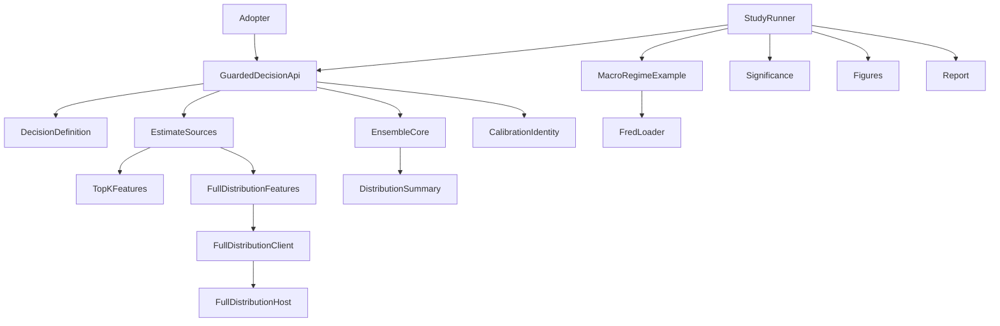
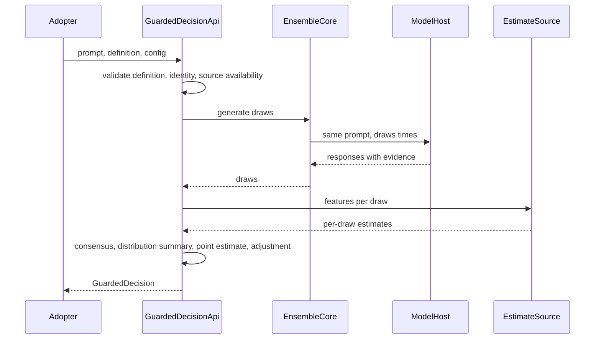
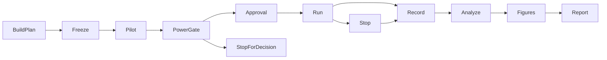

# Design Document: memorization-adjusted-finance-sim

## Overview

**Purpose**: This feature delivers an importable, ensemble-first API that returns a
model's decision for a finance simulation together with its answer distribution,
a calibrated memorization estimate and a memorization-adjusted decision. It also
delivers the study that tests, with pre-registered paired statistics, whether the
adjustment and the ensemble each matter.

**Users**: Quant researchers and Recall Guard adopters (first of all the
Global_Macro_AI_Factors project) call the API from simulations; the principal
investigator runs the study and reads the dated report.

**Impact**: Adds a guarded-decision layer next to the existing scorer, which stays
unchanged; adds full-distribution evidence as a second estimate source; adds a
point-in-time FRED loader, significance helpers and four documentation figures.

### Goals

- One call returns consensus decision, distribution summary, point estimate and
  adjusted decision; a single draw only on explicit request and labelled (1.1, 1.2).
- Estimates from top-k logprobs or full distributions, bound to calibrators that
  record their source (3, 4).
- A positive control (identifying versus anonymised FRED prompts) and a negative
  control (SEC EDGAR), six variants, frozen plan, Holm-corrected paired tests (6 to 8).
- Convergence of top-k to full-distribution features within one model (9).
- One worked example with four figures, reproducible offline (10).

### Non-Goals

- Changing Global_Macro_AI_Factors (it adopts the API in its own change).
- Removing memorization from models; trading advice; live trading.
- Changing `MemoryGuardedScorer.score` or its single-draw parity.
- New hosting runtimes beyond release 1.0 (llama.cpp, Ryzen AI OGA, FastFlowLM,
  Ollama, Modal).

## Boundary Commitments

### This Spec Owns

- The guarded-decision API: decision definitions, the guarded-decision result,
  the adjustment rule, ensemble-by-default behaviour and the distribution summary.
- The estimate-source label and the full-distribution evidence contract.
- The calibration identity's source and corpus fields and the calibrator AUC interval.
- The full-distribution scoring host for prompt plus response (native, loopback).
- The point-in-time FRED loader and the macro regime example (prompt renderer,
  decision definition, defensive spread).
- Significance helpers (Holm, block bootstrap, exact and Monte Carlo nulls, paired
  loss differences, half-ensemble variance comparison, simulated power).
- The study runner, its frozen plan and approval record, results, four figures and
  the dated report with its register entry.

### Out of Boundary

- `MemoryGuardedScorer.score`, `score_many` and their parity with the batch
  harness; `RecallWorkflow` and the completion-only workflow.
- Global_Macro_AI_Factors code and data.
- Model hosts' own lifecycle scripts (`serve_local_ollama.ps1`,
  `serve_local_flm.ps1`), used as they are. `modal_operator.sh` and
  `deploy/modal/` are extended only for the serving route below; their GPT-OSS-20B
  paths stay unchanged.
- Publication of raw licensed values (BAA10Y, FMP prices): only derived
  statistics and figures are published.
- Fine-tuning, rewriting, divergence decoding.

### Allowed Dependencies

- Layering `core < {mia, dataset, portfolio} < harness < scripts`; same-level
  siblings do not import each other; `dspy` stays banned
  (`scripts/check_architecture.py`).
- Runtime dependencies stay `numpy, scikit-learn, rich, pyyaml, requests,
  python-dotenv, psutil`; no scipy or pandas in the API path. Plotting stays lazy
  (`matplotlib` in the `backtest` extra and `dev` group; added to the `docs` extra
  only if figures render at build time, which this design avoids).
- Existing: `generate_ensemble` / `reduce_draws`, `CalibrationIdentity`,
  `feature_p_memorized`, `compute_mia_features`, `full_vocabulary_logprobs`,
  `bootstrap_ci`, `held_out_calibration`, `wilson_interval`, `connect` and the
  provider profiles, `load_cutoffs`, `portfolio/prices.py`, the frozen-plan and
  approval-record pattern of `scripts/measure_modal_model.py`.
- External: FRED API (free key `FRED_API_KEY`), FMP (`FMP_API_TOKEN`),
  llama.cpp b12199 (user-installed), Ryzen AI OGA 0.18.0 venv.

### Revalidation Triggers

- Any change to `GuardedDecision`, `DecisionDefinition` or `DistributionSummary` fields.
- Any change to the adjustment rule or the weak-calibrator and no-evidence policy.
- Any change to `CalibrationIdentity` serialisation (must stay v1-compatible).
- A change of estimate-source semantics (k, normalisation) or the full-distribution
  evidence contract.
- A change of FRED series, vintage policy, cutoffs or the accuracy definition after
  the plan is frozen (requires a new plan).

## Architecture

### Existing Architecture Analysis

- `MemoryGuardedScorer` couples per-draw scoring to the `Direction:` /
  `Confidence:` parser; a JSON decision fails every scored draw. The seam is
  `feature_p_memorized`, which needs only content and logprobs.
- `generate_ensemble` already accepts `decide` and `components` callbacks and
  reduces draws (location, multimodal verdicts, Wilson agreement, lag
  dependence, `draws_sha256`).
- The package invariant states the ensemble is opt-in; this design keeps that for
  the existing scorer and makes the new API ensemble-first, recorded by a steering
  amendment.

### Architecture Pattern and Boundary Map



- **Pattern**: ports and adapters around a pure core. Reductions, adjustment,
  features and statistics are pure functions of recorded inputs; model access sits
  behind the existing `CompletionClient` and one new full-distribution client.
- **Boundaries**: the API owns decisions and their adjustment; estimate sources own
  feature computation per source; the study owns plans, runs, statistics and
  figures. Each can be tested without the others by replaying recorded draws.
- **Preserved patterns**: calibration identity refusal, `min_parsed` failure with
  `None` (never 0.0), content-addressed draws, frozen-plan hashes and approval
  records, native model hosts behind authenticated auto-stopping gateways.
- **Steering compliance**: layering, runtime dependency set, lazy plotting,
  containers on Windows, report rules.

### Technology Stack

| Layer | Choice / Version | Role in Feature | Notes |
|-------|------------------|-----------------|-------|
| Library | Python 3.12+, numpy, scikit-learn | API, features, statistics | No new runtime dependency |
| Model hosts | llama.cpp b12199 (Vulkan), Ryzen AI OGA 0.18.0, FastFlowLM 1.0.12 | Generation, top-k logprobs, full distributions | Native Windows, loopback, gateway |
| Data | FRED API (vintages), FMP end-of-day, SEC EDGAR corpus (`data/edgar/`) | Macro rows, realized returns, negative control | Raw licensed values stay in `runs/` |
| Figures | matplotlib (backtest extra, dev group) | Four static figures, light and dark | Rendered offline, committed as SVG |
| Runtime | Docker dev image (Linux) | Recall Guard and study execution | Hosts run natively |

## File Structure Plan

### Directory Structure

```
recall_guard/
├── core/
│   ├── decision.py            # DecisionDefinition, DecisionVector, validation, adjustment rule
│   ├── full_distribution.py   # FullDistributionEvidence contract and FullDistributionClient (gateway HTTP, digest check)
│   ├── distribution.py        # DistributionSummary from recorded draws (quantiles, spread, sign agreement, distinct answers, first-draw position)
│   └── significance.py        # Holm, block bootstrap, exact binomial, Monte Carlo null, paired loss difference, half-ensemble variance test, simulated power
├── mia/
│   └── estimate_source.py     # EstimateSource label; features from top-k evidence and from full-distribution evidence; truncate full to top-k
├── dataset/
│   ├── fred.py                # FRED API client with point-in-time (vintage) queries, local cache
│   ├── macro_regime.py        # Macro row model, identifying and anonymised prompt renderers, regime decision definition, defensive spread
│   └── edgar_outlook.py       # EDGAR outlook decision definition and prompt renderer (EDGAR calibrator and negative control)
├── harness/
│   └── guarded_decision.py    # guarded_decide: ensemble-first API, per-draw estimates, adjustment, policy, identity record
scripts/
├── serve_full_distribution.py # Native host: llama.cpp in-process teacher forcing of prompt plus response, loopback HTTP
├── serve_full_distribution.ps1# Starts the host behind the bearer gateway, idle stop, verified teardown
├── serve_local_llamacpp.ps1   # Starts llama-server on the pinned GGUF (top-k logprobs) behind the bearer gateway, idle stop, verified teardown
└── finance_sim/
    ├── build_plan.py          # Builds and freezes the study plan (items, variants, metrics, seeds, limits) with hashes
    ├── run_study.py           # Executes variants within limits, records draws and evidence, resumable, never replays
    ├── analyze.py             # Pre-registered statistics from recorded results
    ├── convergence.py         # Top-k versus full-distribution convergence (ConvergenceAnalysis), from recorded evidence
    ├── figures.py             # Renders the four figures and their data tables
    └── negative_control.py    # EDGAR sentiment-tilt decision task for the negative control
docs/
├── results/<run-date>-memorization-adjusted-finance-sim.md  # Dated report (template), dated when the study runs
└── assets/finance-sim/        # Committed SVG figures, light and dark, plus CSV tables
tests/
├── core/test_decision.py, test_distribution.py, test_significance.py
├── mia/test_estimate_source.py
├── dataset/test_fred.py, test_macro_regime.py
├── harness/test_guarded_decision.py
└── scripts/test_finance_sim_*.py
```

### Modified Files

- `recall_guard/harness/scorer_client.py`: `CalibrationIdentity` gains
  `estimate_source` and `corpus_sha256` (omitted when default, v1-compatible).
- `recall_guard/harness/scorer.py`: calibrator exposes `holdout_auc_interval`;
  no change to `score` / `score_many` behaviour.
- `recall_guard/core/completion.py` and `recall_guard/core/providers.py`:
  optional `FullDistributionEvidence` on `ModelResponse`; capability
  `full_distribution`.
- `recall_guard/core/profiles.py` and `provider_profiles/`: profile
  `llamacpp-gemma3-4b` (generation through llama-server, full distribution through
  the new host, same GGUF digest).
  - The capability lives on the profile, because core cannot import mia.
    `ProviderProfile` gains `full_distribution: FullDistributionHostConfig | None =
    None`, where `FullDistributionHostConfig` holds `endpoint` (loopback URL),
    `endpoint_ref` (environment variable for the gateway URL), `credential_ref`
    (`env:LOCAL_MODEL_API_KEY`), `model_digest` and `top_k_keep` (100). Older
    profiles omit the key and load unchanged.
  - `ProviderProfile.estimate_sources` is a tuple of source names, using the same
    strings as `EstimateSource`: `"top_k"` when the generation parameters request
    logprobs, and `"full_distribution"` when `full_distribution` is set.
  - `require_source(name)` raises `ProfileError` before any request, naming the
    available sources.
  - Load-time check: `full_distribution.model_digest` must equal the generation
    profile's declared `artifact_digest` (the shared GGUF).
  - Ports and state:
    - llama-server on loopback 11570, with its gateway on 11571;
    - the full-distribution host on loopback 11580, with its gateway on 11581;
    - state under `runs/finance-sim/hosts/llama-server` and
      `runs/finance-sim/hosts/full-distribution`, as recorded in the profile notes.
    - Tasks 6.2 and 6.3 test their script defaults against these values.
    - Gateway port is loopback port plus one, the repository convention (Ollama
      11434/11435, FastFlowLM 11540/11541), so the profile's loopback URLs fix both
      ports; 6.2 and 6.3 test their defaults against the profile URL ports and this
      rule. The gateway URL variables `LLAMACPP_ENDPOINT_URL` and
      `FULL_DISTRIBUTION_ENDPOINT_URL` are listed, empty, in `.env.sample`.
  - RAM: `min_free_ram_bytes` covers the generation process only. The local
    sampling arm runs two resident llama.cpp loads of the same GGUF; the 6.2 and 6.3
    start scripts check free RAM for both before loading and otherwise propose Modal
    or another machine. The profile's fallback is a Modal profile, never a same-host
    profile with the same requirement.
  - Pins: GGUF `sha256:f06e91e18fc74295d0c781bf91622508c75655e2c18ed869d52447ffe1e667e1`
    (q4_K_M, `models/blobs`), runtime llama.cpp b12199 (Vulkan iGPU).
- `configs/modal/gemma-3-4b-measurement.json` (new) and
  `recall_guard/core/provider_profiles/modal-gemma3-4b.json` (new): the serving
  arm's pinned Gemma 3 4B revision, limits and generic-mapping profile.
- `deploy/modal/manifest.py` and `deploy/modal/serve.py`: accept the Gemma manifest
  (generic mapping, no Harmony tokenizer) alongside the unchanged GPT-OSS-20B
  pilot manifest, with the weight volume taken from the manifest and a CPU-only
  staging step.
- `scripts/modal_operator.sh`: a serve mode (deploy, reachable for the study runner,
  verified stop) for the serving route; existing modes unchanged.
- `recall_guard/harness/plots.py`: four lazy plot functions; the outdated
  "reliability curve not constructible" note is corrected.
- `recall_guard/__init__.py`: a new `# guarded decision (ensemble-first)` block in
  `__all__` exporting the API (`guarded_decide`, `guarded_run`, `decide_from_draws`,
  `GuardConfig`, `DrawMode`, `GuardStatus`, `GuardIdentity`, `GuardedDecision`,
  `GuardedRun`, `SourceCalibrator`), the definitions (`DecisionDefinition`,
  `ComponentSpec`, `DecisionDefinitionError`, `DecisionParseError`,
  `parse_json_components`, `adjust`), the results (`RecordedDraw`,
  `DistributionSummary`, `ComponentDistribution`) and the sources
  (`EstimateSource`, `SourceLabel`, `FullDistributionClient`,
  `FullDistributionEvidence`), so an adopter can call the API with either source
  from the root alone. Existing exports and their order are unchanged, and
  `import recall_guard` still loads no matplotlib (the existing lean-import test).
- `tests/test_installed_wheel.py` (task 5.2, 11.6): builds the wheel with
  `uv build --wheel --out-dir <tmp_path>`, creates a fresh environment with
  `uv venv` under `tmp_path` (pytest's temp root is under `D:\BuildArtifacts` on
  this host), installs the wheel there with `uv pip install`, and runs a script
  with that interpreter using `-I` and `cwd=tmp_path` so the checkout is not
  importable. The script imports the names above from the root, runs
  `guarded_decide` in ENSEMBLE mode and `decide_from_draws` on a fake client and a
  fake calibrator built inside the script, asserts `status == "ok"`, asserts that
  no module from `matplotlib` or `vectorbt` was imported, and asserts that the
  installed package tree contains no `scripts`, `data`, `runs` or `docs` folder
  (no research data, hosts or study code). The test skips with a reason when `uv`
  is not on PATH; it runs in the Linux CI image, where `uv` is present.
- `.kiro/steering/recall-guard-package.md`: amendment, the guarded-decision API is
  ensemble-first; the scorer's ensemble stays opt-in.
- `.env.sample`: `FRED_API_KEY=`.
- `mkdocs.yml`, `docs/results/index.md`, `docs/research-register.md`,
  `docs/research-report.md`: report link, R42 onward.

## System Flows

### Guarded decision (ensemble by default)



- Validation happens before any request (2.3, 3.4, 4.2).
- `min_parsed` failure returns a failure status and no decision (5.6).
- Weak calibrator or missing evidence returns the consensus unchanged with the
  reason (1.4, 1.5).
- Full-distribution source: after generation, prompt plus response is
  teacher-forced on the same weights through the full-distribution host (3.2).

### Study lifecycle



- `Freeze` writes the plan with content hashes before any request (8.2).
- `PowerGate` continues only at simulated power of at least 0.8 (8.9); otherwise
  `StopForDecision` reports the expected power and waits.
- `Approval` is required for paid runs only (11.2), including the Modal serving arm;
  local runs check limits.
- `Stop` closes admission on any frozen limit and keeps partial results (11.3).
- `Analyze`, `Figures` and `Report` replay recorded data offline (10.7).

## Requirements Traceability

| Requirement | Summary | Components | Interfaces | Flows |
|-------------|---------|------------|------------|-------|
| 1.1, 1.2 | Ensemble by default, labelled single draw | GuardedDecisionApi | `guarded_decide` | Guarded decision |
| 1.3 | Clipped, sign-preserving scaling | DecisionDefinition | `adjust` | Guarded decision |
| 1.4, 1.5, 1.6 | No evidence, weak calibrator, parse failure | GuardedDecisionApi | `GuardedDecision.status` | Guarded decision |
| 1.7 | Identity record | GuardedDecisionApi, CalibrationIdentity | `GuardedDecision.identity` | |
| 1.8 | No single-draw gate, label | GuardedDecisionApi | `DrawMode` | |
| 2.1 to 2.4 | Decision definitions, summary, validation, macro example | DecisionDefinition, MacroRegimeExample | `DecisionDefinition`, `regime_definition` | |
| 3.1 to 3.5 | Top-k and full sources, labels, refusal, logit conversion | EstimateSources, FullDistributionClient, FullDistributionHost | `EstimateSource`, `FullDistributionEvidence` | Guarded decision |
| 4.1 to 4.3 | Calibration identity, refusal, AUC interval | CalibrationIdentity, scorer | `CalibrationIdentity`, `holdout_auc_interval` | |
| 5.1 to 5.9 | Ensemble, distribution summary, first draw, replay, dependence | EnsembleCore, DistributionSummary | `summarize_distribution` | Guarded decision |
| 6.1 to 6.6 | Positive control prompts, cutoffs, vintages, accuracy | MacroRegimeExample, FredLoader, StudyRunner | `render_identifying`, `render_anonymised`, `fetch_point_in_time` | Study lifecycle |
| 7.1 to 7.3 | Negative control and tolerance | NegativeControlTask, Significance | `negative_control_change` | Study lifecycle |
| 8.1 to 8.10 | Six variants, frozen plan, paired tests, Holm, power | StudyRunner, Significance | `StudyPlan`, `holm`, `block_bootstrap`, `paired_loss_difference`, `half_ensemble_variance` | Study lifecycle |
| 9.1 to 9.4 | Top-k versus full convergence | EstimateSources, Analyze | `truncate_to_top_k`, `convergence_table` | |
| 10.1 to 10.7 | Worked example and four figures | Figures, Report | `plot_*` | Study lifecycle |
| 11.1 to 11.6 | Hosts, approvals, limits, reporting, installed package | StudyRunner, hosts, Report | `StudyLimits`, approval record | Study lifecycle |

## Components and Interfaces

| Component | Layer | Intent | Req Coverage | Key Dependencies | Contracts |
|-----------|-------|--------|--------------|------------------|-----------|
| DecisionDefinition | core | Parse, validate and adjust decisions | 1.3, 2.1 to 2.3 | none | Service |
| DistributionSummary | core | Distribution of draws and estimates | 5.2 to 5.4, 5.7 to 5.9 | `reduce_draws` (P0) | Service |
| Significance | core | Paired and multiple-testing statistics | 7.2, 8.3 to 8.10 | numpy (P0) | Service |
| EstimateSources | mia | Features per source, truncation | 3.1 to 3.5, 9.1 to 9.4 | `compute_mia_features` (P0) | Service |
| FredLoader | dataset | Point-in-time macro values | 6.5 | FRED API (P0) | Service |
| MacroRegimeExample | dataset | Prompts, regime definition, spread | 2.4, 6.1, 6.6 | DecisionDefinition (P0) | Service |
| GuardedDecisionApi | harness | Ensemble-first guarded decision | 1, 4.2, 5.1, 5.5, 5.6 | `generate_ensemble` (P0), CalibrationIdentity (P0) | Service |
| CalibrationIdentity (ext.) | harness | Source and corpus binding, AUC interval | 4.1 to 4.3 | scorer (P0) | State |
| FullDistributionClient | core | Request full-distribution evidence | 3.2, 3.5 | FullDistributionHost (P0) | API |
| FullDistributionHost | scripts (native) | Teacher-force prompt plus response | 3.2, 9.1 | llama.cpp (P0) | API |
| StudyRunner | scripts | Plan, run, record within limits | 6 to 8, 11 | GuardedDecisionApi (P0) | Batch |
| NegativeControlTask | scripts | EDGAR sentiment-tilt decisions | 7.1 | `data/edgar` (P0) | Batch |
| Figures | harness (lazy) and scripts | Four figures and tables | 10.2 to 10.6 | matplotlib (P1) | Batch |

### core

#### DecisionDefinition

| Field | Detail |
|-------|--------|
| Intent | Describe what the model is asked for and how its answer becomes numbers |
| Requirements | 1.3, 2.1, 2.2, 2.3 |

**Responsibilities & Constraints**
- Parses a response into named finite components within declared bounds; rejects
  duplicate keys and missing components.
- Optional summary mapping from components to one value; optional discretisation
  `decide` for agreement.
- Validation runs at construction, before any request.
- Adjustment scales each component by `1 - clip(p, 0, 1)` and never changes signs.

**Contracts**: Service [x]

```python
@dataclass(frozen=True)
class ComponentSpec:
    name: str
    lower: float
    upper: float
    grid: float | None = None

@dataclass(frozen=True)
class DecisionDefinition:
    name: str
    components: tuple[ComponentSpec, ...]
    parse: Callable[[str], Mapping[str, float]]
    summary: Callable[[Mapping[str, float]], float] | None = None
    decide: Callable[[Mapping[str, float]], Hashable] | None = None

    def parse_response(self, text: str) -> DecisionVector: ...

DecisionVector = Mapping[str, float]

def parse_json_components(text: str) -> dict[str, float]: ...
def adjust(vector: DecisionVector, p_memorized: float) -> dict[str, float]: ...
```
- Preconditions: unique component names; `lower < upper`; a grid is positive and
  finite; callables are pure.
- Strict parsing: `parse` is the caller's raw extractor; `parse_response` is the one
  validating entry point. It calls `parse`, then requires exactly the declared
  component names (missing or extra keys rejected) with finite, non-boolean numbers
  inside the declared bounds; out-of-bounds values are rejected, never clipped.
  Duplicate keys are rejected by `parse_json_components`, a core strict JSON helper
  (duplicate keys refused through `object_pairs_hook`) that definitions such as the
  macro regime and EDGAR outlook use as their `parse`.
- Postconditions: `adjust` returns values with the same signs and magnitudes scaled
  by `1 - clip(p)`. It takes floats only and rejects a non-finite estimate; the
  guarded-decision API keeps unresolved components as `None` and never passes them
  to `adjust` (5.7).
- Errors: `DecisionDefinitionError` (construction), `DecisionParseError` (per response).

#### DistributionSummary

| Field | Detail |
|-------|--------|
| Intent | Summarise recorded draws without new requests |
| Requirements | 5.2, 5.3, 5.4, 5.7, 5.8, 5.9 |

**Responsibilities & Constraints**
- Pure function of recorded parsed draws and per-draw estimates; order-free except
  the first-draw position, which uses `draw_index == 0`.
- Per component: quantiles (5, 25, 50, 75, 95), spread (standard deviation, IQR),
  sign agreement, multimodal flag from `reduce_draws`; summary value distribution;
  estimate quantiles and spread; distinct answers; first-draw quantile rank per
  component and summary; lag-one dependence and the independence statement.

```python
@dataclass(frozen=True)
class RecordedDraw:
    draw_index: int
    temperature: float | None
    seed: int | None
    response_sha256: str
    parsed: Mapping[str, float] | None   # None when the response did not parse
    failure_code: str | None             # set exactly when parsed is None
    estimate: float | None               # per-draw memorization estimate, if any
    evidence_ref: str | None

@dataclass(frozen=True)
class ComponentDistribution:
    name: str
    quantiles: Mapping[int, float]
    sd: float
    iqr: float
    sign_agreement: float
    unresolved: bool | None              # None when the split check could not run
    first_draw_rank: float | None        # None when draw 0 did not parse

@dataclass(frozen=True)
class DistributionSummary:
    n_requested: int
    n_parsed: int
    n_failed: int
    components: tuple[ComponentDistribution, ...]
    summary_value: ComponentDistribution | None
    decision_agreement: float | None
    decision_agreement_ci: tuple[float, float] | None
    estimate_quantiles: Mapping[int, float] | None
    estimate_sd: float | None
    distinct_answers: int
    lag1_dependence: float | None
    independence_note: str

def summarize_distribution(draws: Sequence[RecordedDraw], definition: DecisionDefinition) -> DistributionSummary: ...
```
- `RecordedDraw` is the shared record that the guarded-decision API and the study
  runner both write. Item and variant keys belong to the study recording, because
  one ensemble per item and rendering feeds every variant.
- Semantics:
  - Quantiles use linear interpolation over the parsed values.
  - `sd` uses ddof 1, and is 0.0 for a single value. `iqr` is q75 minus q25.
  - `sign_agreement` is the share of parsed values with the median's sign, where
    zero counts as its own sign.
  - `unresolved` comes from the per-component verdicts of `reduce_draws`
    (`component_verdicts`), with the definition's grid. It is True when separated
    clusters were found, False when the check ran and found none, and None when the
    check could not run (no grid, or too few parsed draws). A split skipped by the
    existing density guard in `consensus.py` reads as False, as `reduce_draws`
    reports it; this spec does not change that guard. None is never reported as
    resolved. For the summary value, which has no grid,
    `unresolved` is True when any component is True and None otherwise.
  - `decision_agreement` and its Wilson interval come from `reduce_draws` when the
    definition has `decide`; otherwise they are None. The interval follows the
    package convention, one-sided at 95 percent, set from explicit exported
    constants: the lower bound is the 95 percent lower bound, and the pair covers
    90 percent two-sided. Reports state this.
  - `distinct_answers` counts distinct parsed vectors in declared order.
  - `first_draw_rank` is the mid-rank of draw index 0 among the parsed values: the
    share strictly below plus half the share tied.
  - `lag1_dependence` is the lag-one Pearson autocorrelation over parsed draws
    (failed draws skipped), ordered by draw index, of the summary value (or of the first component when there is no
    summary). It is None with fewer than three parsed draws or zero variance.
  - `independence_note` states that intervals assume independent draws and that
    the dependence is reported, not corrected.

#### Significance

| Field | Detail |
|-------|--------|
| Intent | Pre-registered statistics without scipy |
| Requirements | 7.2, 8.3 to 8.10 |

**Contracts**: Service [x]

```python
def holm(p_values: Mapping[str, float]) -> dict[str, float]: ...
def block_bootstrap(stat: Callable[[np.ndarray], float], blocks: np.ndarray, *, block_length: int, n_resamples: int, seed: int, confidence: float = 0.95) -> Interval: ...
def did_gap(correct: np.ndarray, identifying: np.ndarray, pre_cutoff: np.ndarray) -> float: ...
def paired_loss_difference(loss_a: np.ndarray, loss_b: np.ndarray, *, block_length: int, n_resamples: int, seed: int) -> TestResult: ...
def half_ensemble_variance(halves_a: np.ndarray, halves_b: np.ndarray, singles: np.ndarray, *, n_resamples: int, seed: int) -> TestResult: ...
def random_answerer_null(observed: np.ndarray, sampler: Callable[[np.random.Generator, int], np.ndarray], *, statistic: Callable[[np.ndarray], float], n_null: int, seed: int, confidence: float = 0.95) -> TestResult: ...
def exact_binomial_greater(k: int, n: int, p: float = 0.5) -> float: ...
def simulated_power(effect: float, noise_sd: float, n_items: int, *, alpha: float, n_sim: int, seed: int) -> float: ...
```
- `TestResult` holds statistic, interval, raw p-value, method and parameters.
- Block bootstrap resamples contiguous blocks of decision months, keeping the
  identifying/anonymised and variant pairing within each month (Bertrand, Duflo and
  Mullainathan 2004).

```python
@dataclass(frozen=True)
class Interval:
    lo: float
    hi: float
    confidence: float            # two-sided coverage, e.g. 0.95
    method: str                  # e.g. "moving-block percentile bootstrap"

@dataclass(frozen=True)
class TestResult:
    statistic: float
    interval: Interval | None
    p_value: float | None        # raw, before Holm
    method: str
    parameters: Mapping[str, object]   # n, seeds, resamples, block length, ...
```
- Module `recall_guard/core/significance.py`; numpy and the standard library only.
  `block_bootstrap` and the functions built on it take `confidence: float = 0.95`.
- Semantics:
  - `holm` is the step-down adjustment: sort ascending, multiply the i-th smallest
    (1-based) by m - i + 1, enforce monotonicity with a running maximum, cap at 1.
    Ties keep a stable order by key. It returns the same keys.
  - `exact_binomial_greater(k, n, p)` is P(X >= k) for X ~ Binomial(n, p), summed
    exactly (log-space terms for stability); it validates 0 <= k <= n and 0 < p < 1.
  - `block_bootstrap`: the first axis of `blocks` is the ordered unit (decision
    months), each row holding everything paired within that month. Each resample
    draws ceil(n / L) start indices uniformly from 0..n-L (non-circular moving
    blocks), concatenates L consecutive rows each, truncates to n rows and applies
    `stat`. It returns a two-sided percentile interval and is deterministic for a
    seed (`numpy.random.default_rng`).
  - `did_gap(correct, identifying, pre_cutoff)` is (accuracy of identifying minus
    anonymised before the cutoff) minus (the same after the cutoff), over aligned
    per-item arrays. It raises ValueError when any of the four cells is empty.
  - `random_answerer_null` evaluates `statistic` on `n_null` samples of size
    len(observed) drawn by `sampler` from the supplied decision space. The
    one-sided p-value is (1 + #null >= observed) / (1 + n_null). Its interval is the
    central `confidence` range of the null distribution, and `method` says so.
  - Statistic values that are 0-d integer or floating arrays are coerced with
    `float()`; anything else
    that is not a finite real is a dropped resample (bootstrap) or an error (null).
  - Every `TestResult` built on resampling records `dropped_resamples` in its
    `parameters`, so a conditional interval is visible in reports, not only in logs.
  - `paired_loss_difference(loss_a, loss_b)`: aligned arrays whose first axis is the
    ordered month unit (1-D, or 2-D with rows as months). The statistic is
    mean(loss_a) minus mean(loss_b) over all elements. The interval is the
    moving-block bootstrap of that difference, resampling rows of both arrays
    together. The two-sided p-value is min(1, 2 min((1 + #boot <= 0), (1 + #boot >=
    0)) / (1 + n_kept)). It also serves the negative-control change against no
    adjustment (7.2), with the outlook values in place of losses.
  - `half_ensemble_variance(halves_a, halves_b, singles)`: per item, the result of
    each of two disjoint half-ensembles (`halves_a`, `halves_b`, shape (n_items,))
    and two single draws (`singles`, shape (n_items, 2)), all from the same
    recorded ensemble. Run-to-run variance is half the mean squared difference of
    each pair. The statistic is the ratio of the half-ensemble variance to the
    single-draw variance (below 1 means the ensemble reduces variance; about 2/K for
    halves of K/2 draws when draws are independent). The interval is an item-level
    percentile bootstrap of the ratio, and the one-sided p-value for a ratio below 1
    is (1 + #boot >= 1) / (1 + n_kept).
    A resample with zero single-draw variance but positive half-ensemble variance
    has an unbounded ratio: it is kept and counted as >= 1 for the p-value (the
    conservative direction), never dropped. Only 0/0 resamples are dropped. If the
    upper percentile reaches an unbounded rank (the unbounded share exceeds
    (1 - confidence) / 2, or linear interpolation puts positive weight on an
    unbounded rank), the upper bound is not finite, so `interval` is None and
    `parameters` records `unbounded_resamples` and the reason; otherwise the interval uses the percentile over all kept resamples with
    the unbounded ones ranked highest.
  - `simulated_power(effect, noise_sd, n_items, alpha)`: power of a one-sided test of
    a positive mean on n_items independent normal(effect, noise_sd) values with the
    t statistic. The critical value is the (1 - alpha) quantile of the same
    statistic simulated under effect 0, so no t table is needed. Power is the share
    of simulations under `effect` that exceed it. It is deterministic for a seed.

#### FullDistributionClient

| Field | Detail |
|-------|--------|
| Intent | Obtain full-distribution evidence for a prompt plus response |
| Requirements | 3.2, 3.5 |

**Contracts**: API [x]

| Method | Endpoint | Request | Response | Errors |
|--------|----------|---------|----------|--------|
| POST | `/v1/full_distribution` (host, via gateway) | `{model_digest, prompt_text, response_text, top_k_keep}` | `FullDistributionEvidence` | 401, 409 digest mismatch, 413, 422 tokenisation |

```python
@dataclass(frozen=True)
class FullDistributionEvidence:
    model_digest: str
    n_vocab: int
    response_token_ids: tuple[int, ...]
    logprob: tuple[float, ...]          # actual token, per response position
    entropy: tuple[float, ...]
    rank: tuple[int, ...]
    top_logprobs: tuple[tuple[tuple[int, float], ...], ...]   # top_k_keep alternatives per position, from the full vector
```
- Log-probabilities are computed from logits by a float64 log-softmax per position (3.5).
- `top_k_keep` (default 100) enables truncation to any smaller k for convergence (9.1).

```python
def logprobs_from_logits(logits: np.ndarray) -> np.ndarray: ...   # float64 log-softmax per row

class FullDistributionClient:
    def __init__(self, base_url: str, *, model_digest: str, credential_ref: str,
                 timeout_s: float = 120.0, environment: Mapping[str, str] | None = None) -> None: ...
    def evidence(self, prompt_text: str, response_text: str, *, top_k_keep: int = 100) -> FullDistributionEvidence: ...
```
- Module `recall_guard/core/full_distribution.py`. `credential_ref` follows the
  existing `env:NAME` convention (for example `env:LOCAL_MODEL_API_KEY`); the
  bearer value is read from `environment` (default `os.environ`) at request time
  and never stored, logged or echoed in errors.
- The host returns the evidence fields as JSON. The client validates them:
  - equal per-position lengths;
  - logprob <= 0, entropy >= 0, rank >= 1;
  - alternatives sorted by descending logprob, at most `top_k_keep`;
  - n_vocab > 0;
  - the digest equals the requested one.
- Errors are `RequestError` (core/request_control.py) with `status_code` and
  `code`: 401 `auth_failed`, 409 `digest_mismatch`, 413 `oversize`, 422
  `tokenisation_failed`; another HTTP status is `http_error`, a network failure
  `transport_error` (retryable), a request that cannot be encoded `transport_error`
  (not retryable, no header value in the error), and invalid evidence
  `invalid_evidence`. Credentials must be visible ASCII (RFC 6750) and are refused
  before any request otherwise, without echoing the value.
- `ModelResponse` gains `full_distribution: FullDistributionEvidence | None = None`.
  The provider capability `full_distribution` belongs to task 3.3.

### mia

#### EstimateSources

| Field | Detail |
|-------|--------|
| Intent | One feature set from either source |
| Requirements | 3.1, 3.3, 9.1 to 9.4 |

```python
class EstimateSource(Enum):
    TOP_K = "top_k"
    FULL_DISTRIBUTION = "full_distribution"

@dataclass(frozen=True)
class SourceLabel:
    source: EstimateSource
    k: int | None

@dataclass(frozen=True)
class SourcedFeatures:
    features: MiaFeatures
    label: SourceLabel

def features_from_top_k(content: str, logprobs: Sequence[TokenLogprob]) -> SourcedFeatures: ...
def features_from_full(content: str, evidence: FullDistributionEvidence) -> SourcedFeatures: ...
def truncate_to_top_k(evidence: FullDistributionEvidence, k: int) -> list[TokenLogprob]: ...
def top_k_mass(evidence: FullDistributionEvidence, k: int) -> np.ndarray: ...
```
- Module `recall_guard/mia/estimate_source.py` (mia may import core).
- Both paths produce the existing `MiaFeatures` through `compute_mia_features`, so
  one calibrator type serves both sources, and a calibrator is fitted per source
  (3.3, 4.1). `content` is the response text, needed for `zlib_ratio`.
- `truncate_to_top_k(e, k)` builds `TokenLogprob` entries from the evidence: the
  actual-token logprob and the first k kept alternatives (k <= `top_k_keep`); token
  strings are the ids rendered as `"<id>"`, since the features use only the numbers
  and `content`. `features_from_full(content, e)` is the same computation with all
  kept alternatives, labelled `FULL_DISTRIBUTION` with k = the kept count;
  `features_from_top_k` is labelled `TOP_K` with k = the alternatives per position.
- `top_k_mass(e, k)` is, per position, the sum of exp of the first k kept
  alternatives' logprobs.
- Convergence compares `features_from_top_k(content, truncate_to_top_k(e, k))` with
  `features_from_full(content, e)` on the same responses and weights only (9.4).
- Scope of "full distribution" here: the full-distribution features are the existing
  features computed on the kept alternatives (top 100) taken from the full vector,
  plus the exact actual-token logprob. Agreement at k = kept is identical by
  construction, and Min-K%++ uses moments of the kept alternatives, not of the whole
  vocabulary. The convergence study and the report state this.
- Full evidence must keep the same number of alternatives at every position; uneven
  evidence is refused. Host top-k evidence with uneven alternatives is labelled
  `TOP_K` with k None. The calibration identity (3.2) binds the configured
  top-logprobs count from the generation settings, never a per-response label.

### dataset

#### FredLoader

| Field | Detail |
|-------|--------|
| Intent | Values as available on a decision date |
| Requirements | 6.5 |

```python
@dataclass(frozen=True)
class Observation:
    series_id: str
    observation_date: date        # the period the value describes
    value: float
    as_of: date                   # the decision date the query was made for
    vintage_start: date | None    # realtime_start of the returned row; None when revised
    revised_data: bool            # True when no vintage existed on as_of

def vintage_available(series_id: str, as_of: date, *, api_key: str, cache_dir: Path) -> bool: ...
def fetch_series_as_of(series_id: str, as_of: date, *, api_key: str, cache_dir: Path) -> tuple[Observation, ...]: ...
def fetch_point_in_time(series_id: str, as_of: date, *, api_key: str, cache_dir: Path) -> Observation | None: ...
```
- Module `recall_guard/dataset/fred.py` (dataset may import core; stdlib, numpy,
  requests only).
- `vintage_available` reads `series/vintagedates` once per series (cached) and
  returns True when the earliest vintage date is on or before `as_of`.
- `fetch_series_as_of` returns every observation dated on or before `as_of` as it
  stood on `as_of`: `series/observations` with `realtime_start = realtime_end =
  as_of` and `observation_end = as_of` when a vintage exists, otherwise the current
  vintage with `revised_data = True` on every row (6.5). Missing values (`"."`) are
  skipped. `fetch_point_in_time` is its last element, or None when empty.
- Cache: one JSON file per request under `cache_dir`, named
  `<series_id>_<as_of>_<sha256 of the canonical parameters without the key>[:16].json`
  for observations and `<series_id>_vintagedates_<hash>.json` for the once-per-series
  vintage list, holding the response body only, written atomically after the body
  validates. A malformed 200 body raises ValueError (not retried); a corrupt cached
  file is refused, not refetched. `DEFAULT_CACHE_DIR` is `runs/finance-sim/fred`,
  relative to the repository root. The key never enters a file name, a cache key,
  a log line, an exception message or a repr; the module follows the redaction
  pattern of `core/full_distribution.py`.
- Rate: a module-level limiter of at most 120 requests per rolling minute with an
  injectable clock and sleep, so tests run without waiting. HTTP errors become
  `RequestError` with `status_code` and code `fred_http_error`; a network failure
  is `transport_error`.
- Tests use recorded response bodies as fixtures (shape of the FRED JSON API: a
  top-level `observations` list of `{realtime_start, realtime_end, date, value}`;
  `vintage_dates` as a list of ISO dates) served by a fake transport; no network.
- Series: CPIAUCSL (CPI, vintages), T10Y2Y, BAA10Y (substitute for HY OAS; Moody's
  copyright, cite and do not publish raw values), DTB3 (cash leg).

#### MacroRegimeExample

| Field | Detail |
|-------|--------|
| Intent | The worked example's prompts, decision and spread |
| Requirements | 2.4, 6.1, 6.6 |

- `render_anonymised(row)` and `render_identifying(row)` differ only in date, asset
  names and raw levels (6.1); the row carries the date and `ASSETS` the identities.
- `regime_definition`: components inflation, growth, credit_stress, policy,
  risk_appetite in [-1, 1], grid 0.1; summary = defensive spread
  `(tilt_gold + tilt_cash) - (tilt_equity + tilt_tech)` from the frozen exposure
  matrix; `decide` = sign of the spread.
- Accuracy (6.6): a decision is correct when the sign of the spread matches the sign
  of the realized next-month return of the defensive pair (gold, cash) minus the
  risk pair (world equity, tech), from FMP adjusted closes and DTB3.
- Module `recall_guard/dataset/macro_regime.py`. The renderer mirrors the adopter's
  `render_regime_loadings_prompt` (Global_Macro_AI_Factors
  `macro_framework/factor_scoring.py`): the anonymised form is built first, line by
  line, and the identifying form reproduces every base line verbatim and appends
  three blocks (`As-of date: <date>`, `Real asset identities:` with the four
  tickers, `Raw (non-normalized) macro levels:`). Token identity except the
  additions is tested by prefix comparison.

```python
@dataclass(frozen=True)
class MacroRow:
    decision_date: date
    raw: Mapping[str, float]        # cpi_yoy, t10y2y, baa10y (percent)
    zscores: Mapping[str, float]    # cpi_yoy_z, t10y2y_z, baa10y_z (60-month rolling, ddof 1, min 30)
    revised: Mapping[str, bool]     # per series, from Observation.revised_data

ASSETS = (("Asset_A", "world_equity", "SWDA.L"), ("Asset_B", "tech_sector", "XLK"),
          ("Asset_C", "gold_commodity", "IAU"), ("Asset_D", "short_treasury_cash", "DTB3 (3-month US Treasury bill)"))

EXPOSURE = {  # loading -> tilt, per asset category; frozen, from the adopter's REGIME_ASSET_EXPOSURE
    "world_equity":        {"inflation": -0.3, "growth": 1.0, "credit_stress": -0.8, "policy": -0.3, "risk_appetite": 0.6},
    "tech_sector":         {"inflation": -0.6, "growth": 1.0, "credit_stress": -0.7, "policy": -0.5, "risk_appetite": 0.8},
    "gold_commodity":      {"inflation": 0.8, "growth": -0.4, "credit_stress": 0.7, "policy": 0.1, "risk_appetite": -0.5},
    "short_treasury_cash": {"inflation": 0.3, "growth": -0.6, "credit_stress": 0.6, "policy": 0.8, "risk_appetite": -0.6},
}

@dataclass(frozen=True)
class RealizedReturns:          # simple next-month returns, decimal
    world_equity: float
    tech_sector: float
    gold_commodity: float
    short_treasury_cash: float

def tilts(loadings: Mapping[str, float]) -> dict[str, float]: ...
def defensive_spread(loadings: Mapping[str, float]) -> float: ...
def is_correct(spread: float, realized: RealizedReturns) -> bool: ...
regime_definition: DecisionDefinition
```
- The spread weight per axis (defensive minus risk column sums) is inflation 2.0,
  growth -3.0, credit_stress 2.8, policy 1.7, risk_appetite -2.5, matching the
  adopter's appendix I; a test pins these.
- `decide` returns 1 when the spread is above 0 and -1 otherwise (zero counts as
  risk-on, as in the adopter). `is_correct` is `(spread > 0) == (realized defensive
  minus risk > 0)`, where the realized difference is `(gold + cash) - (equity +
  tech)`. No data fetching in this module: 7.1 supplies the row and the returns.
- Sign tests use the spread rounded to nine decimals (`round(spread, 9)`), so a
  spread that is zero in decimal arithmetic on the 0.1 grid is zero in the test,
  whatever its floating-point residue. Measured over the whole grid: 0.12 percent of
  vectors have an exact-zero spread, and the rule changes the adopter's decision on
  the 0.05 percent of them whose float residue is positive, by design. `render_identifying(row)` takes only the
  row, because `MacroRow` carries the date and `ASSETS` the identities. The prompt
  text is the adopter's, including its one em dash, kept for comparability and
  stored as an escape. The 0.1 grid drives snapping and adherence statistics and is
  not requested in the prompt, as in the adopter. `EXPOSURE` is read-only; the
  plan hash (7.2) converts it to plain dicts first.
- The macro state in the prompt uses the three z-scores; DTB3 is only the cash
  return leg. `parse` is `parse_json_components`; values are formatted `+.2f` for
  z-scores and `:g` for raw levels, sorted by key, as in the adopter.

### harness

#### GuardedDecisionApi

| Field | Detail |
|-------|--------|
| Intent | Ensemble-first guarded decision |
| Requirements | 1.1 to 1.8, 4.2, 5.1, 5.5, 5.6 |

```python
class DrawMode(Enum):
    ENSEMBLE = "ensemble"
    SINGLE = "single"

@dataclass(frozen=True)
class GuardConfig:
    definition: DecisionDefinition
    source: SourceLabel
    draws: int = 32
    min_parsed: int = 24
    mode: DrawMode = DrawMode.ENSEMBLE
    temperature: float | None = None   # None keeps the profile's setting
    seed_base: int | None = None       # per-draw seed = seed_base + draw_index, recorded

@dataclass(frozen=True)
class GuardedDecision:
    status: Literal["ok", "estimate_unavailable", "adjustment_skipped_weak_calibrator", "failed"]
    mode: DrawMode
    decision: DecisionVector | None          # consensus, or the single draw
    adjusted: DecisionVector | None
    p_memorized: float | None                # mean over draws, or single-draw estimate
    distribution: DistributionSummary | None # None for SINGLE
    reason: str | None
    identity: GuardIdentity                  # model, source, settings, calibrator, prompt hash
    draws_sha256: str | None

def guarded_decide(prompt: str, config: GuardConfig, *, client: CompletionClient, calibrator: SourceCalibrator, full_distribution: FullDistributionClient | None = None) -> GuardedDecision: ...
```
- Per-draw estimates use features from the configured source, never the direction
  parser.
- Each draw records its temperature and seed; a deterministic host at temperature 0
  yields identical draws, which the distribution summary reports as one distinct
  answer rather than as agreement evidence.
- `SINGLE` results carry `mode = SINGLE` and no distribution (1.2, 1.8).
- `SourceCalibrator` is the existing MCS calibrator wrapped with its extended
  `CalibrationIdentity` (source, settings, corpus hash); it is defined in
  `harness/guarded_decision.py` together with `GuardIdentity` (model, source,
  settings, calibrator fingerprint, prompt hash).
- Unresolved components keep `None` values in `decision` and are left unadjusted (5.7).
  A component whose split check could not run (`unresolved is None`) keeps its value
  but is flagged as not assessed in the result; it is never presented as resolved.
- Module `recall_guard/harness/guarded_decision.py`; tests in
  `tests/harness/test_guarded_decision.py`. Concrete contracts:

```python
@dataclass(frozen=True)
class SourceCalibrator:
    mcs: MCSCalibrator                 # recall_guard/mia/mcs.py
    baseline: ControlBaseline          # recall_guard/mia/control.py
    identity: CalibrationIdentity      # extended: estimate_source, corpus_sha256
    fingerprint: str                   # the scorer's calibration_fingerprint

    def estimate(self, features: MiaFeatures) -> float: ...   # mcs.predict_proba(features, baseline)
    @property
    def is_weak(self) -> bool: ...
    def holdout_auc_interval(self) -> dict | None: ...        # held_out_discrimination over the retained holdout
    @classmethod
    def from_scorer(cls, scorer: MemoryGuardedScorer, *, source: EstimateSource, corpus_sha256: str | None) -> SourceCalibrator: ...

@dataclass(frozen=True)
class GuardIdentity:
    model: str
    protocol: str
    endpoint: str | None
    response_mapping: str
    source: SourceLabel
    settings_json: str                 # generation settings without seed keys, canonical JSON
    temperature: float | None
    draws: int
    calibrator_fingerprint: str
    prompt_sha256: str

@dataclass(frozen=True)
class GuardedRun:
    decision: GuardedDecision
    responses: tuple[ModelResponse | None, ...]              # by draw index, None for a failed request
    evidence: tuple[FullDistributionEvidence | None, ...]    # by draw index, FULL_DISTRIBUTION only

def guarded_run(prompt, config, *, client, calibrator, full_distribution=None) -> GuardedRun: ...
def guarded_decide(prompt, config, *, client, calibrator, full_distribution=None) -> GuardedDecision: ...   # guarded_run(...).decision
def decide_from_draws(draws: Sequence[RecordedDraw], config: GuardConfig, identity: GuardIdentity) -> GuardedDecision: ...
```
- `GuardedDecision` gains `draws: tuple[RecordedDraw, ...]` so the study recording
  (7.4) can store what the API saw; `decide_from_draws` recomputes a decision from
  those records and issues no request (5.8). `MemoryGuardedScorer` gains two
  read-only properties, `mcs` and `control_baseline`, for `from_scorer`; `score`
  and `score_many` are unchanged.
- Identity before any request: the API builds a candidate from
  `CalibrationIdentity.from_client(client, calibrator.identity.intervention_id)` with
  the configured temperature applied, `estimate_source = config.source.source.value`
  and the calibrator's `corpus_sha256`, then calls `calibrator.identity.require_match`
  (4.2). Settings compared for identity exclude `seed` and `random_seed`
  (`identity_settings(parameters)` in `scorer_client.py`): the seed selects a
  sample, it does not change the distribution that was calibrated. The existing
  adapter checks are unchanged.
- Draw loop: the API issues its own bounded loop (not `generate_ensemble`, which
  cannot carry seeds), `client.generate(prompt, **overrides)` with `temperature`
  when configured and `seed = seed_base + draw_index` when `seed_base` is set,
  at most `config.draws` requests, never a retry. Each draw becomes a `RecordedDraw`:
  `response_sha256` of the content, `parsed` from `definition.parse_response` or a
  `failure_code` (`request_error:<code>`, `parse_error`, `evidence_missing` with
  `parsed` kept when only the estimate is missing is expressed as `estimate = None`),
  `estimate` from the configured source, `evidence_ref` = SHA-256 of the evidence
  payload (`to_dict`) or None.
- Per-draw estimate: `TOP_K` uses `features_from_top_k(content,
  response.to_legacy().logprobs)`; `FULL_DISTRIBUTION` calls
  `full_distribution.evidence(prompt, content)` then `features_from_full(content, e)`;
  a `FULL_DISTRIBUTION` config without a client is refused at call time before any
  request. `p_memorized` is the mean over parsed draws that carry an estimate, the
  same set `summarize_distribution` uses.
- Consensus: per component the median of parsed values (the `reduce_draws`
  location at its defaults), `None` where the summary marks the component
  `unresolved is True`; the categorical decision from `definition.decide` on the
  consensus when every component is present. `adjusted` applies `adjust` to the
  present components and keeps `None` where the consensus is `None`.
- Statuses: `failed` when parsed draws are below `min_parsed` (no decision, no
  distribution, counts in `reason`); `estimate_unavailable` when no parsed draw
  carries an estimate (decision passed through, `adjusted == decision`, `p_memorized`
  None, reason); `adjustment_skipped_weak_calibrator` when `calibrator.is_weak`
  (decision and `p_memorized` reported, `adjusted == decision`); otherwise `ok`.
  When only some draws carry an estimate, `reason` states the counts.
- `SINGLE` uses exactly one request (seed `seed_base`), `distribution` None,
  `p_memorized` that draw's estimate, the same status rules; `GuardConfig` rejects
  `min_parsed > draws`, `draws < 1`, and `SINGLE` with `draws != 1`, at construction.
- `draws_sha256` is `canonical_draw_hash` over the parsed contents in draw order.

#### CalibrationIdentity (extension)

- Adds `estimate_source` and `corpus_sha256`; serialisation omits them at their
  defaults, so v1 and v2 payloads still load (4.1).
- `validate_response` refuses a different source or settings (4.2).
- Calibrators report `holdout_auc_interval` from the retained holdout via the
  existing stratified bootstrap; weak means the point AUC is below `min_auc` (4.3).
- Concretely, in `recall_guard/harness/scorer_client.py`:
  - `CalibrationIdentity` gains `estimate_source: str = "top_k"` (a value of
    `EstimateSource`) and `corpus_sha256: str | None = None`.
  - `to_dict` omits each field at its default; `from_dict` accepts both as optional
    keys, so existing v1 and v2 payloads load and serialise byte-identically.
  - The top-logprobs count stays in `parameters_json` (the configured generation
    setting), never a per-response label.
  - `CalibrationIdentity.mismatches(other) -> tuple[str, ...]` names the differing
    fields (`settings` for `parameters_json`).
  - `require_match(other)` raises `CalibrationMismatchError(ValueError)` with
    `.fields` and a message naming them; for example, a top-k calibrator given
    full-distribution evidence is refused naming `estimate_source`.
  - Existing scorer checks and their messages are unchanged.
- `MemoryGuardedScorer.holdout_auc_interval` (recall_guard/harness/scorer.py):
  - It returns the result of `held_out_discrimination` (harness/local_reporting.py)
    over `holdout_probabilities` and `holdout_labels`, so the interval is a seeded
    stratified percentile bootstrap that names its method.
  - It is None when no holdout was retained.
  - `is_weak` keeps its meaning.

### scripts

#### FullDistributionHost

- Native Windows process using the llama.cpp library (as
  `scripts/score_documents_llamacpp.py`), loopback port, behind the bearer gateway
  with idle stop and verified teardown (11.1).
- Teacher-forces prompt plus response token by token on the pinned GGUF digest and
  returns `FullDistributionEvidence`; refuses a different digest (409).
- Exactness check against llama-server's full-vocabulary output, as in R40.
- Concretely (task 6.1):
  - The ctypes bindings (`Llama`: `tokenize`, `logits`, `incremental_logits`,
    `close`) and `token_statistics` move from `scripts/score_documents_llamacpp.py`
    into `scripts/llamacpp_native.py`, imported by both scripts; the scoring
    script's behaviour and its R40 receipts are unchanged.
  - `scripts/serve_full_distribution.py` is a native Windows process (the model-host
    exception): stdlib `http.server` bound to `127.0.0.1:11580`, one request at a
    time, one model instance loaded at start, a warm-up decode on a fixed short
    text, and the GGUF SHA-256 computed once at start and compared with the pinned
    digest; a mismatch refuses to start.
  - Tokenisation: prompt and response are tokenised separately with
    `add_special=True, parse_special=False` for the prompt and `add_special=False`
    for the response, and the ids are concatenated; the evidence covers the
    response ids. The report states that this boundary can differ from the
    generation's own tokenisation. No chat template is applied; the host scores the
    text as sent.
  - Per response position: the full logit row gives the actual-token logprob,
    entropy and rank through `token_statistics` (float64 log-softmax) and the top
    `top_k_keep` alternatives `(id, logprob)` by `argpartition`, sorted by
    descending logprob; `n_vocab` from the model.
  - Errors: 409 `digest_mismatch` when `model_digest` differs; 413 `oversize` when
    prompt plus response ids exceed the context (2048) or the body exceeds 1 MiB;
    422 `tokenisation_failed` when either text fails to tokenise or the response
    tokenises to zero ids; 400 for a malformed body. The gateway (6.2) owns 401.
  - Exactness: `--check-against-server` records llama-server b12199's
    full-vocabulary logprobs (`/completion` with `n_probs` over the vocabulary) on
    two fixed responses, then stops the server, loads the host and compares, so
    only one model is resident at a time (the steering's sequential-load rule and
    the two-load RAM note); agreement within 1e-4 after float64 normalisation,
    identical ranks, and two host runs bitwise identical. The private receipt goes
    under `runs/finance-sim/hosts/full-distribution/`.
  - Unit tests (`tests/scripts/test_serve_full_distribution.py`) run with a fake
    `Llama` and cover the evidence assembly, top-k ordering, boundary handling,
    each error code, the digest refusal and the body limits; the live exactness
    check is a receipt, not a unit test.
- Lifecycle scripts (tasks 6.2 and 6.3) are siblings of `scripts/serve_local_flm.ps1`
  and reuse its structure: actions `start | stop | status | gateway`, a hidden
  `pwsh` gateway process bound to `127.0.0.1` by default (the study runner is native
  since 2026-11-10) or to the adapter address given with `-BindAddress` when a
  container (Podman: `host.containers.internal`) or another machine must reach the
  host, never to all interfaces; the bearer token read from `LOCAL_MODEL_API_KEY`
  in the root `.env` and never printed, `-IdleMinutes` idle stop, `Stop-All`
  verifying that no process tree and no listener remain, state and logs under the
  private runs folder. Readiness of the full-distribution host is "port 11580
  listening", which the host reaches only after its warm-up.
  - `scripts/serve_full_distribution.ps1`: host `127.0.0.1:11580`, gateway `11581`,
    state `runs/finance-sim/hosts/full-distribution/`; forwards only
    `POST /v1/full_distribution`.
  - `scripts/serve_local_llamacpp.ps1`: starts `llama-server` b12199 on the pinned
    GGUF with `--ctx-size 2048`, `--n-gpu-layers` for the Vulkan iGPU, logprobs
    enabled, on `127.0.0.1:11570`, gateway `11571`, state
    `runs/finance-sim/hosts/llama-server/`; forwards `/v1/chat/completions`,
    `/v1/models`, `/health` and `/props` (the runner's digest check reads
    `model_path` from `/props`). Shared gateway helpers may be factored out of
    `serve_full_distribution.ps1` into `scripts/host_gateway_common.ps1` and
    dot-sourced by both scripts, provided the 6.2 tests stay green; the FLM script
    is not touched. After an idle or host-exit stop the gateway logs the same
    leftover check `stop` runs, and the listener's process id is recorded at
    readiness so a stop can reach the python child even if its launcher died.
  - RAM gate before loading: each start reads free physical memory with
    `Get-CimInstance Win32_OperatingSystem` and requires the profile's
    `min_free_ram_bytes` for its own load plus the same again when the sibling host
    is not yet resident (two loads of the same GGUF); otherwise it refuses and
    prints the Modal alternative (`--profile modal-gemma3-4b`) and the "another
    machine" option, matching `preflight_host`'s wording.
  - Script defaults are tested against the `llamacpp-gemma3-4b` profile URLs and the
    gateway = loopback + 1 rule by parsing the scripts' `param` defaults in a
    pytest test (PowerShell 7 present on the host; skipped where `pwsh` is absent).
  - Live checks are receipts under the state folders: a request without the token
    gets 401 and with it succeeds, from WSL or from the host against the adapter
    address; after `stop`, `Get-NetTCPConnection` shows nothing on either port.

#### StudyRunner

**Ensemble arms** (5.1, 8.5, 8.6). Every ensemble claim names its arm:
- *Sampling arm*: local Gemma 3 4B through llama.cpp at a frozen sampling
  temperature (default 0.7) with seed `seed_base + draw_index` per draw. It measures
  the model's sampling distribution. Local llama.cpp is bitwise deterministic at
  temperature 0 (R35, R40), so temperature 0 would give identical draws.
- *Serving arm*: Modal vLLM at temperature 0, measuring serving nondeterminism as in
  the adopter's 1,000-draw study. Paid; it has its own frozen limits and approval.
  The serving model is Gemma 3 4B (`google/gemma-3-4b-it`, a gated Hugging Face
  licence accepted with `HF_TOKEN`) on vLLM with the generic response mapping. It
  needs its own Modal measurement manifest, pinned weight revision, staged weights
  and provider profile; the GPT-OSS-20B pilot manifest stays unchanged. These are
  different weights from the local GGUF, so the two arms are reported separately.
  Its variant set is no adjustment and top-k only, with its own calibrator for the
  Modal model fitted on the calibration months within the approved limits. The arm
  also runs the negative control within the same limits. The serving arm has no
  pilot or power gate: it runs the frozen size within its approved limits and
  reports its achieved power (8.9); the sampling arm is the confirmatory, gated arm.
- *Serving route*: the Modal deployment takes its weight volume from the manifest
  (one volume per manifest; the GPT-OSS-20B volume name is unchanged), stages the
  pinned weights in a CPU-only step with its own frozen limit, and gains a serve mode
  in `modal_operator.sh` that deploys the app, keeps it reachable for the study
  runner through `MODAL_ENDPOINT_URL` and `MODAL_PROXY_BEARER` within the approved
  limits, and stops it with verified cleanup. Credentials pass by name only.
  - Stage limits are a small JSON file, validated by the pure module
    `deploy/modal/stage_limits.py` (no SDK, no network):

    ```python
    @dataclass(frozen=True)
    class StageLimits:
        plan_sha256: str      # 64 lowercase hex, hash of the frozen study plan file
        stage: str            # weight_staging | deployment | smoke_run | calibration | full_run | negative_control
        max_requests: int
        max_output_tokens: int
        max_seconds: int      # hard app lifetime (serve) or function timeout (staging)
        max_usd: float
    ```

    Each limit must fit inside the manifest's reviewed ceiling (`inference_posts`,
    `total_output_tokens`, `gpu_phase_seconds`, `cost.target_usd`), or loading
    refuses. Task 7.3 writes these files from the frozen plan; task 9.4 checks
    `plan_sha256` against the frozen plan before any stage.
  - Volume per manifest: `Plan` exposes `volume_name` from the reviewed cache entry;
    `create_app`, the weight-cache check and `stop_experiment` use it. The GPT-OSS
    name `recall-guard-gpt-oss-20b-weights` is unchanged.
  - Staging (`stage`): a CPU-only Modal function (0 GPUs, `timeout=max_seconds`)
    downloads the pinned revision into the manifest's volume with `HF_TOKEN` passed
    as a Modal secret by name. It refuses to start when the worst-case CPU cost of
    running to its timeout exceeds `max_usd`, or when `max_seconds` exceeds the
    manifest ceiling. Its receipt records the volume, revision, bytes and duration,
    never the token.
  - Serve (`serve`): deploys the expiry app and the serving app, arms the expiry
    controller with `deadline = gpu_started_at + max_seconds` (the stage limit,
    never `gpu_phase_seconds`), writes the registered endpoint URL and the
    deadline to a private receipt, and exits leaving the app reachable. Stop
    (`stop-serve`) runs `stop_experiment` and `stop_expiry_controller` and reports
    `verified_stopped` or `unverified`; the receipt records which. No approval gate
    of its own: the study plan's approval record (7.5) is the only approval, checked
    by the runner before it sends requests.
  - Entry point `scripts/serve_modal_model.py {stage|serve|stop-serve} --manifest
    --stage-limits --receipt`, run through `modal_operator.sh stage|serve|stop-serve`
    with the root `.env` passed to the container as the other credentialed modes do.
    `measure-plan` gains an optional trailing `--modal-manifest PATH`.
  - The Gemma manifest caveats state that `gpu_phase_seconds` is applied per
    lifecycle by `serve.py` and that stage limits bound the arm. The
  full-distribution variants are reported as missing for this arm (8.10), because
  the full-distribution host serves different weights and values from different
  builds are not comparable (9.4).

**Calibration set** (4.1, 6.3). The macro calibrator follows the adopter's
`_build_corpus`: a frozen set of pre-cutoff decision months, disjoint from the
evaluation months, rendered as the identifying prompt (memorized class) and as the
token-identical anonymised prompt (control class), in the same prompt format and
settings as evaluation. Every post-cutoff month stays in evaluation. The frozen plan
records the month split and its hash. Limitation stated in the report: the control
class is anonymised rather than truly unseen.

**Pilot and power gate** (8.9, 11.3). Before the full run, a pilot (about 12
evaluation months times 8 draws per rendering, frozen in the plan) estimates the
item-level variances. `simulated_power` then evaluates the pre-registered effect at
the planned size. The full run starts only when power is at least 0.8; otherwise the
runner stops, reports the expected power and the options (wider window, more draws),
and waits for a decision. Pilot items are excluded from the confirmatory analysis.

**Scored probability** (8.4). The forecast scored by Brier and log loss is the
probability that the defensive pair beats the risk pair over the next month (the
outcome, from FMP adjusted closes with DTB3 as the cash leg). For an ensemble it is
the share of parsed draws with a positive defensive spread; for a single draw it is
that draw's sign as 0 or 1. Both are clipped to [0.01, 0.99]. Adjustment shrinks
the probability toward 0.5 by the same factor as the components:
`p_adj = 0.5 + (1 - p_memorized) * (p_raw - 0.5)`. The mapping, outcome and clip
are frozen in the plan before any request.

**Study plan** (tasks 7.1 to 7.3). Modules under `scripts/finance_sim/`: `items.py`
(7.1), `plan.py` (7.2 and 7.3), `build_plan.py` (the CLI that runs both and writes
the frozen plan). Private storage root `runs/finance-sim/`: `data/fred/` (the FRED
loader cache), `data/fmp/` (raw adjusted closes, licensed, never published),
`plan/items.json`, `plan/plan.json`, `plan/receipt.json`.

- Decision months: the last calendar day of each month from 2016-01 to 2026-06
  (126 items), `as_of = decision_date`. Macro row per month, strictly point in time:
  `fetch_series_as_of(series, as_of)` for CPIAUCSL, T10Y2Y and BAA10Y (one call
  each per month, cached), then from that vector alone: `cpi_yoy` = the latest CPI
  level known on `as_of` divided by the level twelve observations earlier, minus
  one, in percent; `t10y2y` and `baa10y` = the latest daily value on or before
  `as_of`; monthly series for the z-scores = the last observation of each calendar
  month in the as-of vector; `zscores` over the trailing 60 monthly values (ddof 1,
  at least 30, else the month is excluded with the reason); `revised` from
  `Observation.revised_data`. DTB3 is not a model input.
- Realized returns per month M: FMP `historical-price-eod/dividend-adjusted`
  (`adjClose`) for SWDA.L, XLK, IAU from 2015-12 to 2026-07, key `FMP_API_TOKEN`
  from the environment only; `return = adjClose(last trading day of M+1) /
  adjClose(last trading day of M) - 1`; cash = `DTB3(last observation on or before
  the end of M) / 100 / 12` from the current FRED vintage. Months without a
  complete M+1 are kept as items with `realized = None` (reported as missing for
  accuracy, never substituted).
- Cutoff classes: `load_cutoffs("data/cutoffs.yaml")`; `pre_cutoff = decision_date
  <= cutoff` per model; a model without a sourced cutoff is excluded with the reason
  in the plan. Both arms use `google/gemma-3-4b-it` (2024-08-31): 104 pre-cutoff
  and 22 post-cutoff months.
- EDGAR items: calibration rows = `data/edgar/calibration/{is_memorized,
  oos_control}.jsonl` (40 and 100, label 1 and 0); negative-control items =
  `data/edgar/held_out/oos_control.jsonl` (40 post-cutoff releases the model cannot
  have memorised, the clean no-change control); `held_out/is_memorized.jsonl` is
  recorded as unused. Row sets are frozen by the manifest's per-file sha256.
- Month split (7.2), seeded by `plan.seed`: calibration = 3 pre-cutoff months per
  calendar year 2016 to 2023 (24 months, stratified random); pilot = 12 pre-cutoff
  months stratified over the remaining years; evaluation = every remaining
  pre-cutoff month (68) and every post-cutoff month (22). Calibration, pilot and
  evaluation are disjoint; pilot months are excluded from the confirmatory analysis.
- Frozen fields (7.2): `schema_version`, `seed`, `created_at`, the item list with
  per-item sha256 of its row and prompts, the month split, the EDGAR file hashes,
  `metrics` (names of the 7.10 and 7.11 statistics), `accuracy = "macro_regime.is_correct"`
  with `EXPOSURE` converted to plain dicts, `effect_size` (the pre-registered DiD
  accuracy gap, default 0.10 as the smallest effect of practical interest; the
  user may change it before the freeze at 9.2), `tolerance` (negative control:
  the allowed mean absolute change of the outlook against no adjustment, default
  0.10 on the [-1, 1] scale), `n_resamples = 2000`, `block_length = 6` months,
  `alpha = 0.05`, `power_threshold = 0.8`, the scored-probability mapping; 7.3 adds
  the arms, variant sets, limits and pilot settings.
- Hashing and refusal: `plan_sha256` = SHA-256 of the canonical JSON of every frozen
  field (sorted keys, compact separators, ISO dates, no floats beyond what the
  fields hold) excluding `plan_sha256` itself; `load_plan(path)` recomputes it and
  raises `PlanChangedError` on any difference; the runner stores the hash in every
  record and refuses a plan whose hash differs from the recording's. The stage
  limit files (3.5) carry the same hash.
- Keys come from the process environment only (`FRED_API_KEY`, `FMP_API_TOKEN`);
  the 9.2 wrapper loads named keys from the root `.env` as
  `check_prerequisites.ps1` does. Tests use recorded FRED and FMP response bodies.

**Recording, resume, limits and approval** (tasks 7.4 and 7.5). Modules
`scripts/finance_sim/recording.py` (7.4) and `scripts/finance_sim/limits.py` (7.5).
- Layout under `runs/finance-sim/records/<arm>/<stage>/`: one `<item_id>.jsonl` per
  item with one line per request attempt (`plan_sha256`, `arm`, `stage`, `item_id`,
  `rendering`, `draw_index`, `requested_at`, `prompt_sha256`,
  `settings_json` = `identity_settings(parameters)`, `seed`, `response_sha256` or
  null, `failure_code` or null, `usage`, `latency_s`, `evidence_ref`), one
  `<item_id>.<rendering>.result.json` holding the serialised `GuardedRun` (draws by
  `RecordedDraw.to_dict`, evidence by `FullDistributionEvidence.to_dict`, the
  decision by `GuardedDecision.to_dict`), and `budget.json` (7.5). Task 7.4 adds
  `to_dict`/`from_dict` to `GuardedDecision`, `GuardIdentity` and
  `DistributionSummary` in their modules (plain dicts, mappingproxy fields
  converted), and an optional `recorded: Sequence[RecordedDraw] = ()` parameter to
  `guarded_run` that pre-fills those draw indices and issues only the missing ones
  with their deterministic seeds; `decide_from_draws` then reduces the union.
- Resume: before any request for an item and rendering, the runner reuses a
  complete result whose `plan_sha256`, `prompt_sha256` and `settings_json` match
  and issues nothing; a partial `.jsonl` is completed draw by draw through
  `recorded=`; a recorded request is never issued again. A record under a different
  `plan_sha256` is refused, never merged.
- Host checks before admission (11.1): sampling arm, `GET /v1/models` on
  llama-server through its gateway with the bearer, and `GET /props` whose
  `model_path` basename equals the pinned GGUF blob name; full-distribution host, a
  minimal evidence request with the pinned digest (409 means mismatch; the host has
  no separate health route); serving arm, `GET /v1/models` on `MODAL_ENDPOINT_URL`
  with the proxy bearer. Results go into the stage's `receipt.json`; at the end the
  runner records the paths and `verified_stopped` flags of the host scripts' stop
  receipts as teardown evidence.
- Limits (7.5): per arm and stage, `max_requests`, `max_output_tokens`,
  `max_seconds` and, for the serving arm, `max_usd`, taken from the frozen plan
  (the serving arm's are the 3.5 StageLimits files, same `plan_sha256`). A
  persisted counter (`budget.json`: requests issued, output tokens, elapsed seconds,
  estimated USD) is checked before every request; reaching any limit closes
  admission, marks the stage `incomplete` with partial results kept, and exits with
  a distinct code (11.3); resume continues the counters. The in-memory guard reuses
  `CallBudget` and raises `BudgetExhaustedError`, which the guarded loop treats as
  fatal.
- Approval (7.5): the serving arm runs only with
  `runs/finance-sim/approvals/<plan_sha256>.json`, validated by the existing
  `approval_record(path, plan, hashes)` gate from `scripts/probe_modal_model.py`
  with `hashes = {plan_sha256, manifest_sha256, stage_limits_sha256}` (the StageLimits
  files hashed in execution order), the explicit assertions, `workspace`,
  `endpoint` and `provider_budget_reference`, plus `max_usd_total` at least the sum
  of the stage `max_usd`; any mismatch refuses before any request. The sampling arm
  needs no approval record, only the frozen plan.

**Calibration fits** (task 7.6, `scripts/finance_sim/calibrate.py`). One
calibrator per arm and source: the macro calibrator from the 24 calibration months,
both renderings, one recorded ensemble per rendering (identifying draws labelled 1,
anonymised draws labelled 0, each draw one feature row through the configured
source); the EDGAR calibrator from the 140 calibration rows with the outlook prompt
and the same draw count. Fits reuse `mia.control.build_baseline` and `mia.mcs.train`
with the holdout split by prompt, never by draw, so the held-out AUC is not
inflated by sibling draws; `holdout_auc_interval` is recorded per calibrator.
`corpus_sha256` is the SHA-256 of the ordered `(prompt_sha256, label)` list.
`SourceCalibrator` is built directly with an identity carrying `estimate_source`
and `corpus_sha256` at fit time (the 5.1 note), not by relabelling. Calibrators are
stored under `runs/finance-sim/calibrators/<arm>/<source>/<macro|edgar>.json` with
the scorer's calibration payload scheme and the identity; the macro calibrator is
never applied to EDGAR prompts.

**Execution from one ensemble** (task 7.7, `scripts/finance_sim/execute.py`). Per
item and rendering the runner issues exactly one ensemble through `guarded_run`
with the TOP_K config (recording the responses with their top-k evidence) and
derives every variant from those draws without another generation request:
- `draws_top_k`: the recorded draws as returned; `draws_full`: the same draws with
  `estimate` and `evidence_ref` replaced by the host's evidence per draw
  (`full_distribution.evidence(prompt, content)` once per recorded draw, cached by
  `evidence_ref`); `draws_none`: the same draws with `estimate = None`, so the
  decision passes through unchanged (status `estimate_unavailable` by construction,
  reported as the no-adjustment variant, not as a failure).
- Ensemble variants: `decide_from_draws(draws_X, config_X, identity_X)`; single-draw
  variants: `decide_from_draws(draws_X[:1], SINGLE config)` on draw index 0. The
  six variants are therefore paired on identical responses (8.1). The serving arm
  has only `draws_top_k` and `draws_none` (its full-distribution variants are
  recorded as missing with the reason).
- Per item, rendering and variant the runner stores: `decision` (consensus or the
  single draw), `adjusted`, `p_memorized`, `summary_value` (the defensive spread or
  the outlook), `category`, `correct` (via `is_correct` with the item's realized
  returns, None when realized is None), the scored probability (plan mapping),
  `first_draw_rank` of the summary value, `not_assessed`, and the draw-level
  arrays needed by 7.11.

**Pilot and power gate** (task 7.8). The pilot runs the 12 pilot months through the
same execution with `draws = 8` and the plan's pilot `min_parsed`. Per month the
noise statistic is the identifying-minus-anonymised correctness difference of the
ensemble top-k variant (values in {-1, 0, 1}); its standard deviation over the pilot
months is `noise_sd`. Task 7.8 adds `simulated_power_two_sample(effect, noise_sd,
n_a, n_b, *, alpha, n_sim, seed)` to `core/significance.py` (same conventions as
`simulated_power`: the critical value is simulated under effect 0, the statistic is
the difference of the two sample means over its pooled standard error) and
evaluates it with `n_a = 68` pre-cutoff and `n_b = 22` post-cutoff months for the
frozen effect size. The gate continues at power >= `power_threshold`, else stops
with the expected power and the options; the serving arm reports achieved power
through the same helper on its realised counts.

**Negative control** (task 7.9). For each variant with an adjustment, the per-item
change is `adjusted_outlook - raw_outlook` on the 40 held-out control releases; the
statistic is the mean absolute change, with a moving-block bootstrap over filing
quarters (rows ordered by quarter, block length 2). Outcomes per variant: `no
material change` when the interval's upper bound is below `tolerance`;
`discounting honest answers` (the flag) when the lower bound is above `tolerance`;
`inconclusive` otherwise. The signed mean change and the share of items with a
sign flip are reported beside it.

**Analysis inputs** (tasks 7.10 to 7.12). All statistics exclude pilot months and
use the frozen seeds, `n_resamples`, `block_length` and `alpha`:
- Accuracy gap per variant: `did_gap(correct, identifying, pre_cutoff)` over the
  evaluation months times two renderings, with a moving-block bootstrap over months
  (rows = months, both renderings in a row); the identifying-minus-anonymised
  differences of the estimate and of accuracy, before and after the cutoff, come
  from the same rows.
- Losses: `paired_loss_difference` of the Brier and log-loss arrays of each
  variant against the no-adjustment variant of the same draw mode, rows = months.
- Half-ensemble variance (8.5): halves = draw indices 0 to 15 and 16 to 31 reduced
  with `decide_from_draws`, singles = draw indices 0 and 16; the statistic on the
  summary value and on `p_memorized`; report `dropped_resamples`,
  `unbounded_resamples` and `interval_note`.
- First-draw rate (8.6): share of items where draw 0's `category` differs from the
  consensus, or its `first_draw_rank` lies outside [0.25, 0.75], with a Wilson
  interval, per arm and control.
- Random-answerer null (8.7): statistic = accuracy of the consensus decision over
  the evaluation items; sampler = uniform loadings on the 0.1 grid passed through
  `defensive_spread` and `decide` (outlook uniform on the grid for EDGAR), with
  `random_answerer_null`.
- Holm across the six variants per metric family; raw and adjusted p-values,
  effect sizes with intervals, achieved power; every uncomputable cell is reported
  as missing with its reason (8.10).
- Convergence (7.12, `scripts/finance_sim/convergence.py`): for each recorded draw
  with full evidence, features and estimates from `truncate_to_top_k` at k in
  {1, 5, 10, 20, 50, 100} against `features_from_full`; per feature and k the
  agreement (Spearman-free: mean absolute difference and the share within 1e-6
  of the full value) and the mean `top_k_mass`; the adjusted-decision change
  between the top-k and full estimates per item; values compared only within one
  model and set of weights, stated in the table.

**Contracts**: Batch [x]
- Trigger: `build_plan.py` then `run_study.py --plan --approval?`.
- Input: frozen plan (items, variants, metrics, tolerance, seeds, resample counts,
  significance level, block length, decision rule, limits) with content hashes.
- Output: per item and variant, recorded draws, evidence and `GuardedDecision`
  results under `runs/finance-sim/` (private); summaries for analysis.
- Idempotency: resumable per item; never replays a recorded request; refuses a
  changed plan; stops on any limit and marks the run incomplete (11.3).
- Hosts: model hosts are native Windows processes started and stopped by the
  Windows-side scripts (`serve_local_llamacpp.ps1`, `serve_full_distribution.ps1`,
  `modal_operator.sh`). The runner (native on Windows since 2026-11-10, or in a
  container) never starts them; it checks reachability and the model digest before
  admitting requests and records the scripts' teardown evidence (11.1).

#### NegativeControlTask

- Decision: one component `outlook` in [-1, 1] for each SEC EDGAR press release,
  using each arm's variant set.
- `recall_guard/dataset/edgar_outlook.py` (task 4.3) owns `outlook_definition`
  (one component `outlook`, bounds [-1, 1], grid 0.1, summary = the outlook itself,
  `decide` = 1 when above 0 and -1 otherwise, `parse` = `parse_json_components`) and
  `render_outlook_prompt(release_text: str) -> str`: a fixed instruction asking for
  the business outlook the release conveys as one number, the release text exactly
  as stored in the EDGAR corpus (`prompt` field, title plus body, at most 1500
  characters), and a JSON example `{"outlook": 0.2}`. `prompt_sha256(text)` is the
  SHA-256 of the UTF-8 prompt and is stable for a fixed release. `decide` applies the
  same nine-decimal sign rule as the macro definition. The example value is a mild
  positive anchor, constant across arms and variants, so it cancels in the per-item
  change against no adjustment; the report states this.
- Calibrator: an EDGAR calibrator per model and source, fitted on the EDGAR
  calibration split (40 memorized, 100 control) in the same outlook prompt format
  and settings; the held-out EDGAR rows are the negative-control items. The macro
  calibrator is never applied to EDGAR prompts.
- Metric: per-item change `|adjusted - raw|` against no adjustment, with a block
  bootstrap interval over filing quarters; a variant whose upper interval exceeds the
  frozen tolerance is reported as discounting honest answers (7.2, 7.3).

#### Figures

Four static figures rendered offline from recorded results into
`docs/assets/finance-sim/` as SVG in light and dark variants (MkDocs Material
`#only-light` / `#only-dark`), each with a CSV and a markdown table beside it.
Palette: the fixed-order `PAPER_PALETTE`, validated with the dataviz
`validate_palette.js` for light and dark surfaces before use; identity is always
also carried by marker shape and fill.

| Figure | Form | Encoding | Req |
|--------|------|----------|-----|
| F1 Gap | Dot and interval, small multiples by control | y = six variants; x = pre minus post accuracy gap of identifying minus anonymised; zero line; marker shape = adjustment, filled or open = draw mode | 10.2 |
| F2 Reliability | Small multiples, one per variant | x = mean predicted `p_memorized`, y = observed share; diagonal; marker area by count, count labels; ECE in panel title | 10.3 |
| F3 Draws | Strip plots, one panel per quantity (one axis each) | Per-draw component and estimate; ensemble median and IQR band; first draw marked with a distinct marker and label | 10.4 |
| F4 Convergence | Lines, small multiples by feature; separate mass panel | x = k (log scale), y = absolute difference to full; at most four direct-labelled lines | 10.5 |

Captions state data, sample size and interval method (10.6).

Layout (tasks 8.1 to 8.4):
- `recall_guard/harness/plots.py` gains the four lazy functions `plot_gap`,
  `plot_reliability`, `plot_draws`, `plot_convergence`, each taking plain data
  (sequences and mappings produced by the analysis, never a results file) and a
  `theme` of `light` or `dark`, returning a matplotlib `Figure`; matplotlib stays
  imported inside the functions or the module, never from the package root. The
  outdated note in `plot_mcs_calibration` (a true reliability curve cannot be
  reconstructed) is corrected, since calibrators now retain `holdout_probabilities`
  and `holdout_labels`.
- `PAPER_PALETTE` is the fixed-order categorical palette; 8.1 validates it with the
  dataviz `validate_palette.js` for both surfaces (`--mode light`, `--mode dark`),
  records the validator's path, sha256 and output in a private receipt under
  `runs/finance-sim/figures/palette/`, and pins the validated hex values in a test.
  Marker shape encodes the adjustment (none, top-k, full) and fill encodes the draw
  mode (single open, ensemble filled); status colours are never reused.
- `scripts/finance_sim/figures.py` renders from the analysis outputs
  (`runs/finance-sim/analysis/*.json`) into `docs/assets/finance-sim/` as
  `<figure>-light.svg`, `<figure>-dark.svg`, `<figure>.csv` and `<figure>.md`, with
  `<figure>` in {`gap`, `reliability`, `draws`, `convergence`}; the markdown table
  is the CSV rendered with the caption line (data, n, interval method) above it.
- Published CSV and markdown carry derived statistics only: point estimates,
  interval bounds, counts, k, ECE, per-draw loadings and estimates of the one
  example item (model outputs, not licensed data). They never carry a FRED, FMP or
  BAA10Y raw series or a per-month realized return; 8.4's guard test scans every
  published CSV and markdown for the frozen raw series values and the ETF closes
  and fails on any match. Moody's (BAA10Y) and FMP are cited in the captions.
- The example item for F3 is frozen in the plan (one evaluation month and one
  rendering); the replay command (8.4) regenerates all four figures from fixtures
  with network disabled and compares the SVG and CSV bytes to the committed ones.

## Data Models

### Domain Model

- **StudyPlan** (aggregate root): items (decision dates or EDGAR rows), the
  calibration-month and pilot-month sets, variants (draw mode times source), ensemble
  arms (sampling, serving) with temperature and seed base, metrics, power threshold,
  seeds, limits, hashes. Immutable once frozen.
- **RecordedDraw**: item, variant, draw index, response text hash, parsed vector,
  evidence reference, per-draw estimate.
- **GuardedDecision**: as above; derived, recomputable from recorded draws.
- **MacroRow**: decision date, series values as available on that date, vintage flags.

### Data Contracts and Integration

- Recorded draws and evidence are JSON lines with content hashes; full-distribution
  evidence keeps the top 100 alternatives per position, not full vectors.
- Licensed raw values (BAA10Y, FMP prices) are stored only under `runs/`; published
  files contain derived statistics.

## Error Handling

### Error Strategy

- Fail fast before requests: invalid definition, unavailable source, identity
  mismatch, missing key, unfrozen or changed plan.
- Per draw: parse failures and evidence defects fail that draw with a code; the
  ensemble fails only below `min_parsed`.
- Per run: limits close admission; partial results are kept and labelled incomplete.

### Error Categories and Responses

- **Configuration errors**: `DecisionDefinitionError`, `SourceUnavailableError`,
  `IdentityMismatchError`, raised before any request with the problem named.
- **Response errors**: `DecisionParseError`, item-evidence codes from release 1.0,
  recorded per draw.
- **Policy outcomes**: `estimate_unavailable`, `adjustment_skipped_weak_calibrator`,
  returned as statuses with reasons, never as exceptions.
- **Host errors**: 401, 409, 413, 422 from the full-distribution host map to
  `RequestError` codes; host stop is verified.

### Monitoring

- Every run writes counts, timings, limits used and host teardown evidence to its
  receipt; reports cite them.

## Testing Strategy

- **Unit**: `adjust` keeps signs and scales by `1 - clip(p)` (1.3); definition
  validation rejects bad bounds and duplicate names before requests (2.3);
  `summarize_distribution` quantiles, sign agreement, distinct answers and first-draw
  rank on fixed draws (5.3, 5.4); `holm`, `exact_binomial_greater` and
  `block_bootstrap` against hand-computed cases (8.3, 8.7); `truncate_to_top_k` and
  `top_k_mass` against brute force (9.1, 9.2).
- **Integration**: `guarded_decide` on fake clients returns ensemble by default,
  labelled single draw on request, pass-through on missing evidence and weak
  calibrator, failure below `min_parsed`, unresolved components unadjusted
  (1.1 to 1.8, 5.6, 5.7); identity refusal across sources and settings (4.2);
  full-distribution client against a fake host including 409 on digest mismatch
  (3.2, 3.4); FRED point-in-time queries against recorded responses (6.5).
- **Replay**: distribution summary, statistics and figures recomputed from recorded
  draws with network disabled match stored results (5.8, 10.7).
- **Study**: plan freezing refuses changed hashes (8.2); limits stop admission and
  keep partial results (11.3); negative-control tolerance flag (7.3); calibration
  months are disjoint from evaluation and pilot months (4.1); the power gate stops
  below 0.8 (8.9); per-draw seeds and temperatures are recorded, and a
  deterministic temperature-0 host yields one distinct answer (5.3).
- **Docs**: strict MkDocs build and `tests/docs`; installed-wheel import test without
  research data (11.6); the `import recall_guard` no-matplotlib test stays green.

## Performance and Scalability

- Study size per model (sampling arm): up to 126 monthly decision dates (2016-01 to
  2026-06), less the calibration and pilot months, times two renderings times 32
  draws, at most 8,064 generations, each also teacher-forced for
  the full-distribution source. At about 6 s per generation on the iGPU this is
  about 13 to 15 hours per model locally, at no cost; the plan states the exact
  limits and is approved before running.
- Ensemble draws run sequentially per host (one model loaded), as in release 1.0.

## Security Considerations

- Hosts bind to loopback; containers reach them only through the bearer gateway on
  the WSL adapter; idle stop and verified teardown.
- Keys (`FRED_API_KEY`, `FMP_API_TOKEN`, `LOCAL_MODEL_API_KEY`) come from the root
  `.env` by name and are never printed or stored in receipts.
- Licensed data stays private; reports publish only derived statistics, with source
  citations (Moody's for BAA10Y, FMP for prices).
