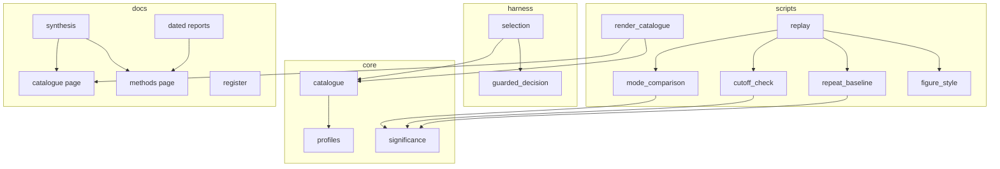
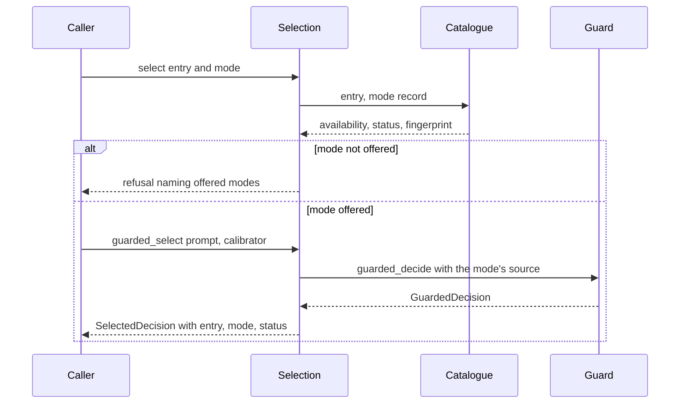
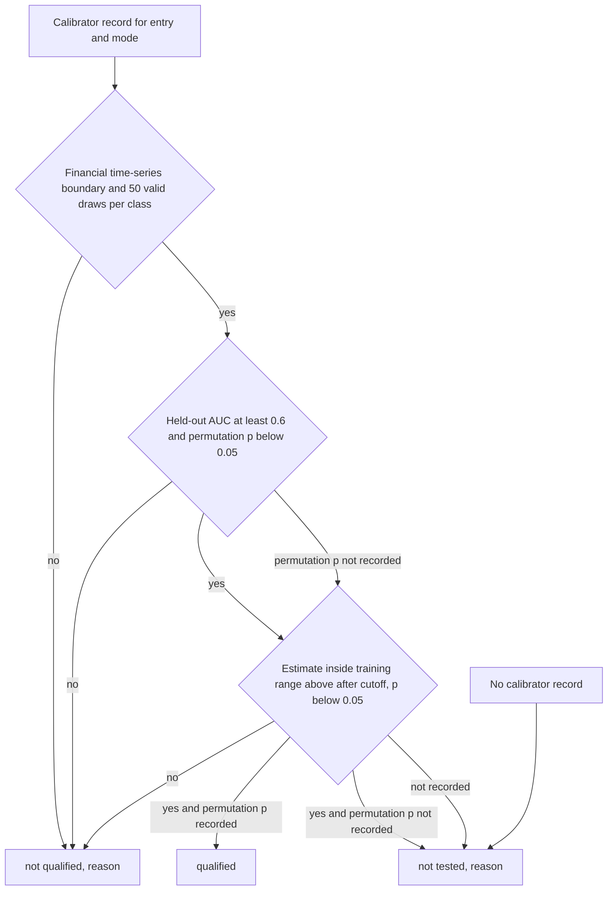
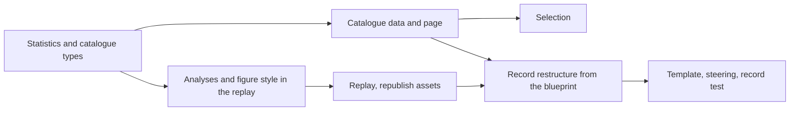

# Design Document: qualified-model-catalogue

## Overview

**Purpose**: this feature tells a quant researcher which model and serving
route combinations are qualified to give recall-aware answers in point-in-time
analysis of financial time series, in which evidence mode, and on what
statistics. It answers whether logits improve on the logprobs correction or can
stand in for it, and it turns the research record into quantitative reporting.

**Users**: the project owner and adopters read the catalogue and the synthesis;
developers call the selection interface; `macro_framework` can later consume
the same interface.

**Impact**: adds a shipped catalogue and a selection module to `recall_guard`,
three statistics to `core/significance`, three analyses and one figure style to
the finance simulation, and restructures `docs/research-report.md`,
`docs/research-register.md`, the R43 report, the report template and the
reporting rules. No measured number changes and no model is run.

### Goals
- One catalogue, keyed by model on a serving route, with a status per evidence
  mode from a single stated rule.
- A selection interface that marks every answer with entry, mode and status.
- A paired, like-for-like answer to "do logits help", with its statistics.
- A research record that leads with results, shows how each value is
  calculated, states each fact once and contains no infrastructure narrative.
- Figures in one academic style.

### Non-Goals
- New runs, new calibrations, new known-recall data.
- Changes to `macro_framework`, to `guarded_decide` or to provider profiles.
- A calibrator store or a calibrator shipped in the wheel.
- Rewriting dated reports other than R43 (they get a summary block, a class
  and dated notes).

## Boundary Commitments

### This Spec Owns
- The catalogue data file, its schema, loader, filters and the qualification
  rule.
- The selection interface and the `SelectedDecision` result.
- The statistics added to `core/significance` (clustered AUC interval, label
  permutation test, paired AUC difference, agreement).
- The finance-simulation analyses `mode_comparison`, `cutoff_check` and
  `repeat_baseline`, the single figure style, and their publication through
  the replay.
- The structure and content of the synthesis, the register (purpose, state of
  evidence, index columns), the R43 report, `docs/catalogue.md`,
  `docs/research-methods.md`, the report template and
  `.kiro/steering/research-reports.md`.
- The documentation tests that keep the record in this form.

### Out of Boundary
- How a model is reached (provider profiles) and how the guard computes
  `p_memorized` and the correction.
- The consumer pipeline and the Black-Litterman conversion.
- Operational notes: they stay in spec implementation notes and the handover.
- Findings of earlier dated reports.

### Allowed Dependencies
- `recall_guard.core.catalogue` may import `recall_guard.core.profiles` only.
- `recall_guard.harness.selection` may import `core.catalogue`,
  `core.profiles`, `mia.estimate_source` and `harness.guarded_decision`.
- Layer rule of `scripts/check_architecture.py` holds: harness 0; dataset, mia,
  portfolio 1; core 2; a module imports its own layer or a higher order only.
- `scripts/finance_sim/*` may import `recall_guard` and its own modules.
- No new third-party dependency. matplotlib stays out of `import recall_guard`.

### Revalidation Triggers
- A change to the catalogue schema or to the status vocabulary.
- A change to the qualification rule or its thresholds.
- A change to `ProviderProfile.estimate_sources` or to the calibrator
  fingerprint scheme.
- A change to the published asset names of the finance simulation.

## Architecture

### Existing Architecture Analysis
- A provider profile is a model on a serving route and reports its estimate
  sources (`top_k`, `full_distribution`). 13 profiles ship; only
  `llamacpp-gemma3-4b` declares a full-distribution host, whose digest must
  equal the declared weights digest.
- Both modes use `compute_mia_features` and `MCSCalibrator`. The quality rule
  in code is held-out AUC at least 0.6 with at least 50 valid draws.
  Calibrators are not persisted by the package; the finance simulation writes
  private records with a fingerprint and the held-out labels and
  probabilities.
- `guarded_decide` returns a `GuardedDecision` with status `ok`,
  `estimate_unavailable`, `adjustment_skipped_weak_calibrator` or `failed`.
  The caller picks the source through `GuardConfig.source`; nothing links that
  choice to the profile.
- The replay renders every published finance-simulation file and scans it
  with the licensing guard.

### Architecture Pattern & Boundary Map



**Architecture Integration**:
- Selected pattern: a shipped data file with a typed loader, wrapped by a thin
  harness module; analyses as replay modules; documents rendered or checked
  from the same data.
- Boundaries: the catalogue records what was shown; profiles say how to reach
  a model; the guard computes; selection joins the three without changing any.
- Existing patterns preserved: exact-key JSON schemas with a `schema` field,
  frozen dataclasses, layer order, replay as the only publisher.
- New components: each maps to one requirement area (see traceability).

### Technology Stack

| Layer | Choice / Version | Role in Feature | Notes |
|-------|------------------|-----------------|-------|
| Package | Python, frozen dataclasses, `StrEnum` | Catalogue types, selection | No new dependency |
| Data | JSON in the wheel, schema `recall-guard-catalogue/1` | Catalogue content | Curated from the register |
| Statistics | numpy, scikit-learn `roc_auc_score` (already used) | Intervals, tests | Seeds fixed |
| Figures | matplotlib 3.10.9 (replay pin) | Academic style, SVG | One variant per figure |
| Docs | MkDocs strict build | Catalogue, methods, record | Tests under `tests/docs` |

## File Structure Plan

### Directory Structure
```
recall_guard/
├── core/
│   ├── catalogue.py                 # Catalogue types, loader, filters, rule
│   ├── catalogue_data.json          # The catalogue (schema recall-guard-catalogue/1)
│   └── significance.py              # + clustered_auc_interval, permutation_auc_test,
│                                    #   paired_auc_difference, agreement
└── harness/
    └── selection.py                 # select(), guarded_select(), SelectedDecision
scripts/
├── catalogue/
│   └── render_catalogue.py          # Writes docs/catalogue.md from the data file
└── finance_sim/
    ├── figure_style.py              # The one academic figure style
    ├── mode_comparison.py           # Logprobs against logits, paired
    ├── cutoff_check.py              # Recall estimate inside and after the cutoff
    ├── repeat_baseline.py           # Different answers per repeated prompt
    └── figures_catalogue.py         # Figures for the three analyses
docs/
├── catalogue.md                     # Rendered catalogue table and views
├── research-methods.md              # Every statistic: estimand, formula, worked example
tests/
├── core/test_catalogue.py
├── core/test_significance_catalogue.py
├── harness/test_selection.py
├── scripts/catalogue/test_render_catalogue.py
├── scripts/finance_sim/test_mode_comparison.py
├── scripts/finance_sim/test_cutoff_check.py
├── scripts/finance_sim/test_repeat_baseline.py
├── scripts/finance_sim/test_figure_style.py
└── docs/test_research_record.py     # Structure, classes, banned content, captions
```

### Modified Files
- `recall_guard/__init__.py`: re-export the catalogue and selection names.
- `scripts/finance_sim/calibrate.py`: use `clustered_auc_interval` from core.
- `scripts/finance_sim/figures.py`, `figures_draws.py`,
  `figures_convergence.py`: render through `figure_style`, one SVG per figure,
  both axes labelled, numbered caption, no in-plot title.
- `scripts/finance_sim/replay.py`: write and publish the three new analyses and
  their figures; publish one SVG per figure.
- `tests/scripts/finance_sim/test_figures*.py`, `test_replay.py`: new file
  sets and captions.
- `docs/research-report.md`, `docs/research-register.md`,
  `docs/results/2026-11-11-memorization-adjusted-finance-sim.md`: restructured
  from the blueprint.
- `docs/results/*.md` (other dated reports): summary block, class, dated notes.
- `docs/results/template.md`, `docs/results/index.md`, `mkdocs.yml`,
  `.kiro/steering/research-reports.md`: new structure and rules.
- `docs/assets/finance-sim/`: regenerated by the replay.
- `pyproject.toml`: include `catalogue_data.json` as package data if the
  existing include rule does not already cover it.

## System Flows



The correction is exposed only when the catalogue status is `qualified` and
the supplied calibrator's fingerprint equals the one recorded for that entry
and mode. Otherwise the answer is returned without correction and carries the
status (`not_qualified`, `not_tested`) and the reason.



## Requirements Traceability

| Requirement | Summary | Components | Interfaces | Flows |
|-------------|---------|------------|------------|-------|
| 1.1, 1.9 | Entry per model on a route; related entries | Catalogue | `CatalogueEntry`, `related()` | |
| 1.2, 1.5, 1.6 | Per-mode record, evidence, recall boundary | Catalogue | `ModeRecord`, `Evidence`, `RecallBoundary` | |
| 1.3, 1.4 | One status from one rule | Catalogue | `qualify()` | Rule flow |
| 1.7, 1.8 | First content from the register; no inference | Catalogue data, tests | `catalogue_data.json` | |
| 2.1, 2.2 | List and filter | Catalogue, Selection | `load_catalogue()`, `Catalogue.filter()` | |
| 2.3, 2.4, 2.7 | Select entry and mode, refuse, default mode | Selection | `select()` | Selection flow |
| 2.5, 2.6 | Unqualified answers uncorrected and marked | Selection | `guarded_select()`, `SelectedDecision` | Selection flow |
| 3.1, 3.2, 3.3, 3.4 | Logits where no logprobs | Catalogue, catalogue page | `ModeRecord.availability`, `Catalogue.without_logprobs()` | |
| 4.1, 4.2 | Same features, calibration, rule, answer form | Catalogue, Selection | `ModeRecord.features`, `qualify()` | |
| 4.3, 4.4, 4.5, 4.6, 4.7 | Paired comparison, tilt, convergence, answer | Mode comparison, Significance | `mode_comparison()` | |
| 5.1, 5.2, 5.5, 5.7 | Definitions, proxy, design condition, missing evidence | Synthesis, methods page | Blueprint heads 1, 2, 9 | |
| 5.3, 5.4 | Inside and after the cutoff | Cutoff check, Catalogue | `cutoff_check()`, `ModeRecord.cutoff` | Rule flow |
| 5.6 | Repeat baseline | Repeat baseline, figures | `repeat_baseline()` | |
| 6.1, 6.2, 6.3, 6.4, 6.5, 6.6 | Estimand, calculation, sample, interval, test, effect size | Significance, analyses, methods page | `Statistic` record | |
| 6.7, 6.8 | Worked examples, methods section | Methods page, template | | |
| 6.9, 6.10, 6.11 | Missing inputs, equal by construction, power | Analyses | `Statistic.missing`, `by_construction`, `detectable_effect` | |
| 7.1, 7.2, 7.3 | Summary, catalogue first, blueprint heads | Synthesis | | |
| 7.4, 7.5, 7.6, 7.7, 7.8 | Summary block, results not spec narration, each fact once | Dated reports, record test | | |
| 7.9, 7.10 | Classes | Register, record test | | |
| 7.11, 7.12 | No infrastructure content | Record test | Banned-term list | |
| 7.13, 7.14 | Humanizer pass, blueprint first | Blueprint, record test | | |
| 8.1, 8.2, 8.3, 8.4, 8.5, 8.6, 8.7, 8.8 | Academic figures | Figure style, figure modules | `academic_rc()`, `caption()` | |
| 9.1, 9.2, 9.3, 9.4, 9.5 | Template and rules | Template, steering | | |
| 10.1, 10.2, 10.3, 10.4 | Numbers intact, computed values dated, dated notes, runs kept | Record, record test | | |
| 10.5, 10.6, 10.7 | No licensed value, strict build, replay | Replay, docs tests | `replay()` | |

## Components and Interfaces

| Component | Layer | Intent | Req Coverage | Key Dependencies | Contracts |
|-----------|-------|--------|--------------|------------------|-----------|
| Catalogue | core | Entries, statuses, rule, filters | 1, 2.1, 2.2, 3, 4.1, 4.2 | profiles (P0) | Service, State |
| Selection | harness | Select and run the guard under a status | 2.3 to 2.7 | Catalogue (P0), guarded_decision (P0) | Service |
| Significance additions | core | Clustered AUC interval, permutation, paired difference, agreement | 4.3, 5.3, 6 | numpy, scikit-learn (P0) | Service |
| Mode comparison | scripts | Logprobs against logits on the same weights and prompts | 4.3 to 4.7, 6 | Significance (P0), calibrator records (P0) | Batch |
| Cutoff check | scripts | Estimate inside and after the cutoff | 5.3, 5.4, 6 | Significance (P0), stored results (P0) | Batch |
| Repeat baseline | scripts | Different answers per repeated prompt | 5.6, 6 | recorded draws (P0) | Batch |
| Figure style | scripts | One academic style | 8 | matplotlib (P0) | Service |
| Catalogue page renderer | scripts | Docs table from the data file | 1, 3, 7.2 | Catalogue (P0) | Batch |
| Research record | docs | Synthesis, register, reports, methods, template | 5, 6.7, 6.8, 7, 9, 10 | blueprint (P0) | |
| Record test | tests | Keeps the record in form | 7, 8.2, 9, 10 | | |

### core

#### Catalogue

| Field | Detail |
|-------|--------|
| Intent | Hold what was shown about each model on a route, and derive one status per mode |
| Requirements | 1.1 to 1.9, 2.1, 2.2, 3.1 to 3.4, 4.1, 4.2 |

**Responsibilities & Constraints**
- Authoritative for entries, per-mode records, evidence references and status.
- Availability of a mode is derived from the profile when the entry has one;
  the data file may only add the reason and the requirement.
- Status is computed by `qualify()`; the data file stores inputs, not the
  status, so a status cannot disagree with its evidence.
- Loading validates exact keys, evidence ids of the form `R<nn>`, intervals
  with method and level, and that no value is present without evidence.

**Contracts**: Service [x] / State [x]

##### Service Interface
```python
class Mode(StrEnum):
    LOGPROBS = "logprobs"   # maps to EstimateSource.TOP_K
    LOGITS = "logits"       # maps to EstimateSource.FULL_DISTRIBUTION

class Status(StrEnum):
    QUALIFIED = "qualified"
    NOT_QUALIFIED = "not_qualified"
    NOT_TESTED = "not_tested"

@dataclass(frozen=True)
class Evidence:
    register_ids: tuple[str, ...]          # ("R43",)
    method: str                            # "reply_features" | "document_likelihood"

@dataclass(frozen=True)
class RecallBoundary:
    domain: str                            # "financial_time_series" | "document_text"
    exposed: str                           # what stands for recall-exposed answers
    fenced: str                            # what stands for fenced answers
    date_range: str                        # relative to the training cutoff

@dataclass(frozen=True)
class Quality:
    holdout_auc: float
    interval_low: float
    interval_high: float
    interval_method: str                   # "prompt_clustered_bootstrap" | "row_bootstrap"
    confidence: float
    n_exposed: int
    n_fenced: int
    n_prompts: int | None
    permutation_p: float | None

@dataclass(frozen=True)
class CutoffCheck:
    inside_mean: float
    after_mean: float
    difference: float
    interval_low: float
    interval_high: float
    p_value: float
    n_inside: int
    n_after: int

@dataclass(frozen=True)
class ModeRecord:
    mode: Mode
    available: bool
    unavailable_reason: str | None
    requires: str | None                   # what the adopter needs for this mode
    features: tuple[str, ...]
    features_unavailable: tuple[str, ...]
    boundary: RecallBoundary | None
    quality: Quality | None
    cutoff: CutoffCheck | None
    calibrator_fingerprint: str | None
    evidence: Evidence | None

@dataclass(frozen=True)
class CatalogueEntry:
    entry_id: str                          # profile id, or a route slug
    profile_id: str | None
    model: str
    route: str
    weights_identity: str | None
    weights_group: str | None              # entries sharing weights
    modes: Mapping[Mode, ModeRecord]

@dataclass(frozen=True)
class Qualification:
    status: Status
    reason: str
    checks: Mapping[str, bool | None]      # boundary, sample, discrimination, cutoff

def load_catalogue() -> Catalogue: ...
def qualify(record: ModeRecord) -> Qualification: ...

class Catalogue:
    entries: tuple[CatalogueEntry, ...]
    def entry(self, entry_id: str) -> CatalogueEntry: ...
    def filter(self, *, mode: Mode | None = None, status: Status | None = None) -> tuple[CatalogueEntry, ...]: ...
    def without_logprobs(self) -> tuple[CatalogueEntry, ...]: ...
    def related(self, entry_id: str) -> tuple[CatalogueEntry, ...]: ...
    def usable(self, entry_id: str) -> bool: ...
```
- Preconditions: the data file matches schema `recall-guard-catalogue/1`.
- Postconditions: `qualify` is a pure function of the record; the same rule
  for every entry and mode.
- Invariants: a record without `quality` is `not_tested`; a record whose
  boundary domain is not `financial_time_series`, or whose evidence method is
  not `reply_features`, cannot be `qualified`.

**Qualification rule** (stated once; thresholds are module constants):

| Check | Condition | Source |
|---|---|---|
| boundary | domain is financial time series, evidence method is reply features | `RecallBoundary`, `Evidence` |
| sample | at least 50 valid draws in each class entering the calibrator's fit, held-out draws included (the meaning of `min_valid` in the existing calibration code); the held-out sizes `n_exposed` and `n_fenced` are reported and are not what this check reads | `Quality.n_valid_exposed`, `n_valid_fenced` |
| discrimination | held-out AUC at least 0.6 and permutation p below 0.05 | `Quality` |
| cutoff | estimate inside the training range above after the cutoff, one-sided p below 0.05 | `CutoffCheck` |

Checks are evaluated in the order of the table. A check whose input was
recorded and fails gives `not_qualified` with that check as the reason. If no
check fails and at least one check has no recorded input (no quality record,
no permutation p, no cutoff check), the status is `not_tested` with the first
missing input as the reason (Requirement 1.8: a missing result is never read
as a failure and never inferred). All four true gives `qualified`.

**Implementation Notes**
- First content: one entry per shipped profile plus one for the Ryzen AI OGA
  route (R41). Values from R26, R30, R38, R40, R41 and R43 only. Profiles with
  no recorded calibrator are `not_tested`.
- Risk: curated values drift from the register; a test matches every value
  and evidence id against `docs/research-register.md`.

#### Significance additions

| Field | Detail |
|-------|--------|
| Intent | The statistics the catalogue and the analyses need, with their calculation exposed |
| Requirements | 4.3, 5.3, 6.1 to 6.6, 6.9 to 6.11 |

##### Service Interface
```python
@dataclass(frozen=True)
class Statistic:
    name: str
    estimand: str
    formula: str
    inputs: Mapping[str, float | int]
    unit: str                              # "prompt" | "draw" | "month" | "filing"
    n: int
    independent_units: bool
    value: float | None
    interval: Interval | None
    test: TestResult | None
    effect_size: float | None
    detectable_effect: float | None        # at power 0.8, alpha 0.05
    by_construction: bool
    missing: str | None                    # which input is missing when value is None

def clustered_auc_interval(scores, labels, clusters, *, n_resamples=1000, confidence=0.95, seed=0) -> Interval: ...
def permutation_auc_test(scores, labels, clusters, *, n_permutations=2000, seed=0) -> TestResult: ...
def paired_auc_difference(scores_a, scores_b, labels, clusters, *, n_resamples=2000, confidence=0.95, seed=0) -> tuple[float, Interval, TestResult]: ...
def agreement(a, b, clusters, *, n_resamples=2000, confidence=0.95, seed=0) -> Mapping[str, Statistic]: ...
def permutation_mean_difference(values, groups, blocks, *, alternative="greater", n_permutations=2000, seed=0) -> TestResult: ...
```
- `permutation_mean_difference` permutes the group label at block level (a
  month keeps one label); null: the two groups have the same mean.
- `permutation_auc_test` permutes labels at cluster level (a prompt keeps one
  label); null: the scores carry no information about the label.
- `paired_auc_difference` resamples clusters and recomputes both AUCs on the
  same resample; null: equal AUC.
- `agreement` returns the mean difference with limits of agreement, the mean
  absolute difference and the rank correlation.
- `detectable_effect` comes from the bootstrap standard error:
  `(z_0.975 + z_0.80) * se`.

### harness

#### Selection

| Field | Detail |
|-------|--------|
| Intent | Run the guard for a catalogue entry and mode, and mark the answer with its status |
| Requirements | 2.3, 2.4, 2.5, 2.6, 2.7 |

##### Service Interface
```python
class SelectionError(ValueError): ...

@dataclass(frozen=True)
class Selection:
    entry: CatalogueEntry
    mode: Mode
    qualification: Qualification
    source: SourceLabel

@dataclass(frozen=True)
class SelectedDecision:
    entry_id: str
    mode: Mode
    status: Status
    reason: str
    answer: Mapping[str, float] | None     # the uncorrected decision
    p_memorized: float | None
    corrected: Mapping[str, float] | None  # present only when status is qualified
    decision: GuardedDecision

def select(entry_id: str, mode: Mode | None = None, *, catalogue: Catalogue | None = None) -> Selection: ...
def guarded_select(prompt: str, selection: Selection, definition: DecisionDefinition, *,
                   client: CompletionClient, calibrator: SourceCalibrator,
                   full_distribution: FullDistributionClient | None = None,
                   draws: int = 32, min_parsed: int = 24) -> SelectedDecision: ...
```
- Preconditions: `select` raises `SelectionError` naming the offered modes
  when the mode is not offered; with `mode=None` it returns the single
  qualified mode or raises asking for one.
- Postconditions: `corrected` is set only when the status is `qualified`, the
  guard status is `ok` and `calibrator.fingerprint` equals the catalogue's;
  a fingerprint mismatch downgrades the run to `not_tested` with the reason.
- Invariants: `guarded_decide` is called unchanged; `p_memorized` is the
  guard's value.

### scripts

#### Mode comparison, cutoff check, repeat baseline (Batch)

| Analysis | Input (private) | Output | Statistics |
|---|---|---|---|
| `mode_comparison` | calibrator records of one arm in both sources; stored item results | `mode-comparison-<arm>.{json,md}` | AUC per mode; paired difference with interval and test; agreement of `p_memorized`; difference of the correction factor `1 - p_memorized`; convergence by k (read from the convergence analysis); one of three answers |
| `cutoff_check` | stored item results, plan cutoff classes | `cutoff-check-<arm>.{json,md}` | per mode and prompt kind: mean estimate inside and after, difference with month-block interval, one-sided permutation test |
| `repeat_baseline` | recorded draws of both arms | `repeat-baseline.{json,md}` | per route and temperature: distribution of distinct answers per prompt, share of prompts with one answer with a Wilson interval |

- Trigger: `replay()`; each analysis is written once and copied to the
  published directory with the published header.
- Validation: only fully recorded ensembles enter the repeat baseline; a
  missing input yields `Statistic.missing`, never a value.
- Idempotency: deterministic with fixed seeds; the replay compares bytes.
- The three-answer decision (4.6): `improve` when the paired AUC difference
  interval excludes 0 in favour of logits on the financial time-series
  boundary and the cutoff check passes for logits; `match` when the interval
  lies inside a margin of 0.05 either side and the agreement limits lie inside
  0.10; otherwise `undecided`, with the detectable effect.
- 4.7: when the two modes carry different weights identities the comparison
  is refused with the reason.

#### Figure style

```python
def academic_rc() -> dict[str, object]: ...        # white, black ink, serif, no grid
def series_style(index: int) -> dict[str, object]: ...  # marker, linestyle, grey level
def caption(number: int, message: str, *, n: str, interval: str | None) -> str: ...
```
- One SVG per figure (`<name>.svg`), with `<name>.csv` and `<name>.md`.
- No `suptitle`, no in-plot annotation; the caption text is written to the
  `.md` and placed below the figure in the report.
- Interval bars wherever the plotted value has an interval.

### docs

#### Research record
- Synthesis: heads 1 to 10 of `blueprint.md`; summary first; the catalogue
  table (included from `docs/catalogue.md`) is the first table.
- Methods page: every statistic with estimand, formula, unit, interval, test
  and one worked example taken from a published table.
- Dated reports: sections Summary block, Question, Methods, Data, Results,
  Limits, References. R43 is rewritten to this form; other reports gain the
  summary block, the class and dated notes.
- Register: purpose from the governing idea; state of evidence replaced by
  the catalogue and heads 4 to 7; index gains Class and Catalogue entry.
- Order of work: structure from the blueprint, then prose, then the humanizer
  pass per rewritten passage. Approval of this design is the owner's
  acceptance of the blueprint grid.

## Data Models

### Logical Data Model (`catalogue_data.json`)

```
{ "schema": "recall-guard-catalogue/1",
  "rule": { "min_auc": 0.6, "min_valid": 50, "alpha": 0.05 },
  "entries": [ { "entry_id", "profile_id", "model", "route",
                 "weights_identity", "weights_group",
                 "modes": { "logprobs": ModeRecord, "logits": ModeRecord } } ] }
```
- Natural key: `entry_id`. `profile_id`, when set, must name a shipped profile.
- A `ModeRecord` may carry several evidence items in the data file (for
  example a document-text calibrator and a time-series calibrator); the loader
  exposes the time-series reply-features one as the record that `qualify`
  reads and keeps the others as `other_evidence` for the docs table.
- Versioning: a schema change bumps the suffix and is a revalidation trigger.

## Error Handling

- `CatalogueError` (load time): unknown key, evidence id not of the form
  `R<nn>`, value without evidence, profile id that does not exist. The package
  import does not load the catalogue; the error surfaces on first use.
- `SelectionError`: unknown entry, mode not offered, no single qualified mode.
- Analyses: a missing input produces a `Statistic` with `missing` set and no
  value; a comparison across different weights is refused with the reason.
- Replay: unchanged; a licensing leak removes the output and raises.

## Testing Strategy

### Unit Tests
- `qualify`: each of the four checks failing alone gives `not_qualified` with
  that reason; no quality gives `not_tested`; a document-text boundary cannot
  be `qualified` (1.3, 1.4, 1.8).
- Catalogue loading: exact keys, evidence format, availability equals
  `ProviderProfile.estimate_sources` for every profile entry (1.1, 1.2, 3.1).
- `Catalogue.filter`, `without_logprobs`, `related`, `usable` (2.2, 3.3, 3.4,
  1.9).
- `permutation_auc_test`, `paired_auc_difference`, `agreement`: known answers
  on constructed data, cluster-level resampling, seed stability (6.4, 6.5).
- `select`: refusal names offered modes; default mode rule (2.4, 2.7).

### Integration Tests
- `guarded_select` with a fake client and calibrator: qualified entry returns
  the correction; unqualified returns none and the status; fingerprint
  mismatch downgrades to `not_tested`; `p_memorized` equals `guarded_decide`
  (2.3, 2.5, 2.6).
- Catalogue against the register: every evidence id exists and every recorded
  value appears in the register text (1.7, 10.1).
- `mode_comparison`, `cutoff_check`, `repeat_baseline` on fixtures: values,
  missing inputs, refusal across weights, the three-answer decision (4.3 to
  4.7, 5.3, 5.6, 6.9).
- Replay on fixtures: the new analyses and figures are published, one SVG per
  figure, guard still scans every file (10.5, 10.7).

### Documentation Tests (`tests/docs/test_research_record.py`)
- Every dated report has the four-line summary block and a class from the
  fixed list; the register index has Class and Catalogue entry (7.4, 7.9).
- The synthesis opens with the summary and its first table is the catalogue
  (7.1, 7.2).
- No banned infrastructure terms, no em dashes, no section head that is a
  model or API name in the synthesis and in R43 (7.8, 7.11, 7.13).
- The template has the summary block, Methods and References sections (9.1,
  9.2); the steering file carries the rules (9.3 to 9.5).
- Each published figure caption starts with "Figure N." and no light or dark
  variant is referenced (8.2, 8.6).
- Figure style: rc has a white face, black ink and a serif family; every
  figure function labels both axes (8.1, 8.4).

## Migration Strategy


- Commit and push before and after each step.
- The asset republish and the report edits that reference the new file names
  land in one commit, so the strict build never sees a missing figure.

## Amendment 2026-11-11: the front (Requirement 11)

The owner's objective: a front where people run their prompts and get
point-in-time answers as good as we can make them; integration tests and demos
enter through it. The front is the existing Python interface, extended. The
catalogue, `select` and `guarded_select` are its back.

### Boundary
- **Owns**: `ask`, `FrontAnswer`, `FrontFailure`, the mode-choice order, the
  fixed-reply client for offline use, the worked example, the integration
  tests, the demo script and notebook, the front page of the docs.
- **Out of boundary**: the guard, the catalogue rule, provider profiles, the
  consumer pipeline, any web or command-line product.
- **Allowed dependencies**: `recall_guard.harness.front` may import
  `harness.selection`, `harness.guarded_decision`, `core.catalogue`,
  `core.profiles`, `core.decision`, `mia.estimate_source` and
  `dataset.macro_regime` (for the worked example only).
- **Revalidation triggers**: a change to `SelectedDecision`, to the status
  vocabulary, or to how a profile builds a client.

### Component: Front (harness)

| Field | Detail |
|-------|--------|
| Intent | Run a caller's prompt for a catalogue entry and return the best answer available, with what limited it |
| Requirements | 11.1 to 11.10 |

```python
@dataclass(frozen=True)
class FrontFailure:
    step: str            # "entry" | "mode" | "client" | "request" | "reply"
    detail: str
    remedy: str          # what the caller can change

@dataclass(frozen=True)
class FrontAnswer:
    entry_id: str
    mode: Mode | None
    mode_choice: str                         # why this mode was used
    status: Status | None
    reason: str
    answer: Mapping[str, float] | None       # the uncorrected decision
    p_memorized: float | None
    corrected: Mapping[str, float] | None    # only when status is qualified
    limits: tuple[str, ...]                  # empty when nothing limited the answer
    failure: FrontFailure | None
    selected: SelectedDecision | None        # the guard's own result, untouched

def choose_mode(entry: CatalogueEntry, *, catalogue: Catalogue,
                calibrators: Mapping[Mode, SourceCalibrator]) -> tuple[Mode, str]: ...

def ask(prompt: str, definition: DecisionDefinition, *, entry: str, mode: Mode | None = None,
        client: CompletionClient | None = None,
        calibrator: SourceCalibrator | Mapping[Mode, SourceCalibrator] | None = None,
        full_distribution: FullDistributionClient | None = None,
        catalogue: Catalogue | None = None, draws: int = 32, min_parsed: int = 24,
        environment: Mapping[str, str] | None = None) -> FrontAnswer: ...

class FixedReplies(CompletionClient): ...   # replays given replies with their token evidence, no network

def worked_example() -> tuple[str, DecisionDefinition]: ...   # fenced macro prompt and its definition
```
- Mode choice (11.4): a qualified available mode; otherwise an available mode
  that has a supplied calibrator; otherwise logprobs if available, else logits.
  `mode_choice` states which rule applied.
- With a calibrator, `ask` calls `guarded_select` unchanged; the status, the
  recall estimate and the correction are exactly its result (11.2, 11.5).
- Without a calibrator (11.6), `ask` asks the model for the ensemble and
  reduces it with the same decision definition, returns the answer with
  `p_memorized=None`, the catalogue status of the mode, and the limit "no
  calibrator supplied". It computes no estimate of its own.
- Without a client (11.7), `ask` builds one from the entry's profile through
  the existing profile connection; an entry without a profile needs a client.
- Failures (11.9) are returned as `FrontAnswer.failure` with `answer=None`;
  programming errors (wrong types) still raise.
- `limits` (11.8) is derived, not free text: fixed phrases for no qualified
  mode, no calibrator, calibrator not the recorded one, estimate unavailable.
- `ask`, `FrontAnswer`, `FrontFailure`, `FixedReplies` and `worked_example`
  are exported at the package root; the root still imports no plotting
  library and reads no file at import.

### Files
```
recall_guard/harness/front.py            # ask, FrontAnswer, FrontFailure, choose_mode, FixedReplies, worked_example
tests/harness/test_front.py              # unit tests with fakes
tests/integration/test_front_offline.py  # every status, both modes, mode choice, failures, through ask()
tests/integration/test_front_live.py     # opt-in, local host, skipped unless declared available
examples/pit_front.py                    # demo script, --fixture runs offline
notebooks/pit_front.ipynb                # the same demo as a notebook
docs/front.md                            # the one page for the front
```
Modified: `recall_guard/__init__.py` (exports), `tests/test_root_exports.py`
(pins the new block), `mkdocs.yml` and `docs/index.md` (link to the page).

### Traceability

| Requirement | Summary | Components | Interfaces |
|-------------|---------|------------|------------|
| 11.1 | Existing interface kept | Front | root exports, `tests/test_root_exports.py` |
| 11.2, 11.3, 11.5 | Answer with estimate, correction, status; any prompt; never refuses for status | Front, Selection | `ask`, `FrontAnswer` |
| 11.4 | Mode choice with its reason | Front | `choose_mode`, `FrontAnswer.mode_choice` |
| 11.6, 11.7 | No calibrator; no client | Front | `ask` |
| 11.8, 11.9 | Limits and failures | Front | `FrontAnswer.limits`, `FrontFailure` |
| 11.10 | Worked example | Front | `worked_example` |
| 11.11 | Offline integration tests | Integration tests | `FixedReplies` |
| 11.12 | Opt-in live test | Integration tests | `tests/integration/test_front_live.py` |
| 11.13 | Demos | Demo script, notebook | `examples/pit_front.py`, `notebooks/pit_front.ipynb` |
| 11.14 | Front page | Docs | `docs/front.md` |

### Testing
- Unit: mode choice for each branch; limits for each cause; each failure step;
  no-calibrator path returns no estimate; the guard's result is passed through
  untouched.
- Integration, offline: through `ask` only, with `FixedReplies` and fixture
  catalogues: qualified with correction, not qualified, not tested, calibrator
  mismatch, both modes, chosen mode, no calibrator, each failure.
- Integration, live: the worked example on the local route, opt-in by an
  environment variable; records entry, mode and status in the test output.
- Demos: the script runs with `--fixture` in a test; the notebook executes
  offline in a test.

## Amendment 2026-11-12: the two evidence modes (Requirement 12)

On the owner's instruction; approved by the owner on 2026-11-12. The owner's finding:
the figures and pages exist, but what each mode computes, how the modes differ
and which result matters are not stated. This amendment puts a mathematical
note first and builds the figure rework and a notebook on it. Rules:
`.kiro/steering/research-guardrails.md`.

### Order

1. Mode Note, then the owner's approval.
2. Figure Specification, then the owner's approval.
3. Notebook and figure rework, independent of each other.
4. Task 4.2 (republishing) runs after the figure rework, so that the reworked
   figures are the ones published. Task 5.2 (methods page) takes its
   definitions of the two modes from the approved Mode Note.

### Boundary
- **Owns**: the Mode Note, the Figure Specification, the two-mode notebook and
  its test, the rework of the published figures to the specification.
- **Out of boundary**: a new estimator, a new labelling of the calibrators, a
  new run. The note describes what the code computes and what the recorded
  data supports. A calibrator labelled by exposure (inside against after the
  cutoff) is recorded in the note as the open research step and is not built
  here.
- **Allowed dependencies**: the notebook imports the package root only, as the
  front demo does.
- **Revalidation triggers**: a change to a feature formula, to the evidence a
  mode reads, or to the calibrator's inputs invalidates the note and what was
  built on it.

### Component: Mode Note

A working document of the spec, `modes-note.md`. Sections in this order:
notation; evidence per mode; features (one row per feature: formula, inputs,
value in each mode, equal by construction or not, derivation); calibrator and
recall estimate; correction of the answer; estimand and what it is not;
recorded statistics with labels; open step. Every statement about the code
cites the function it was read from. No statement is taken from an earlier
report without that check.

Starting points to verify, not yet verified: the features that use only the
logprob of the generated token are equal in both modes; a feature that needs
the mean and variance over the vocabulary is exact only on the full vector;
the logprobs evidence is the full vector truncated to the returned
alternatives; each mode has its own calibrator.

### Component: Figure Specification

A working document of the spec, `figure-specification.md`: one section per
published figure with the fields of Requirement 12.6, the decision of 12.7,
and the list of table columns that still carry internal values (recorded in
the note of task 4.1) with their plain replacement.

### Component: Two-mode notebook

`docs/notebooks/recall_adjusted_answers.ipynb`, a usage example (owner,
2026-11-12: a notebook under `docs/`, simple and clear, how to use the tool,
not a research project). It enters through `ask` twice with the same prompt
and definition, once per mode, and prints the two `FrontAnswer` results side
by side. It does not depend on the Mode Note.

The front has the caller supply the calibrator (Requirement 11.6) and the
shipped catalogue has no qualified mode, so a usage example needs an offline
setup. `recall_guard.offline_example()` (module
`recall_guard/harness/offline_example.py`, root export with `OfflineExample`)
returns an invented entry qualified in both modes, a calibrator per mode
fitted in process on made-up prompts, and per call a fresh fixed-reply client
and fixed logits host. Everything in it is invented and says so; the entry
names no model. The notebook closes with the status of every shipped entry.

The documentation renders the notebook with its stored outputs through the
`mkdocs-jupyter` plugin (development dependency, no execution at build time).

### Files
```
.kiro/specs/qualified-model-catalogue/modes-note.md            # Mode Note
.kiro/specs/qualified-model-catalogue/figure-specification.md  # Figure Specification
docs/notebooks/recall_adjusted_answers.ipynb                   # two-mode usage notebook
recall_guard/harness/offline_example.py                        # invented offline setup for it
tests/integration/test_recall_modes_notebook.py                # executes it offline
```
Modified for the notebook: `recall_guard/__init__.py` and
`tests/test_root_exports.py` (two root names), `pyproject.toml` and `uv.lock`
(`mkdocs-jupyter`), `mkdocs.yml` (plugin and navigation).
Modified by the figure rework: the figure modules under `scripts/finance_sim/`
and their tests.

### Traceability

| Requirement | Summary | Components |
|-------------|---------|------------|
| 12.1 to 12.5 | Definitions, equalities, estimand, labels, approval | Mode Note |
| 12.6 to 12.8 | Question, estimand and emphasis per figure, approval | Figure Specification |
| 12.9 to 12.14 | Usage example: both modes side by side, terms, own route, invented offline setup, page, test | Two-mode notebook, `offline_example` |
| 12.15 | Guardrails and the two passes before publication | all texts |

### Testing
- The notebook executes offline in a test; both modes return a recall estimate
  and a corrected answer; the stored outputs equal those of a fresh run.
- The reworked figures keep the replay tests of task 4.1: the published set,
  the licensing guard, identical bytes from two fresh processes.
