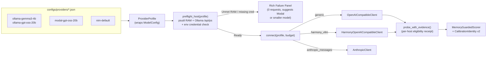

# Design: Release 1.0 — Unified Provider Profiles, Host Preflight and Adopter Flow

Draft — 2026-11-08 (`M1.1` deliverable). Feeds the consolidated tracker in
[tasks.md](tasks.md) and addresses the gap analysis in [research.md](research.md).
No live provider calls, model downloads or paid deployments are performed by
this design.

## 1. Overview

Recall Guard 1.0 unifies its three token-evidence hosting modes (**Ollama local**,
**Modal remote GPU**, and **NVIDIA NIM managed API**) plus completion-only
experiment targets (**Anthropic Opus**, **Mistral**) behind a single declarative
`ProviderProfile` and `connect()` factory. Scoring (`MemoryGuardedScorer`),
ensemble consensus (`EnsembleSpec`), and completion workflows (`RecallWorkflow`)
consume the resulting `CompletionClient` without branching on backend.

### Goals

- **One provider seam (R2.1, R2.2, R2.6):** Wrap `ModelConfig` in a declarative
  `ProviderProfile` stored under `configs/providers/*.json`. Build clients
  through `connect(profile, budget, ...)` and expose
  `MemoryGuardedScorer.from_profile(...)` while keeping legacy `NvidiaLM` as a
  compatible NIM delegate and keeping hosting SDKs (`modal`, `torch`) outside
  the core package.
- **Friendly pre-load RAM & host preflight (R2.3, R2.4, C1):** Measure free
  host memory via `psutil` (and inspect Ollama `/api/ps`, `/api/tags`,
  `/api/version`) before loading any local model. Refuse to load when free RAM is
  below the profile's requirement (20.0 GiB for `gpt-oss:20b`) and present a
  friendly proposal (`modal-gpt-oss-20b`, a smaller local profile, or freeing
  host memory). Record eligibility per host, never as a global exclusion.
- **Profile-bound calibration identity (R2.5, C9):** Include `response_mapping`
  (`generic` vs `harmony-vllm`) and tokenizer mapping digest in
  `CalibrationIdentity` so calibrators cannot cross incompatible evidence
  profiles.
- **Sanitized error-body retention & Rich failure panels (R2.7, C1):** Retain
  non-2xx HTTP response bodies (minus registered credentials) in `RequestError`
  and render actionable Rich error summaries for rate limits, 500s, 504 timeouts,
  and alignment failures.
- **Adopter-friendly workflow & maintainable complexity (R1, R3, R4):** Support
  `plan/doctor -> probe -> calibrate/score` across native `uv run` and Docker
  Compose, automate plan SHA-256 hashing, and enforce complexity limits via
  Ruff (`C901`, `PLR0912`, `PLR0915`).

### Non-Goals

- Rewriting `core` numerical kernels (`mia/features.py`, `mia/mcs.py`,
  `core/divergence*.py`) or replacing `RequestControl`/`CallBudget` with a
  third-party LLM router (`litellm`).
- Automatic fallback across models or hosts when a probe or request fails.
- Claiming mitigation efficacy from endpoint availability or pilot runs (R3.3).

---

## 2. Boundary Commitments

### This Spec Owns

- `recall_guard/core/profiles.py`: `ProviderProfile`, `HostResourceRequirement`,
  `HostPreflightReport`, `load_profile()`, `preflight_host()`, and `connect()`.
- `configs/providers/*.json`: curated declarative profiles for Ollama, Modal,
  NIM, and completion-only targets.
- `recall_guard/harness/scorer_client.py`: `CalibrationIdentity` v2 with
  `response_mapping` and `mapping_revision`.
- `recall_guard/harness/scorer.py`: `MemoryGuardedScorer.from_profile(...)` and
  routing legacy `NvidiaLM` through the profile seam.
- `recall_guard/harness/request_failures.py`: user-facing failure classification
  and Rich diagnostic formatting with sanitized error-body retention.

### Out of Boundary

- `deploy/modal/` control-plane deployment recipes remain isolated in the
  operator project (`deploy/modal/pyproject.toml`); `recall_guard` never imports
  `modal`.
- NPU execution (`P2`), iGPU offload (`P4`), and Ollama GPT-OSS token-less
  Harmony channel mapping (`P1`) remain parked outside the 1.0 critical path.

### Allowed Dependencies

- Add **`psutil>=5.9`** to core dependencies in `pyproject.toml` (lightweight,
  cross-platform wheel with zero transitive dependencies) for accurate host
  available-RAM inspection on Windows, macOS, and Linux.
- Reuse existing core dependencies: `requests`, `rich`, `numpy`, `scikit-learn`,
  `pyyaml`, `python-dotenv`.
- Enable Ruff `C901`, `PLR0912`, `PLR0915` in `pyproject.toml` (dev toolchain).

---

## 3. Architecture & Data Flow



### Layer Discipline (`scripts/check_architecture.py`)

`core (order 2) <- {dataset, mia, portfolio} (order 1) <- harness (order 0) <- scripts/examples`

- `recall_guard/core/profiles.py` lives in `core` and depends only on
  `core.completion`, `core.providers`, `core.provider_anthropic`,
  `core.harmony_evidence`, `core.local_evidence`, `core.request_control`,
  `requests`, and `psutil`.
- `recall_guard/harness/` consumes `ProviderProfile` and `connect()` to wire
  `MemoryGuardedScorer`, `RecallWorkflow`, and reports.

---

## 4. Component & Contract Design

### 4.1 Declarative `ProviderProfile` (`recall_guard/core/profiles.py`)

`ProviderProfile` wraps `ModelConfig` without duplicating its validation:

```python
from dataclasses import dataclass, field
from enum import StrEnum
from pathlib import Path
from typing import Mapping

from recall_guard.core.completion import FeatureChoices, ModelConfig, CompletionClient
from recall_guard.core.request_control import CallBudget


class HostingMode(StrEnum):
    LOCAL = "local"              # Ollama on local/external host
    REMOTE_GPU = "remote_gpu"    # Modal vLLM endpoint
    MANAGED_API = "managed_api"  # NVIDIA NIM, Anthropic, Mistral


class ResponseMapping(StrEnum):
    GENERIC = "generic"
    HARMONY_VLLM = "harmony_vllm"


@dataclass(frozen=True)
class HostResourceRequirement:
    """Declarative pre-load host requirements for local profiles (R2.3)."""

    min_free_ram_bytes: int | None = None
    recommended_ram_bytes: int | None = None
    context_tokens: int = 2048
    fallback_profile_ids: tuple[str, ...] = ("modal-gpt-oss-20b", "ollama-gemma3-4b")


@dataclass(frozen=True)
class HarmonyMappingConfig:
    """Pinned tokenizer metadata required when response_mapping == HARMONY_VLLM."""

    tokenizer_path: str
    tokenizer_revision: str
    tokenizer_sha256: str | None = None


@dataclass(frozen=True)
class ProviderProfile:
    """Declarative inference profile wrapping ModelConfig (R2.1)."""

    profile_id: str
    display_name: str
    hosting_mode: HostingMode
    model_config: ModelConfig
    response_mapping: ResponseMapping = ResponseMapping.GENERIC
    harmony: HarmonyMappingConfig | None = None
    host_requirements: HostResourceRequirement = field(default_factory=HostResourceRequirement)
    allow_unauthenticated: bool = False
    notes: str = ""
```

**Invariants enforced in `ProviderProfile.__post_init__`:**
1. If `response_mapping == ResponseMapping.HARMONY_VLLM`:
   - `harmony` must be provided with a valid 40-hex `tokenizer_revision`.
   - `model_config.parameters.get("return_token_ids")` must be `True`.
2. If `allow_unauthenticated` is `True`:
   - `hosting_mode` must be `HostingMode.LOCAL` and `model_config.credential_ref` must be `None`.
3. `to_dict()` / `from_dict()` serialize and validate cleanly from `configs/providers/<profile_id>.json`.

### 4.2 Curated Profiles (`configs/providers/`)

| Profile ID | Hosting mode | Model | Mapping | Min free RAM | Auth env var |
| --- | --- | --- | --- | --- | --- |
| `ollama-gemma3-4b` | `local` | `gemma3:4b` | `generic` | `6.0 GiB` | None (`allow_unauthenticated=True`) |
| `ollama-phi4-mini` | `local` | `phi4-mini:3.8b` | `generic` | `6.0 GiB` | None |
| `ollama-llama3.2-3b` | `local` | `llama3.2:3b` | `generic` | `6.0 GiB` | None |
| `ollama-llama3.1-8b` | `local` | `llama3.1:8b` | `generic` | `8.0 GiB` | None |
| `ollama-gpt-oss-20b` | `local` | `gpt-oss:20b` | `generic` (parked `P1`) | **`20.0 GiB`** (`21,474,836,480` B) | None |
| `modal-gpt-oss-20b` | `remote_gpu` | `openai/gpt-oss-20b` | `harmony_vllm` | N/A (remote A100) | `env:MODAL_PROXY_BEARER` |
| `nim-llama3.1-70b` | `managed_api` | `meta/llama-3.1-70b-instruct` | `generic` | N/A | `env:NVIDIA_API_KEY` |

### 4.3 Host Preflight (`preflight_host`) & Free-RAM Gate (R2.3, C1)

Before constructing a client or triggering a model load on a local profile,
`preflight_host(profile, *, environment=None, host_snapshot=None) -> HostPreflightReport`
executes zero-inference checks:

1. **RAM Measurement (`psutil` + container boundary safety):**
   - If the profile has `min_free_ram_bytes` set:
     - When running directly on the model host (loopback endpoint `localhost` /
       `127.0.0.1` and not inside a container without host snapshot), read
       `psutil.virtual_memory().available` and `psutil.virtual_memory().total`.
     - When running inside a container targeting `host.docker.internal` or a
       remote host, require an explicit `host_snapshot` (timestamped free RAM
       bytes from the host helper) if a mandatory RAM gate is active; never
       mistake container VM memory for the external Ollama host's free RAM.
     - If `measured_free_ram_bytes < min_free_ram_bytes`:
       - Return `HostPreflightReport(passed=False, reason="insufficient_free_ram", ...)`
       - **Do not contact `/v1/chat/completions` or load the model.**
       - Exception (loopback Ollama only): one read-only `/api/ps` call; if the
         target model is already loaded the gate passes with `ram_gate:
         "skipped_model_already_loaded"`, otherwise the block stands with no further HTTP.
       - Format the actionable recommendation: state measured GiB vs required
         GiB (e.g. `13.4 GiB measured vs 20.0 GiB required for gpt-oss:20b`) and
         propose `--profile modal-gpt-oss-20b`, `--profile ollama-gemma3-4b`, or
         running on a machine with $\ge 20\text{ GiB}$ free RAM (such as the
         64 GB Mac in `P1`).
2. **Ollama Metadata Inspection (`/api/version`, `/api/tags`, `/api/ps`):**
   - Consolidates `observe_host` from `scripts/probe_local_model.py` into
     `recall_guard/core/profiles.py`.
   - Checks that the model tag exists in `/api/tags` (never triggers an
     implicit `ollama pull`) and records `artifact_digest`, `runtime_version`,
     currently `loaded_models`, and `size_vram` vs `size` (`CPU`, `GPU`, or
     `CPU/GPU offload`).
3. **Credential & Tokenizer Presence (`remote_gpu` / `managed_api`):**
   - Checks that `credential_ref` is present and non-empty in `environment` /
     `os.environ` without printing or storing the secret.
   - For `harmony_vllm`, checks that `harmony.tokenizer_path` exists locally and
     matches `tokenizer_revision` before any network call.

### 4.4 The Single Factory: `connect()` (R2.2)

```python
def connect(
    profile: ProviderProfile | str | Path,
    budget: CallBudget,
    *,
    features: FeatureChoices | None = None,
    environment: Mapping[str, str] | None = None,
    enforce_preflight: bool = True,
) -> CompletionClient:
```

1. Resolves `profile` (if passed a profile ID like `"ollama-gemma3-4b"` or a
   `Path`, loads it from `configs/providers/`).
2. If `enforce_preflight=True`, runs `preflight_host(profile, environment=environment)`
   and raises `PreflightError` (with the friendly proposal attached) if `passed`
   is `False`.
3. Dispatches by `(profile.model_config.protocol, profile.response_mapping)`:
   - `(OPENAI_CHAT, GENERIC)` $\rightarrow$ `OpenAICompatibleClient(...)`
   - `(OPENAI_CHAT, HARMONY_VLLM)` $\rightarrow$ loads `HarmonyTokenMap.from_tokenizer_json(...)`
     and returns `HarmonyOpenAICompatibleClient(..., token_map=token_map)`
   - `(ANTHROPIC_MESSAGES, GENERIC)` $\rightarrow$ `AnthropicClient(...)`

### 4.5 Calibration Identity v2 (`recall_guard/harness/scorer_client.py`) (R2.5, C9)

Update `CalibrationIdentity` so calibrators cannot cross evidence profiles:

```python
@dataclass(frozen=True)
class CalibrationIdentity:
    protocol: CompletionProtocol
    endpoint: str | None
    model: str
    parameters_json: str
    intervention_id: str
    local_identity: LocalModelIdentity | None = None
    response_mapping: str = "generic"
    mapping_revision: str | None = None
```

- `to_dict()` omits `response_mapping` only when `"generic"` and
  `mapping_revision is None` if legacy byte-for-byte dict equality is required,
  or includes `response_mapping` whenever constructed from a `ProviderProfile` /
  `HarmonyOpenAICompatibleClient`.
- `CalibrationIdentity.from_client(client, intervention_id)` inspects whether
  `client` is a `HarmonyOpenAICompatibleClient` (recording
  `response_mapping="harmony_vllm"` and
  `mapping_revision=client.token_map.tokenizer_sha256`).
- Result: A calibrator fitted on Modal (`harmony_vllm`) fails validation if
  paired with an Ollama (`generic`) client for the same model family.

### 4.6 Sanitized Error-Body Retention & Friendly Failure Presentation (R2.7, M1.2, M1.4)

1. **Error-body retention across HTTP failures:**
   - In `OpenAICompatibleClient._http_failure` (`recall_guard/core/providers.py:59-80`)
     and `RequestControl.sanitize_failure` (`recall_guard/core/request_control.py`),
     non-2xx responses (including Ollama HTTP 500 on load/generation) already
     populate `RequestError.detail` from `response.text` / JSON body and redact
     registered secrets.
   - Ensure `local_execution.py`, `probe_local_model.py`, and
     `request_failures.py` preserve bounded sanitized `detail` in failure
     diagnostics rather than dropping the body on HTTP 500.
2. **Friendly Rich failure panels (`recall_guard/harness/request_failures.py`):**
   - Add `describe_failure(error, *, profile_id=None, stage=None) -> FailurePresentation`
     and `render_failure_panel(presentation) -> rich.panel.Panel`.
   - Maps `insufficient_free_ram`, `authentication_error` (401/403),
     `eligibility_error` (402/quota), `rate_limited` (429), `overloaded`
     (503/529), `timeout` (504/ambiguous outcome), `missing_token_evidence` /
     `response_mapping_failed`, and `http_500` to plain-English explanations and
     concrete next actions.

### 4.7 High-Level Scorer & CLI Adopter Ergonomics (R2.2, R4)

1. **`MemoryGuardedScorer.from_profile` (`recall_guard/harness/scorer.py`):**
   ```python
   @classmethod
   def from_profile(
       cls,
       profile: ProviderProfile | str | Path,
       budget: CallBudget,
       *,
       intervention_id: str = "default",
       environment: Mapping[str, str] | None = None,
   ) -> tuple["MemoryGuardedScorer", CompletionClient]:
   ```
   Builds the client via `connect()`, runs or validates the capability probe,
   and binds `LegacyLogprobAdapter`.
2. **Automatic Plan Hashing (`recall_guard/harness/local_evaluation.py`):**
   Add `freeze_plan_hashes(plan_path, manifest_path, corpus_path)` (and `--freeze`
   flag on `scripts/measure_local_models.py`) so adopters do not have to run
   manual `Get-FileHash` commands in PowerShell.

---

## 5. File Structure Plan

| Path | Action | Responsibility & LLOC budget |
| --- | --- | --- |
| `pyproject.toml` | Modify | Add `psutil>=5.9`; enable Ruff `C901`, `PLR0912`, `PLR0915` with baseline ignores for legacy files |
| `recall_guard/core/profiles.py` | Create | `ProviderProfile`, `HostResourceRequirement`, `HostPreflightReport`, `load_profile`, `preflight_host`, `connect` (<=180 LLOC) |
| `configs/providers/*.json` | Create | Curated declarative profiles (`ollama-gemma3-4b`, `ollama-phi4-mini`, `ollama-llama3.2-3b`, `ollama-llama3.1-8b`, `ollama-gpt-oss-20b`, `modal-gpt-oss-20b`, `nim-llama3.1-70b`) |
| `recall_guard/core/readiness.py` & `providers.py` | Modify | Prune unused active-polling scaffolding (`APR 3.3`) while keeping HTTP 202 pending identity and deferral (`M1.2`) |
| `recall_guard/harness/request_failures.py` | Modify | Add `FailurePresentation`, `describe_failure`, Rich panel formatter, and preserve sanitized HTTP 500 error bodies (`M1.2`, `M1.4`) |
| `recall_guard/harness/scorer_client.py` | Modify | Extend `CalibrationIdentity` with `response_mapping` and `mapping_revision` (`M1.3`) |
| `recall_guard/harness/scorer.py` & `runner.py` | Modify | Add `MemoryGuardedScorer.from_profile`; route NIM profile through factory while preserving public `NvidiaLM` (`M1.3`) |
| `scripts/probe_local_model.py` & `measure_local_models.py` | Modify | Reuse `profiles.py` preflight/factory and add `--profile` / `--freeze` support (`M1.3`, `M1.4`) |
| `examples/adopter_flow.py` & `README.md` | Create / Modify | End-to-end offline demonstration of profile selection, RAM preflight fallback proposal, and compact report (`M1.5`) |
| `tests/core/test_profiles.py` | Create | Unit tests for `ProviderProfile`, `connect()`, `psutil` RAM preflight gate, and `/api/ps` parsing |
| `tests/harness/test_profile_calibration.py` | Create | Cross-profile calibration rejection (`harmony_vllm` vs `generic`) and friendly failure rendering tests |

---

## 6. Requirements Traceability Matrix

| Requirement | Design section | Verification method |
| --- | --- | --- |
| **R1.1–1.3** (Single tracker, linear pointer, gated spend) | Section 1, [tasks.md](tasks.md) | `spec.json` audit (`M0.1`), zero live calls in `M1` |
| **R2.1** (Declarative profile wrapping `ModelConfig`) | Section 4.1, 4.2 | `tests/core/test_profiles.py` |
| **R2.2** (`connect()` factory with `generic` / `harmony-vllm`; `NvidiaLM` compatibility) | Section 4.4, 4.7 | `tests/core/test_profiles.py`, existing `NvidiaLM` parity suite |
| **R2.3** (Free-RAM preflight, 20 GiB for GPT-OSS-20B, per-host result, Modal proposal) | Section 4.3 | Fake `psutil` + `/api/ps` tests in `tests/core/test_profiles.py` (13.4 GiB blocked vs 24.0 GiB passed) |
| **R2.4** (Per-host eligibility probe recorded before calibration) | Section 4.3, 4.7 | `probe_with_evidence` receipt fixtures |
| **R2.5** (Calibration identity includes profile/mapping) | Section 4.5 | `tests/harness/test_profile_calibration.py` |
| **R2.6** (Hosting SDKs outside core library) | Section 2, 3 | `scripts/check_architecture.py` + `tests/test_packaging.py` |
| **R2.7** (Retain sanitized error body + friendly failure guidance) | Section 4.6 | HTTP 500/401/429/504 redaction and Rich presentation tests |
| **R3.1–3.3** (Single vs ensemble budgets, partial top-k honesty, no pilot efficacy claims) | Section 1, [research.md](research.md) | Report schema assertions and README/docs audit |
| **R4** (Adopter-friendly README, machine sizing, verified state) | Section 4.2, 4.7, 5 | `M1.5` doc review + offline Docker smoke (`M1.6`) |

---

## 7. Validation & Complexity Gate (`M1.6`)

Every implementation slice in `M1` must pass:
1. `uv run --no-sync ruff check` (including `C901`, `PLR0912`, `PLR0915` on touched modules).
2. `uv run --no-sync python scripts/check_architecture.py` (verifying `core` never imports `harness`, `modal`, or `torch`).
3. `uv run --no-sync pytest -q` (full offline test suite) + `docker compose run --rm dev` smoke test.
