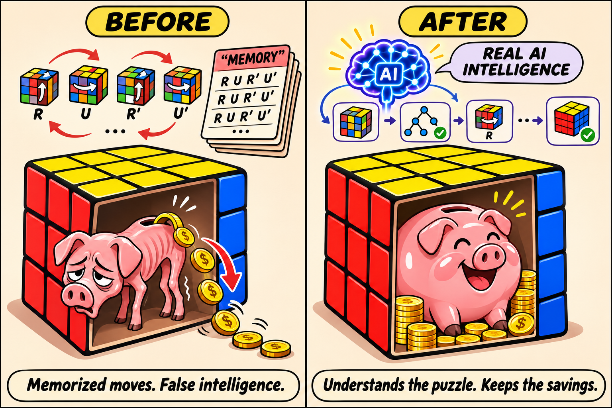

# Recall Guard

[](https://doi.org/10.5281/zenodo.21557232)

Point-in-time inference from language models you host yourself, for quantitative finance research.



A language model used in a simulation knows what happened after every date before its training cutoff. That is lookahead bias: a backtest can look good because the model remembers the outcome. Recall Guard runs a prompt point in time, estimates how much of the answer is recalled, and gives the analyst that estimate to correct with.

| The period your data describes | What the recall estimate means | What to do |
| --- | --- | --- |
| On or before the model's training cutoff | The model may have seen what happened next. The estimate measures how much the reply rests on that. | Use the estimate. An answer for this period needs correction. |
| After the model's training cutoff | The model cannot have seen what happened next. An estimate above zero is noise. | Do not correct. |

Recall Guard is not a forecaster. It measures recall and reports it. How the estimate enters an analysis is the analyst's decision.

## What it is used for

- **Macro timeline analysis.** Ask a model to characterise the macro regime month by month from the state known at each date, and see which months' answers rest on recall.
- **Factor investment research.** Build signals from model answers and weight them by the recall estimate, so that a factor is not credited with what the model remembered.
- **Portfolio optimization.** Feed corrected views into the allocation, and compare a point-in-time strategy with its identifying twin to price the lookahead that remains.

The [use cases page](docs/use-cases.md) says what this repository provides for each and where the applied results are published.

## Install

Python 3.12 or newer, with [uv](https://docs.astral.sh/uv/):

```text
uv add "recall-guard @ git+https://github.com/norandom/recall_guard.git@v0.6.0"
```

Releases are on [GitHub Releases](https://github.com/norandom/recall_guard/releases). The package is not on PyPI.

## First result

One call, `ask`, returns the answer, the recall estimate and the answer corrected by it. This example runs offline on an invented setup, so it needs no model:

```python
from recall_guard import Mode, ask, offline_example, worked_example

prompt, definition = worked_example()   # a point-in-time macro prompt and how its reply is read
example = offline_example()             # invented entry, calibrators and replies

result = ask(prompt, definition, **example.arguments(Mode.LOGPROBS))
print(result.answer)        # the model's answer: five macro loadings
print(result.p_memorized)   # the recall estimate, between 0 and 1
print(result.corrected)     # the answer multiplied by one minus the estimate
```

The [notebook](docs/notebooks/recall_adjusted_answers.ipynb) walks through the same call in both evidence modes and then runs it against live local models.

## Two evidence modes

The recall estimate is computed from what the model reveals about its own output.

| Mode | Reads | Needs |
| --- | --- | --- |
| Logprobs | The top alternatives per output token, as the serving route returns them | A route that returns logprobs |
| Logits | The next-token vector for each output token | A second host that loads the same weights |

Each mode has its own calibrator, fitted on your model from prompts it has seen and prompts it has not.

## Run it on your own model

A catalogue lists the models and serving routes with the modes each one offers.

| Route | Where it runs | Modes |
| --- | --- | --- |
| llama.cpp | Local CPU or GPU | Logprobs, logits |
| Ollama | Local | Logprobs |
| FastFlowLM | AMD NPU, Windows | Logprobs |
| Modal (vLLM) | Rented GPU | Logprobs |
| NVIDIA NIM | Hosted | Logprobs |

Start a local model in the foreground and stop it with Ctrl+C:

```text
scripts/start_model_online_logprobs.ps1     # Windows; .sh on Linux
scripts/start_model_online_logits.ps1
scripts/start_model_online_npu.ps1
```

Then call `ask` with the catalogue entry and your calibrator, at the temperature the calibrator was fitted at:

```python
result = ask(prompt, definition, entry="llamacpp-gemma3-4b", mode=Mode.LOGPROBS,
             calibrator=my_calibrator, temperature=0.7)
```

The [local models guide](docs/guides/local-provider.md) and the [Modal guide](docs/guides/modal-provider.md) describe the routes.

## What is established

- The recall estimate separates prompts that identify a period from prompts that do not, on held-out prompts of the finance simulation.
- It is not yet shown to separate months inside the training range from months after the cutoff. No model and route in the shipped catalogue is qualified, so `ask` returns the answer and the estimate for them and withholds the corrected answer.
- The controls reduce and measure recall. They do not prove that lookahead has been removed.

The [research report](docs/research-report.md) holds the measurements and the [research register](docs/research-register.md) lists every dated result.

## Documentation

- [Home](docs/index.md): what Recall Guard does and where to start
- [Use cases](docs/use-cases.md): macro timeline, factor research, portfolio optimization
- [Notebooks](docs/notebooks/): the usage notebook and the earlier walkthroughs
- [Guides](docs/guides/): point-in-time architecture, ensembles, local and rented models, the scorer, completion APIs, development setup
- [Research](docs/research-report.md): report, register, dated reports, experiments
- [API reference](https://norandom.github.io/recall_guard/)

## Citation

To cite the software, use the Zenodo DOI of the version you ran. The all-versions DOI resolves to the latest release.

- v0.5.0: [GitHub Release](https://github.com/norandom/recall_guard/releases/tag/v0.5.0); version-specific DOI pending.
- v0.4.1: <https://doi.org/10.5281/zenodo.21806959>
- v0.4.0: <https://doi.org/10.5281/zenodo.21795891>
- v0.3.1: <https://doi.org/10.5281/zenodo.21795665>
- v0.3.0: <https://doi.org/10.5281/zenodo.21795407>
- v0.2.0: <https://doi.org/10.5281/zenodo.21637978>
- v0.1.2: <https://doi.org/10.5281/zenodo.21557233>
- all versions: <https://doi.org/10.5281/zenodo.21557232>

`CITATION.cff` carries the same metadata.

The applied results are in the working paper of the consumer pipeline, [Global_Macro_AI_Factors](https://github.com/norandom/Global_Macro_AI_Factors):

```bibtex
@misc{ciepluch2026computationalglobalmacro,
  title        = {Computational Global Macro with AI for Risk and Portfolio Management},
  author       = {Ciepluch, Marius},
  year         = {2026},
  howpublished = {SSRN working paper},
  note         = {Abstract 7231358. Written 31 July 2026, posted 10 August 2026},
  url          = {https://papers.ssrn.com/sol3/papers.cfm?abstract_id=7231358}
}
```

Recall Guard builds on MemGuard-Alpha and addresses the point-in-time evaluation problem benchmarked by Look-Ahead-Bench:

```bibtex
@misc{roy2026memguardalpha,
  title         = {MemGuard-Alpha: Detecting and Filtering Memorization-Contaminated
                   Signals in LLM-Based Financial Forecasting via Membership Inference
                   and Cross-Model Disagreement},
  author        = {Roy, Anisha and Roy, Dip},
  year          = {2026},
  eprint        = {2603.26797},
  archivePrefix = {arXiv},
}

@misc{benhenda2026lookaheadbench,
  title  = {Look-Ahead-Bench: a Standardized Benchmark of Look-ahead Bias in
            Point-in-Time LLMs for Finance},
  author = {Benhenda, Mostapha},
  year   = {2026},
  eprint = {2601.13770},
  archivePrefix = {arXiv},
  primaryClass = {cs.AI}
}
```
